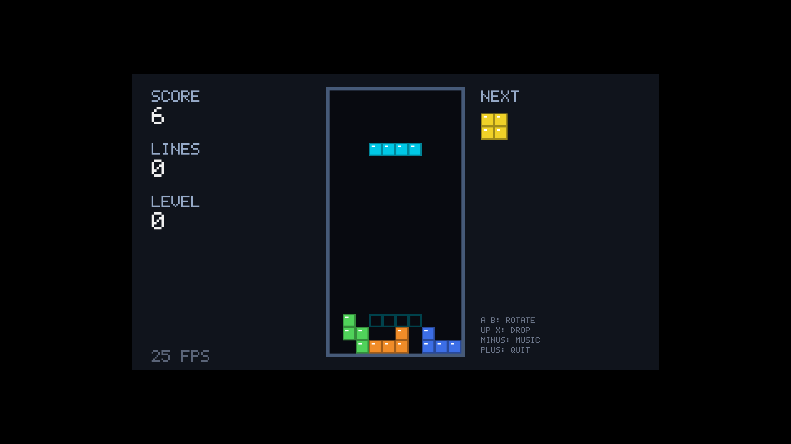
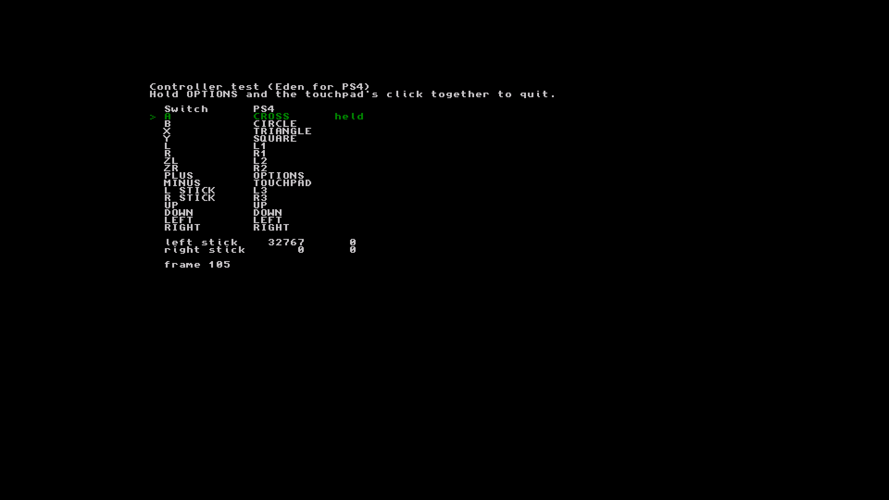
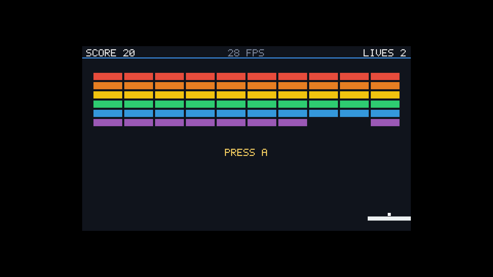
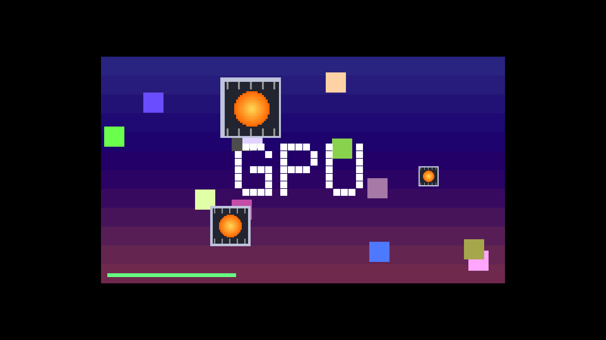
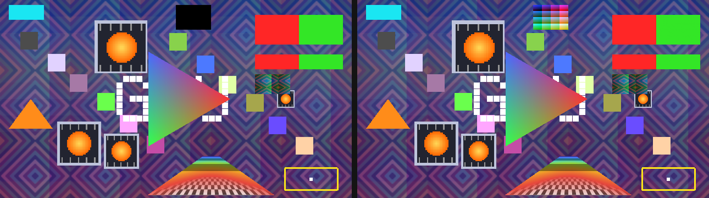
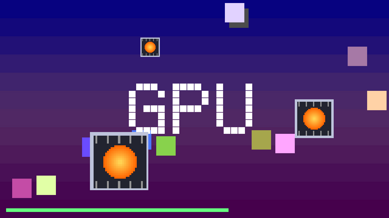

# Eden for PS4: stage 3, Switch games playable; stage 4 begun, the GPU

**Performance work: where it stands, what was tried and what's next is in [PROGRESS.md](PROGRESS.md).**

Stage 1 ([switch-bench](../switch-bench/README.md), results in
[RESULTS.md](../switch-bench/RESULTS.md)) measured Eden's recompiler and the memory a PS4 can give
it. Stage 2 ran Eden's actual Switch core on the PS4: the kernel, the scheduler and the four
emulated CPU cores, the HLE services, the loader, with a Switch program that writes text. Stage 3
plays a game: a Switch homebrew game's picture on the screen, the PS4 controller as the Switch's,
and its sound.

## Stage 3: games

`game/breakout.c` is a small Switch game, written for this: Breakout at 640x360, drawn by the CPU
into a libnx framebuffer (no GPU commands), with the controller read through HID and beeps played
through `audout`. It's built with libnx, the Switch homebrew library, compiled with clang (below).
In the package as `breakout.nro`, first on the start page's list.

`game/blocks.c` is a second game: falling blocks with a ghost piece, a next-piece preview, levels,
and a tune (Korobeiniki, a 19th-century Russian folk song) under the beeps. Its best score is kept
on the emulated SD card (`/data/eden-ps4/user/sdmc/blocks-best.txt` on the PS4), through Eden's
file system services. The two games share `game/nxgame.h` (drawing, the font, sound).

`game/padtest.c` is a controller test: every Switch button with the PS4 button it's mapped to, lit
while held, and the sticks' positions, as text through libnx's console (also drawn by the CPU).






What runs it:

- **Picture.** A Switch program shows a frame by queueing a buffer to the display service (VI),
  whose compositor (nvnflinger) hands its layers to the renderer. Eden's null renderer threw them
  away; patch 0008 has it compose them on the CPU instead, for a frontend that asks for frames
  (`EmuWindow::WantsSoftwareFrames`): each layer's buffer read from emulated memory, unswizzled from
  the GPU's block-linear layout, converted to RGBA (RGBA8, RGBX8, BGRA8 and RGB565), cropped,
  flipped and blended as the compositor asks. A frame of one layer, the usual case, goes to the
  launcher at its own size (Breakout's: 640x360), more layers scaled to 1280x720 and blended. The
  launcher scales it to 1920x1080 into the video-out buffers, a row at a time from a row buffer:
  those buffers are write-combined memory, which the CPU reads uncached (shadPS4 backs them with
  ordinary memory, so it wouldn't show the cost of reading them). A game that draws with the GPU
  (NVN, Vulkan, OpenGL) shows nothing: its buffers hold whatever the GPU would have drawn, and
  there's no GPU emulation.
- **Controller.** The PS4 pad, read every 4 ms, is player 1's Pro Controller, through Eden's virtual
  gamepad input engine (`Launcher::SetPad`). By the PS4's conventions: Cross is A, Circle B, Square
  Y, Triangle X; L1/R1 L/R, L2/R2 ZL/ZR, OPTIONS +, the touchpad's click -, and both sticks.
- **Sound.** Patch 0009 adds a frontend sink to Eden's audio (`AudioEngine::Frontend`): each audio
  stream a program opens (`audout`, `audren`) plays through an output the frontend gives it, from a
  thread of its own, in 512-frame buffers. On the PS4 that's an AudioOut port (the system user's
  main port, 48 kHz stereo, as Crema's audio), on a thread raised above the emulation's priority.
  On the desktop, `EDEN_PS4_AUDIO=<file.wav>` records it. If an output can't open, its stream plays
  silently at an output's pace, so the program doesn't wait on it. Both of libnx's ways to play
  sound work: `audout` (Breakout) and the audio renderer `audren` (switchbrew's audren-simple
  example, recorded on the desktop).

In shadPS4, Breakout runs at 26 to 30 frames per second (61 on the desktop build): the start page,
X, the game; the pad's X launches the ball, the stick moves the paddle, OPTIONS quits back to the
start page. That rate is shadPS4's display here, which draws with a software Vulkan device: each
frame waits 28 to 30 ms for a buffer to come off the screen, and scaling it onto the screen takes
2.2 to 2.4 ms (the boot trace's numbers). A console flips in hardware. It hasn't run on one yet.

Most homebrew programs built with libnx ask for all the memory there is as their heap at start,
about 3.2 GiB, which Eden's kernel clears. On the desktop that took about 30 s, every page of the
emulated DRAM faulting in to be written; patch 0011 drops the pages instead, and they read as zeros
(Linux only). On the PS4 the emulated DRAM is direct memory, committed from the start, so clearing
it is a plain write of 3.2 GiB, a second or so; the package's games and controller test ask for
64 MiB anyway.

## Stage 2: the test program

Stage 2's program, still in the package, is `hello/`: a small Switch homebrew program built by
hand (no libnx). It checks what a game needs first and prints the results through the Switch
kernel's debug output call (`svcOutputDebugString`):

```
hello: a Switch program is running, on emulated core 0
hello: memory available to it: 3283 MiB
hello: heap: 32 MiB at 0x2100c00000, written and read back
hello: computed 0xaf5bb1d62401f407 in 14 ms
hello: slept 250 ms, the clock says 250 ms
hello: a thread on core 1 computed the same
hello: all checks passed, exiting
```

That is the output on a desktop (`build.sh host`), where it passed 30 runs in a row, each exiting
cleanly. The PS4 build prints the same in shadPS4 (below); it hasn't run on a console yet. The
checks:

- the kernel's memory info (`svcGetInfo`)
- a 32 MiB heap (`svcSetHeapSize`), every word written and read back through the recompiler's page
  table
- a loop recompiled from AArch64 and timed by the emulated system tick
- `svcSleepThread`, measured against that tick (the scheduler and the emulated clock)
- a second thread on emulated core 1 (`svcCreateThread`, `svcStartThread`,
  `svcWaitSynchronization`) that must compute the same result
- `svcExitProcess`

Around those lines the launcher shows Eden's own warnings and errors. A bare NRO always brings a
few: no RomFS, no program ID or title (it has no NACP), and controller mappings for the Joy-Con
driver, which this build leaves out with SDL. The launcher sets no Cemuhook (UDP) controller
servers, so that client opens no socket.

## Stage 4, begun: the GPU

`game/gputest.c` draws with the Switch's GPU instead of the CPU. It talks to the GPU through
libnx's nvidia services (no deko3d, no shaders): a GPU channel bound to the Maxwell 3D engine, the
window's framebuffers mapped into the GPU's address space as its render target, every rectangle a
clear limited to a scissor rectangle, and a fence that the command stream signals (a syncpoint
increment) before the frame is queued. It draws a backdrop, bouncing squares and the word GPU,
about 80 clears a frame, and sprites with the 2D engine: a 32x32 image the CPU draws, copied once
by the DMA engine, then blitted onto the frame at 1x, 2x and 3x. And a triangle drawn with shaders:
a vertex program (two attribute loads and stores: position and colour) and a fragment program (the
colour interpolated, into the render target), with their shader program headers, in Maxwell machine
code written by hand, as there's no shader compiler in this build environment. And textured shapes,
drawn as games draw sprites and backgrounds: a turning square with the sprite on it (point
sampled), and a backdrop of tiles over the bands, scrolling, blended by its alpha. The tile is
drawn by the CPU and copied by the DMA engine into a block-linear image, the GPU's own layout, as
games upload their textures; it's filtered bilinearly and repeats. And a depth test: two bars
across each other in depth, a red one drawn first and a green one, each in front on its own half.
And a square coloured from a storage buffer: its fragment program loads 16 bytes from a GPU
address it finds in the constant buffer (where NVN keeps storage buffers' addresses), which Eden's
shader recompiler turns into a storage buffer read. And lines, 3 pixels wide, and a point. And a
stencil test: a triangle drawn into the stencil only, then a square drawn where the stencil is
set, which leaves an orange triangle.



Two ways it shows:

- **The null renderer, in software** (patch 0014; the PS4 build): colour clears are written to
  emulated memory (block linear or pitch, scissored, the common colour formats, channel masks for
  the 8-bit ones), a block of the surface at a time, and DMA copies and 2D engine blits go to their
  engines' software paths instead of being claimed as done. The sprites found a bug in Eden's
  software blitter (from yuzu): its nearest-neighbour scaling mixed the source row's fraction into
  the column, so a 2x blit came out as interleaved stripes (patch 0015 fixes it; the Vulkan
  renderer's blit was right, and the two now draw the same). So a program that draws with clears,
  copies and blits shows in the CPU-composed frames, on the PS4 now: the GPU test runs at 60 frames
  a second on the desktop and 34 in shadPS4 (its display's pace again).
- **Shader draws, in software** (patch 0016; the PS4 build): the null renderer's draws go to a
  software renderer. The vertex and fragment programs are translated by Eden's shader recompiler,
  and their IR flattened into operations on numbered cells (phis become moves on each edge of the
  structured control flow), which an interpreter runs: no JIT, so nothing needs executable memory.
  Vertices are fetched from the vertex streams (float, unorm, snorm, integer, scaled; indexed or
  not; instanced), shaded, clipped against w > 0, mapped to the window as the Vulkan renderer maps
  them, culled, and rasterized into render target 0 in emulated memory a block at a time, with the
  varyings interpolated as Vulkan interpolates them (perspective, linear, flat) and blended. The
  GPU test's first frame comes out the same as through the Vulkan renderer (below), and it draws at
  60 frames a second on the desktop. Not done yet: storage images, geometry and tessellation
  shaders, a fragment shader's own depth; a draw that needs them is skipped (or drawn without
  them), and logged once.
- **Textures, in software** (patch 0017): a texture is decoded from emulated memory the first
  time it's sampled, with Eden's own code for the GPU's layouts and compressed formats (its
  unswizzle, its BC1-7 and ASTC decoders), into 8-bit RGBA for the formats that fit and floats for
  the rest, every mip level and layer, and kept. It's checked again (its bytes hashed) after
  anything that might have written to it (a draw or clear into it, a DMA copy, a 2D blit, an
  inline upload) and once a frame, for the CPU's writes. Sampling follows the texture header and
  the sampler: nearest or bilinear filtering, mipmaps (explicit levels, and implicit ones from
  the pixel's quad: patch 0028), every wrap mode and border colours, swizzles, sRGB,
  depth compares, gathers, texel fetches, size queries; 1D, 2D, 3D, cube maps and arrays. Linear
  inline uploads, which the null renderer dropped, are written to memory now.
- **Faster, on several threads** (patch 0018): each draw's triangles are set up first (24.8 fixed
  point edge functions, so the edge two triangles share is drawn once, by the top-left rule;
  clipped to a guard band), then rasterized 8 rows at a time (a row of the render target's GOBs,
  reached directly) by a few threads: `EDEN_SW_THREADS`, by default half the processors, up to 4.
  The fragment shader runs on 16 pixels at a time, with fast paths for the commonest work: 2D 8-bit textures filtered with 8-bit weights, blending
  by source alpha into RGBA8, and 2D triangles (no perspective correction). A pixel of the GPU
  test's blended, filtered backdrop costs about 70 ns on one desktop thread, against 200 before:
  the test draws at 40-48 frames a second on one thread, 60 on four. `EDEN_SW_STATS` (always on
  in the PS4 build) logs what the draws cost every 2 seconds.
- **Depth** (patch 0019): the depth test against the depth buffer (every depth format, as the
  buffer keeps it, so the test is exact), before the fragment shader runs, so pixels behind skip
  it; depth writes; and depth and stencil clears.
- **Storage buffers and global memory** (patch 0020): shaders' storage buffer reads and writes
  (their addresses and sizes read from the constant buffers, as Eden's buffer cache reads them),
  and global memory accesses the recompiler couldn't tie to a buffer, go to emulated memory. The
  subgroup operations (votes, ballots, shuffles, the quad swizzle) work over a fragment shader's
  16 pixels (patch 0028).
- **Points and lines** (patch 0021): points as squares of the point size (fixed or the vertex
  program's), lines widened along their minor axis to the line width, as aliased lines are drawn;
  line strips and loops, quad strips and polygons too. The GPU test's lines and point come out the
  same as through the Vulkan renderer, pixel for pixel. A line loop showed that Eden's Vulkan
  renderer draws line loops as triangles (its topology table maps them to a triangle list), so
  the test draws a strip back to its start instead.
- **Stencil, and several render targets** (patch 0022): the stencil test with both faces' state
  (Eden starts with two-sided stencil on, so back faces use their own: the test's triangle found
  that), its updates on stencil fail, depth fail and pass, the write mask; a shader that can
  discard runs before the updates are made, so a discarded pixel makes none. Up to eight render
  targets, each with its own format, layout, blending and colour mask.
- **Textures the CPU writes** (patch 0023): the null renderer didn't tell its rasterizer a frame
  had been shown (the Vulkan and OpenGL renderers do), so the once-a-frame check for the CPU's
  writes never came; it does now (every 4th frame for a texture unchanged through 8 checks).
  And a write the memory manager reports marks only the textures where it landed: it reports the
  command buffers it reads, thousands of times a second, which marked every texture before. The
  GPU test's CPU paints the sprite's middle blue at frame 30, and the turning square shows it.
  The stats line counts the textures checked and decoded, and the bytes hashed.
- **GPU macros** (launcher; patches 0024, 0051): deko3d, Mesa and games draw through the 3D
  engine's macros (MME), on the GPU thread. Eden's macro JIT made its code memory executable with
  mprotect, which a PS4 app can't do, so until 03.50 the launcher had Eden interpret macros. Patch
  0051 maps each macro's code read/write/execute once on the PS4 (as dynarmic's code is), and the
  JIT is used everywhere (`EDEN_PS4_MACRO_JIT=0` interprets). Each compiled macro also carried two
  arrays of 65536 labels, 2 MiB: they are sized to the macro now, and freed once it is compiled.
  The GPU test's bouncing squares are cleared by a macro of its own (it sets the clear colour
  and clears, from its parameters). And the null rasterizer reports the writes the memory manager
  gathers (constant buffer updates among them) before each draw and clear, as the Vulkan one does:
  they gathered without end.
- **Indirect draws, inline indices, DrawTexture** (patch 0025): draws whose parameters are in a
  buffer (each read, with their count, and drawn), indices sent in the command stream (the storage
  buffer's square is drawn with them; they were read from memory before), and the 3D engine's
  textured rectangle (NVN's DrawTexture).
- **Less work per draw** (patch 0026): finding a draw's shaders meant Eden's shader environment
  hashing their code, about 60 microseconds a draw (a game drawing a sprite a draw, a thousand a
  frame, would have spent 60 ms on it); a stage's program is now remembered by its address and
  hashed again once a frame, or when something writes over its code. Clears mark the bytes they
  write, not a generous range.
- **Small draws on every thread** (patch 0027): a sprite is a draw too small to share between
  threads, so 2D games' draws ran on one. Draws are now set up and queued, and the queue is
  rasterized together, a GOB row at a time across the threads, each row in draw order (the pixels
  come out as if drawn one by one). It's rasterized before anything that could see or change what
  it draws: a clear, a DMA copy, a 2D blit, an upload, a fence or semaphore, the frame being shown,
  a texture it draws to being read, a shader that writes memory. The GPU test's stress test (A:
  400 more sprites, each a draw; up and down change how many) went from 29 frames a second to 55
  on four desktop threads.
- **Quads, mipmaps, branches** (patch 0028): a fragment shader's 16 pixels are now 8 columns by 2
  rows, four 2x2 quads as the GPU shades them, with helper pixels where a quad sticks out of the
  triangle. The Switch's GPU has no derivative instruction: NVN's code works derivatives out with
  shuffles between a quad's pixels and its swizzled add (FSWZADD), and the texture unit picks an
  implicit level of detail from the quad. Both see the quads now, so mipmaps work. A program that
  branches ran a pixel at a time; now its pixels each go their own way, the ones at the earliest
  instruction running it while the rest wait, rejoining where they meet (results kept only for the
  pixels that ran an instruction), and local memory is per pixel. The texture fast paths now take
  repeating (power-of-two) and clamped coordinates, which sent every lane of the tiled backdrop
  down the slow path before, and mipmapped textures a level at a time with trilinear blending: a
  pixel of the GPU test costs 25-28 ns on one desktop thread, from 38. The test has a floor in
  perspective now (bottom middle): its texture's levels are a colour each, so where each is
  sampled shows, and its shader branches per pixel for its stripes. It matches the Vulkan renderer
  on lavapipe to within a few levels of each colour channel.
- **Setting draws up** (patch 0029): a program remembered at an address was checked again each
  frame through Eden's shader environment, whose reads of the code (the memory manager's safe
  reads) each ask the rasterizer to flush that region, which rasterized the queued draws halfway
  through a draw's setup. The program's bytes are kept and compared instead, and a read of memory
  rasterizes the queue only if a queued draw draws there. A draw's setup went from 157 to 31
  microseconds on the desktop; the GPU test draws at 53 frames a second on one desktop thread.
- **Writes and filtering in arrays, a shader's own depth** (patch 0030): a profile showed the
  rasterizer spending most of its time writing pixels one at a time. In a block-linear RGBA8
  render target, a block's 16 pixels are two runs of 32 bytes (4 columns by 2 rows, as a GOB keeps
  them), so they're converted, blended and stored in loops the compiler vectorizes now. Bilinear
  filtering does two channels in each 32-bit multiply; sRGB textures, which went a pixel at a time,
  take the fast path (decoded through their table, filtered in floats). And a fragment shader that
  writes its own depth gets the depth test after it, with that depth. A pixel of the GPU test costs
  about 22 ns on one desktop thread (60 frames a second; the stress test 37). The test has two
  squares whose fragment programs write opposite depths, and a square of the tile through an sRGB
  texture header (top right); both match the Vulkan renderer.
- **Compute shaders** (patch 0031): the compute engine's dispatches run, which nothing did before:
  the program translated as a draw's stages are (through Eden's compute environment), constant
  buffers from the launch description, textures from the compute engine's pools, storage buffers.
  A workgroup's invocations run 16 at a time, with shared memory, their ids, and atomics on shared
  memory, storage buffers and global memory. A program with barriers runs each group of 16 to the
  barrier, keeping where it stopped, then the next group, until all are past it. The GPU test
  dispatches a compute program of its own every frame (4x4 workgroups of 8x8: each invocation puts
  a colour in shared memory and, after a barrier, writes its mirror image's to a texture), shown on
  a square at the top. Eden's Vulkan renderer shows that square black: its texture cache doesn't
  see a storage buffer's writes to a texture's memory, so the test checks every texel against what
  they should be instead.
- **More of the 3D engine's fixed functions** (patch 0032): primitive restart (an indexed draw's
  runs between restart indices), the provoking vertex register (first or last, for flat
  varyings), polygon offset (the depth bias: a constant and a slope factor, clamped, for the kinds
  of primitive it's enabled for), the alpha test, and point coordinates (gl_PointCoord) across
  points. The GPU test shows three of them on the right: the tile with the alpha test, a strip of
  two quads with a restart between them, and a point coloured by its coordinates; they match the
  Vulkan renderer. (A restart index other than all ones is drawn as the GPU would, but Eden's
  Vulkan renderer can't: Vulkan restarts only at all ones.)
- **Multisampled render targets** (patch 0033): a multisampled target's width and height count
  samples, its pixels a grid of them (2x2 for 4x), and software draws went into the grid's top-left
  corner at the pixels' resolution. They're drawn at the samples' resolution now (the viewport,
  scissor, points and lines scaled, each sample shaded, gl_FragCoord still in pixels), so a resolve
  averages real samples.
- **A 3D workload, and what it showed** (patches 0035-0038): the GPU test's B turns on a second
  stress test, as a 3D game draws: 12 large quads over each other at their own depths, depth-tested,
  each textured in perspective and lit per pixel (a normal normalized, a light: 33 interpreted
  ops). Profiled, it pointed at four things, each fixed: the depth test, a pixel at a time (now 16:
  a block's depths read, converted, compared and written back as two runs of 32 bytes, for the
  commonest case, no stencil and a 4-byte block-linear buffer); varyings interpolated for every
  component though shaders read fewer, and in a longer form than needed (now only those read, in
  plane form); and the interpreter spending a third of its time copying Eden's Identity
  instructions' values, 256 bytes each (now they share their argument's cell, and the moves left
  copy only what a value takes). The 3D test went from 26 to 37 frames a second on one desktop
  thread (12 ns a pixel of its triangles' bounding boxes, from 18), and the 2D scenes gained about
  10%. `EDEN_SW_DUMP=1` logs each program's ops.
- **Storage images and texel buffers** (patch 0039): shaders' image loads, stores and atomics read
  and write the texel in emulated memory where its texture header says it is (pitch or block
  linear, the view's level and layer), converting from and to the image's format (formatted) or
  moving its bytes as they are (typed); texel buffers are fetched the same way. Textures a shader
  may have written are checked again afterwards. The GPU test's second compute program stores
  diagonal bands of colours from a texel buffer into a block-linear storage image, shown below the
  first compute square; Eden's Vulkan renderer on lavapipe draws it the same, texel for texel.
- **Software shaders compiled to native code** (patch 0040): a fragment or compute program's runs
  of instructions between branches are compiled to x86 when it's translated (Xbyak, AVX at 128
  bits, which the PS4's Jaguar cores have), into memory mapped readable, writable and executable,
  as dynarmic's code is on the PS4. A run's arithmetic is done four lanes at a time, a value to a
  register; textures, memory and instructions that mix lanes call the interpreter's code for all
  16. Where lanes have branched apart, the interpreter steps through the run instead. The 3D test
  went from 37 to 43 frames a second on one desktop thread (9.6 ns a pixel, from 11.6), the 2D
  scenes 10% faster; the pictures are the same, byte for byte. `EDEN_SW_JIT=0` interprets.
  `EDEN_SW_JIT_TEST=1` runs every instruction it compiles on awkward values (NaNs, infinities,
  zeros of both signs, denormals, edge integers) against the interpreter (test.sh does).
- **Multisampled texel fetches, and varyings only where they're needed** (patch 0041): a shader's
  texel fetch from a multisampled texture reads its sample from the pixel's grid of samples (the
  GPU test shows the storage image again as a 16x16 texture of 2x2 samples, each pixel's bottom
  right: as Eden's Vulkan renderer draws it); and varyings are interpolated after the early depth
  test, not for blocks it rejects (4% on the 3D test).
- **Vertices shaded once, 16 at a time** (patch 0042): a draw's distinct vertices are shaded once
  each (an indexed mesh uses each about six times), 16 at a time so vertex programs run in native
  code too, and each one's window coordinates and clip planes are worked out once for all its
  triangles. The GPU test's X turns on a vertex stress test (16 indexed meshes of 4225 vertices,
  each transformed by a matrix in a constant buffer): 5 to 17 frames a second on the desktop.


- **Eden's Vulkan renderer, headless** (patch 0013; the desktop, `EDEN_PS4_RENDERER=vulkan`): the
  renderer makes a surface that shows nothing (`VK_EXT_headless_surface`) and reads each frame back
  for the launcher instead of presenting it. With lavapipe, Mesa's Vulkan driver that runs on the
  CPU, the GPU test draws at 58 frames a second, through Eden's whole GPU path: the Maxwell engine,
  its texture cache, its Vulkan renderer and presenter. That is the CPU-Vulkan route below, shown
  working; what's left for the PS4 is a CPU Vulkan built for it.



## Stage 5: the PS4's own GPU (in progress)

Crema, the Wii U emulator this repository builds, already runs Vulkan on the PS4's GPU: Mesa's RADV
with a GNM winsys (`../port/mesa/ac_ps4_drm.c`, `../patches/mesa-ps4*.patch`,
`../scripts/build-mesa.sh`). Eden4 (github.com/xatyy/eden4, GPL-3.0-or-later) showed Eden's Vulkan
renderer working on that kind of stack on a console, on this same Eden commit. Patch 0043 brings
its Eden side here: RADV linked into the executable, a VideoOut swapchain whose flips are queued
behind the GPU's work, and GPU memory budgeted from the direct memory left after the Switch's
4 GiB. The launcher uses it whenever RADV is linked (`src/CMakeLists.txt` links it when
`~/cemups4-build/build/mesa` has been built): it gives the screen (video out and its direct
memory) to the program's display while the program runs, and takes it back after.
`EDEN_PS4_RENDERER=null` in `settings.txt` keeps the software renderer. Without RADV in the
build, nothing changes.

Commercial games: the start page lists every `.nsp`, `.xci`, `.nso` and `.nro` in
`/data/eden-ps4` and at the top of a USB drive (`/mnt/usb0` to `/mnt/usb7`), with each file's
size and where it is (a long list scrolls). Eden needs the keys of the Switch it was dumped from
in `/data/eden-ps4/user/keys/prod.keys` (and `title.keys`) and that Switch's firmware (the NCA
files) in `/data/eden-ps4/user/nand/system/Contents/registered/`; without `prod.keys` the start
page says so when a game is chosen, instead of booting it.

Getting them there (03.40): **Games and Keys, Import from USB** (Square). Without root access on
the console (PS4-Xplorer on 13.52 with GoldHEN says "Not Supported"), file managers can't write
the app's data folder, but the app itself reads USB drives (`src/usb_import.cpp`): `prod.keys`
and `title.keys` from the top of a drive, a folder at its top (Lockpick_RCM writes them to
`switch/`) or that folder's `keys` folder; the firmware's `.nca` files from the folder (at the
top, or one below) that has the most of them, e.g. `Firmware 19.0.1`. The firmware already there
is replaced, as Eden's own firmware install does; files are copied through a `.part` name, and a
message shows the progress and what was copied from where. GoldHEN's FTP server (port 2121, from
its settings) also reaches `/data/eden-ps4`.

One program after another (03.40): the first console run (13.52, GoldHEN) crashed when a second
program started in the same session, without a crash log, its C heap grown by six 32 MiB
overflow heaps. Three things, found on the desktop with `EDEN_PS4_BOOTS=<n>` (several boots in
one process, the heap in use after each):
- Eden kept the host fibers (two stacks each) of the ~66 kernel threads still referenced at
  shutdown: 264 MiB per program on the desktop, 66 MiB on the PS4 (patch 0048: the kernel's
  shutdown releases them for every live thread). The heap now stays flat from one program to the
  next (desktop: 3 MiB after each of three boots, software or Vulkan).
- Stopping a program on Vulkan used freed memory: `~RasterizerVulkan` submitted the last recorded
  work after `frame_gen` and `applet_frame` were destroyed; lavapipe crashed every time (patch
  0047: `~RendererVulkan` finishes the scheduler first).
- RADV's PS4 winsys made a new GPU device for every Vulkan instance (one per program), each with
  new GPU address windows (16 + 8 GiB), and kept the last one's buffers in quarantine (up to
  96 MiB of direct memory) forever. One device now lives for the whole process; when its last
  user goes, the GPU has finished, the quarantine is released, and the boot trace says how much
  is still allocated.

The boot trace now has a `memory before booting` and `memory after the program` line (C heap in
use, flexible memory free, the largest free block of direct memory), and the last session's
`gpu/radv-ps4.log` is kept as `radv-ps4-previous.log` (a crash restarts the app, which started a
new log over it).

04.40: **a black box, and a stall note at 0.3 s.** 04.39's first run (Captain Toad, level 3) took the
PS4 down as before, but nothing of 04.39's hang path is in its logs: no "GPU hang?" line in the boot
trace (written and synced 2 s into a GPU wait), `gpu-hang.txt` still 04.38's Zelda report. The boot
trace ends at 64.8 s, 4 s after its last line of note (the C heap's overflow heap 15: a 23 MiB
allocation of the 32-bit translator, which Mario Kart makes too, and lives); `radv-ps4.log` and
`log.txt` aren't synced and lost their last minute. So either nothing waited on the GPU for 2 s
before the PS4 went down, or the PS4 went down for another reason; Zelda's (the GPU stopped, the PS4
lived ~40 s more) may be a different fault. Two things for the next crash:
- `blackbox.txt` (`BlackBox`, `src/platform_ps4.cpp`): four times a second while a program runs, a
  line with the GPU's submissions made and finished, how long it has finished nothing, RADV's trace
  id, its busy share, the frames shown, the GPU thread's stage, the Switch's RAM, the GPU's buffers,
  flexible and direct memory free; written in place in a ring of 480 lines (2 minutes) and fsynced
  each time. `EDEN_PS4_BLACKBOX=0` turns it off.
- A stall thread in `port/mesa/ac_ps4_drm.c`: every 50 ms it looks at the GPU's progress, and once
  the GPU has finished nothing for 300 ms with work submitted (`RADV_PS4_STALL_MS`), "where the GPU
  stopped" goes to `gpu/gpu-stall.txt` (shaders: `gpu/stall-shaders.txt`) and a line to the boot
  trace, synced. Nothing waiting is needed, and nothing else is done (a long submission is no hang);
  at most 8 notes a session. `ac_ps4_gpu_progress` gives the black box its numbers.

04.39: **the GPU hang: where it stopped, and the app ends instead of the PS4.** 04.38's Zelda log
(Echoes of Wisdom, after the cliff scene) and Captain Toad's level 3 with CPU Auto went down the same
way: a submission the GPU never finished (`radv/ps4: GPU hang? waiting for 30753, completed
30752`), the game waiting on it, and ~40 s later the PS4's system software crashed (CE-36329-3).
Its report couldn't say which of the submission's 135 draws and 199 dispatches hung: the only
progress markers in it were Eden's `WaitForIdle` (`vkCmdSetEvent` + `vkCmdWaitEvents` on one event,
never reset), whose writes are all 1. Three changes (`port/mesa/ac_ps4_drm.c`,
`../patches/mesa-ps4-trace-ids.patch`):
- **RADV's trace ids, cheaply** (`RADV_PS4_TRACE=ids`, Eden's default): RADV writes a number to one
  address as the command processor (CP) reaches each draw, dispatch and cache flush. Before, they
  came only with Crema's flight recorder (every submission's commands to the disk) and
  `radv_init_trace`'s address binding report (a list of every buffer's binding that only grows);
  `ids` makes the trace buffer alone. Each write now gets its own number from one count (RADV's count
  is per command buffer, and Eden submits two at a time, both counting from 1).
- **"Where the GPU stopped"** at the top of `gpu/gpu-hang.txt`: every packet of the unfinished
  submissions the CP acts on, in its order, with the shaders bound at each draw and dispatch, and
  memory checks (WAIT_REG_MEM satisfied or not, ZPASS_DONE written, WRITE_DATA done); the trace id in
  memory is the last place the CP passed. The CP doesn't wait for draws or dispatches, only at waits
  (partial flushes, SURFACE_SYNC, WAIT_REG_MEM), so it stopped at the first wait after that id (or on
  a packet before the next id when there's none between). The suspects (the draws and dispatches
  since the last wait before the id) are listed, and their shaders' code is written to
  `gpu/hang-shaders.txt` (hex, in the log bundle; `tools/gpu-hang-shaders.py` splits it out and
  disassembles it with CLRX's `clrxdisasm`: LLVM can't disassemble gfx7). Tested on the PC by
  `tools/gpu-tests/hangwalk.sh`: hand-made streams (a dispatch that never ends, a WAIT_REG_MEM on
  memory nothing writes, a stuck packet with no wait, two submissions), 04.38's Zelda submission
  rebuilt from its decode, and 20,000 random streams under ASan/UBSan.
- **The app ends on a sure hang** (`RADV_PS4_HANG_EXIT=1`, Eden's default): a wait that's 2 s old
  starts the report; "where the GPU stopped" is fsynced first, then a thread of its own waits 2 s
  more, and if the GPU hasn't finished anything by then, a boot trace line (synced:
  `ps4_boot_trace_sync`, `port/ps4_crashlog.cpp`) and `abort()`, even with the report's long decode
  still being written. Captain Toad's level 3 took the PS4 down within 10 s, Zelda's after ~40 s. With
  the GPU stuck the PS4 may then reset it and close just the app (CE-34878-0); if the GPU goes on, it
  was slow, and the app goes on. settings.txt turns either off (`RADV_PS4_TRACE=0`, `RADV_PS4_HANG_EXIT=0`).
  Crema sets neither: its behaviour is unchanged.

04.38: **the CPU Unsafe switch for 32-bit games too.** Patch 0143: with CPU accuracy Auto the
A32 cores run without `inline_conditional_instructions`, `elide_dead_nzcv(_abi)`,
`fold_address_offsets`, `skip_redundant_extensions`, `split_cold_code`. Captain Toad is a 32-bit
game: 04.35's switch (the A64 cores' options) never touched it. 04.37's synced trace shows its
level 3 going down within 10 s of a 54 fps speed line in three runs (macros interpreted; 50 and
100%, asynchronous shaders on and off, GPU accuracy normal and high), memory plentiful (3.3 GiB
of direct, 280 MiB of flexible memory free), the GPU keeping up at its last record.

04.37: **logs that survive a crash of the whole PS4.** `ps4_boot_trace` (`port/ps4_crashlog.cpp`)
fsyncs its file at most once a second, and the menu's settings are fsynced when saved: Captain
Toad's level 3 with Compiled GPU Macros off (04.36) took the PS4 down again, and the export after
it had the run before's files (04.35's, Draw Shortcuts off): the last run's trace and the
settings change were only in the PS4's cache. With macros off too, the macro compiler is out
(as are the translator's extras and the draw shortcuts): the GPU's work for that level, or the
PS4's GPU driver, is what's left.

04.36: **a menu switch for the GPU macro compiler.** Settings, Graphics, Compiled GPU Macros
(`macros=interpreted` in menu.txt when off): off sets `disable_macro_jit` (the MME interpreter).
Captain Toad's level 3 took the whole PS4 down (blue screen, then black and checkerboard frames
until a hard reset) in three runs, with CPU Unsafe on and off: each run's last lines four new
`MacroCodeAllocator` blocks at 49.5 s, then nothing. Little Kitty, Big City's allocator trap
happens with CPU Unsafe off too: not the translator's extras either.

04.35: **a switch for the 64-bit translator's extras.** Patch 0142: with CPU accuracy Auto (the
menu's CPU Unsafe off), the A64 cores run without 04.22-04.30's options (`fold_address_offsets`,
`skip_redundant_extensions`, `split_cold_code`, `elide_dead_nzcv(_abi)`, `return_stack_pc_only`,
`plain_acquire_loads`, `elide_load_store_only_barriers`, `superblocks(_cond)`, `bitfield_shifts`).
For Little Kitty, Big City (its allocator's `nnmem_nlib_debug_break`, after reads at 0 and at
unmapped addresses, 16 times; no frame in 90 s) and Captain Toad's level 3 (the PS4 itself went
down, the app's last lines new GPU macros being compiled, as in 04.33's run).

04.34: **a boot crash on a stick's movement.** Patch 0141: the launcher's pad thread
(`Launcher::SetPad` -> `VirtualGamepad::SetStickPosition` -> `EmulatedController::SetStick`)
reached `NPad::ControllerUpdate` before the game's applet resource was set, and read it through
a null pointer (fault address 0x188; Captain Toad, Little Kitty, Big City, 6-8 s into the boot).
It returns until that resource exists. Still open: Captain Toad's level 3 (Touchstone Trouble)
ends the app while loading, with no crash report: the GPU log stops mid-run (6,000 submissions,
all but one done), no teardown; 04.31's run ended the same way.

04.33: **the heap grows into direct memory first.** `port/ps4_runtime.cpp`'s `addOverflowStep`
took its overflow heaps from regular flexible memory while 64 MiB more than the request was free,
and from direct memory only after: Bluey's first seconds took 150 + 120 MiB of the about 364 MiB
there, which thread stacks, the page tables' pages (04.31) and the system's libraries take from.
Now direct memory first (with the GPU's reserve kept, as before), flexible memory only when that
fails.

04.32: **"thread constructor failed" (Animal Crossing at 330 s, opening a video device).** Every
thread asking for no stack size (`std::thread`: nearly all of Eden's, the services', the shader
compilers') got the PS4's default of 16 MiB, and the next one's stack couldn't be had
(`Host1x::StartDevice` from `nvhost_vic::OnOpen`, EAGAIN, then `std::terminate`). In
`port/ps4_runtime.cpp`'s `__wrap_pthread_create`: such threads now get 4 MiB (Eden runs with 1
MiB on Windows), and a creation failing with EAGAIN is tried once more with 2 MiB (boot trace:
`threads: no memory for a ... stack`).

04.31: **Bluey's boot crash; stalls on the FPS counter.**

- Patch 0139: Bluey crashed at 64 s in 04.30, in `MapPhysicalMemory` -> `MapPages`, right after
  `sparse_large_vector CommitPage: Failed to commit large buffer region`: a page table's page
  couldn't be mapped, flexible memory being out (04.21's run had ended with 1 MiB of it free;
  direct memory had 4.6 GiB). `Orbis::MapFlexibleMemory` now falls back to 16 KiB pieces of
  direct memory, 8 MiB allocated at a time, each zeroed through a scratch mapping before it is
  mapped in place (the page table's readers don't lock), and logs `Flexible memory is out` once.
- Patch 0140: nothing is presented during a stall, so the FPS counter couldn't change while one
  lasted, and kept the rate from before it. A frame 100 ms or more after the last now turns the
  digits red for 2 s, and one 250 ms or more after it takes the rate at once, the stall in it.

04.30: **bit-field instructions as shifts; no second zero-extension of 32-bit results.** Per 20
steady frames of `game.c` for AArch64 with Eden's options: 1,895,226 instructions in 04.29,
1,806,170 now (-4.7%; -45.8% from 04.22's 3,335,063). unity.c (8 frames minus 3): 381,358 ->
367,705 (-3.6%).

- Patch 0137: `bitfield_shifts`: SBFM and UBFM by immediate (LSL, LSR, UBFX, UBFIZ, SBFX, SBFIZ,
  UXTB, UXTH) as one shift, a shift and an AND with an imm32 mask, or a left shift then a right
  one, instead of the architecture's rotate and two masks (`rorx`, `movabs`, `and`, `and`; nine
  instructions for `SBFIZ #n, #32`, an `(int64_t)i << 2` index). The formulas were checked against
  the architecture's definition for every immr/imms, W and X (471,040 cases). With
  `skip_redundant_extensions`: a W register's value that is zero above 32 bits in its host register
  by how it was made (`EmitX64::GprZeroUpper32`: 32-bit x64 operations, `cmov`, `mov r32`,
  `movzx`, loads of 32 bits or fewer that aren't sign-extended; moves and spills of these widths
  are 32-bit) is stored as it is (`A64SetW`: no copy and `mov r32, r32` first: they were 3.3% of
  game.c's instructions) and widened as it is (`ZeroExtendWordToLong`); a `LeastSignificantWord`
  whose every use reads only the low 32 bits (32-bit ALU operations, shifts, selects, a 32-bit
  store) is the 64-bit value's register. New generator gen18 (every bitfield encoding; 32-bit
  results read back as 64 bits, many live at once); a negative control (the extraction's `mov r32,
  r32` removed) fails it 24 of 30. Patch 0138 turns `bitfield_shifts` on for Eden's 64-bit cores.

04.29: **B.cond side exits, with the flags stored only where the exit's target reads them.**
Per 20 steady frames of `game.c` for AArch64 with Eden's options: 2,047,039 instructions in
04.28, 1,895,226 now (-7.4%; -43.2% from 04.22's 3,335,063); 40 frames after 40: -3.4%; blocks
entered in 30 frames 170,163 -> 129,932. unity.c: flat.

- Patch 0135: **a forward B.cond as a side exit too** (`superblocks_cond`, with `superblocks` and
  the dead flags look-ahead): `A64ExitIfCond` (the condition, the target, and whether the target
  may read the flags: after translating, the look-ahead reads each exit's target as it reads a
  block's successors, and its code is the block's ranges too). Where the condition's flags came
  from a compare in the block, the select pass puts a `CondFlags*` before it (`cmp; jcc`, floats
  `ucomis` with EmitCond's mapping); where the target doesn't read the flags either, the exit
  becomes `A64ExitIfCondHost`, which doesn't read the stored flags: get/set elimination doesn't
  keep their store for it and the dead flags pass goes past it. 04.26's try kept every exit's flags
  stored (and its look-ahead read targets off: patch 0133), and lost. A negative control (every
  exit taken as not reading the flags) fails gen17 17 of 30. Patch 0136 turns it on for Eden's
  64-bit cores.
- Patch 0134: a value in an XMM zero above its width by how it was made (a quad widened from a
  word or a long, a `movd`/`movq` load, GetS/GetD, lane 0 of one of those) isn't widened again
  (no `insertps`, no `movq`): unity.c -0.65%.
- Tests: gen11, gen13, gen17, gen12, gen14, gen16, gen15 250 each (no fastmem and a mapped arena),
  gen8 500, gen6, gen5, the cache suites for gen8, gen11, gen13, gen17; 04.28's long sweep (2,000
  more programs) the same.

04.28: **a fix for 04.23-04.27's flags look-ahead; side exits for null checks; float stores from
vector registers.**

- Patch 0133: **the look-ahead read conditional branches' targets a few bytes off.** 04.23's A64
  flags look-ahead (patch 0119) took a B.cond's, CBZ/CBNZ's target as `s32(inst << 8) >> 11` and a
  TBZ/TBNZ's as `<< 13 >> 16`: the two bits under the immediate came along into the target's low
  bits, the condition's (B.cond with HI and above: +2) or the register's (CBZ/TBZ: +1 to +3). It
  then decoded the words there, usually as something unknown (live: no harm), but now and then as
  code that sets the flags, and a block's flags were taken for dead where the real target reads
  them. Found by 04.28's sweep: one gen8 program of 1,290, an ADC after a CBNZ getting a stale C.
  Now the immediate is shifted down whole and times 4. **Every 64-bit game since 04.23 could hit
  it** (rarely: a wrong branch or a value off by one); 04.28 replaces them. `gen17.py` puts flag
  readers at those targets (the misread is too random for it to catch the old build reliably: the
  sweeps and gen8 are what found it). With the targets right, more flags are found dead: unity.c
  403,729 -> 383,938 instructions (-4.9%), game.c 2,057,617 -> 2,046,682 (-0.5%; -38.6% from
  04.22's 3,335,063).

A new test program,
`programs/c/unity.c`, shaped like Unity's IL2CPP output (Silksong, Bluey: objects with a class and
a vtable, virtual calls, a null check before each field access and a bounds check before each array
element to throw helpers that never run, write barriers, Vector3 math, a dictionary, an Interlocked
add), built by `build64.sh` as `unity64.bin`. Its profile: blocks ending in CBZ were 22.5% of the
blocks entered, 2.4 guest instructions each (game.c's: 1.3%); up to 53% of block changes were a
conditional branch falling through.

- Patch 0131: **forward CBZ, CBNZ, TBZ, TBNZ as side exits** (`superblocks`): the branch doesn't end
  the block; `A64ExitIfZero32/64`, `A64ExitIfTestBit` test the register (`test r, r`, `test`/`bt`)
  and jump to a link of their own in the cold code when taken, and the code after them is translated
  on into the block (eight a block at most, in its first 64 instructions). What was set before an
  exit is stored before it (A64GetSetElimination keeps those sets; the values stay known after),
  and the dead flags pass stops at it. B.cond stays a block end: as a side exit it had to keep the
  flags stored for the code it leaves to (04.26's try). unity.c: 22% fewer blocks entered, -1.5%
  instructions; game.c the same within 0.2%. **Float stores from XMM registers**: a 32- or 64-bit
  store whose value is in an XMM (STR S/D, STP of D registers in prologues, a float result) is a
  `movd`/`movq [mem], xmm` (new fallback stubs) instead of a `movq rax, xmm` first: unity.c -1.5%,
  game.c -0.4%. Patch 0132 turns the side exits on for Eden's 64-bit cores.
- Tests: gen11 (CBZ/CBNZ/TBZ/TBNZ on every bit, flags) 250, gen8 200, gen13, gen14, gen12 in all three
  memory modes and with its data on marked pages (the new store stubs), the cache suites; the full
  set again (every generator, both modes, the cache suites); A32's gen3.

04.27: **constants in one load; a deeper return stack.** Per 20 steady frames of `game.c` for
AArch64 with Eden's options: 2,123,983 instructions in 04.26, 2,066,555 now (-2.7%; -38.0% from
04.22's 3,335,063).

- Patch 0129: a quad widened from a constant (FMOV #imm, MOVI, FMOV from the zero register) is
  one `movq` from the constant pool (`xorps` for 0) instead of a 128-bit constant load and a `movq`
  to clear its upper half (-0.9%). `gen12.py` now has those.
- Patch 0130: **the A64 return stack has 256 entries and its pointer is stepped as a byte**
  (`movzx` from its low byte, a byte store: the wrap needs no `and`), one instruction fewer for
  each call and each return, and deeper call chains (and recursion) return through it (-1.9%).
  A32's stays 8 entries (the shared push keeps its mask there). Tests: gen14 (calls and returns
  around FPCR changes) with the inlined and the shared pop, with and without return addresses
  alone, gen8 with and without fastmem, their cache suites; A32's gen7 (calls and returns) and gen2.

04.26: **loads in one instruction: floats into vector registers, sign-extended values.** Per
20 steady frames of `game.c` for AArch64 with Eden's options: 2,222,553 instructions in 04.25,
2,123,983 now (-4.4%; -36.3% from 04.22's 3,335,063).

- Patch 0126: **LDR S/D straight into an XMM** (a 32- or 64-bit load whose one use widens it to a
  quad: `movd`/`movq xmm, [mem]`, the other lanes zeroed, the widening nothing; was a load into a
  general register and a `movd`/`movq` across) (-1.9%).
- Patch 0127: **LDRSB, LDRSH, LDRSW in one instruction** (`movsx`/`movsxd` from memory; was a load
  and a `movsx`/`movsxd` after it) (-1.0%). Both for fastmem sites only: their fault fallbacks are
  new stubs (the callback's value into the XMM, or sign-extended), a range-check miss takes the
  fallback, and a site fastmem was declined for keeps the general-register path.
- Patch 0128: **a W register read only to be sign-extended** (SXTW, SMULL, SMADDL's operands) is a
  `movsxd` from the JIT state, and **a second SXTW of a value sign-extended already** (LDRSW then
  SXTW of its low half) is that value (-1.6%).
- **Tried and dropped: superblocks** (a B.cond in the middle of a block as a side exit, `A64ExitIf`:
  a `jcc` to a link in the cold code, the code after it translated on). 22% fewer block entries,
  but 13% more instructions in late frames (5.5% with forward branches only): each exit keeps the
  flags stored for the code it leaves to (the dead flags look-ahead only covers a block's end),
  float compares materialize their flags, and only about 35 thousand guest register loads in 30
  frames were saved. Not kept.
- Tests: `gen16.py` (LDRSB/LDRSH/LDRSW into W and X, plain, unscaled, register offset; SXTB/SXTH/SXTW
  of registers just written, loaded or not, extended again; SMULL/SMADDL/SMSUBL/UMULL; ADD/SUB with
  extended registers; the sign bits of each size) 250 with no fastmem, a mapped arena and one every
  access is past; gen12 with its data on a marked page (`GEN12_MARKED=1`: float loads through the
  new fallback stubs) and in both fastmem modes; gen5, gen6, gen8, gen11-gen15 and the cache suites;
  04.25's whole set (960 programs, all generators, both modes, the cache suites) the same as before.

04.25: **no shared page walks where fastmem works; atomics without locked loads.** Per 20
steady frames of `game.c` for AArch64 with Eden's options: 2,425,968 instructions in 04.24,
2,222,553 now (-8.4%; -33.4% from 04.22's 3,335,063).

- **The shared page walk only for accesses fastmem was declined for.** The A64 JIT grouped every
  run of loads and stores through one base register (an object's fields, a stack frame) into one
  page table walk (about 18 instructions, then a test and a branch for each access), fastmem or
  not; since 04.22's folding an access with fastmem is a `cmp`, a `jae` and the load or store
  itself, which the walk never beats. Now, with fastmem, only the accesses it was declined for
  (pages the PS4 can't map at the game's addresses) share walks, from the emitter's list of them
  after the other passes (`A64SharedWalkForSlowAccesses`, as A32's); without fastmem, as before.
  The hottest blocks of `game.c` with four field loads went from 30 instructions to 12.
- **A load-acquire is a plain load** (`plain_acquire_loads`: LDAR, LDAXR, and A32's LDA, off
  there): it was a locked exchange-add of 0 (`lock xadd`), about 20 cycles and the cache line
  taken exclusive, so cores polling one atomic (a spin lock, a job counter) bounced it between
  them. x86's loads aren't reordered with later loads or stores, and the store-release before one
  is an `xchg` (a full barrier): the sequentially consistent mapping C++ uses on x86. **DMB ISHLD
  and ISHST are nothing** (`elide_load_store_only_barriers`): x86 keeps loads before loads and
  stores, and stores before stores; a DMB of all types stays a locked no-op. game.c has neither
  (single-threaded): the gain is the games' own atomics (Unity's, the engines' job systems).
- **Indirect jumps' location descriptor** (the fast dispatch lookup of a BLR/BR, and a return
  stack miss): the PC masked, or'd with the FPCR's part kept in the JIT state by `SetFpcr` (4
  instructions instead of 7).
- Tests: `gen15.py` (LDAR/LDARB/LDARH, STLR, LDAXR/STLXR pairs, plain loads and stores and DMBs
  of every type between them, on ordinary and marked pages) with and without fastmem; gen5
  (exclusives, acquire forms) with and without; gen6 (accesses sharing a base) and gen8 with
  fastmem on faulting pages (declines, then their shared walks) and without; gen14 (indirect calls
  around FPCR changes) with and without the return stack of PCs; the cache suites.

04.24: **selects on the host's flags, returns without the descriptor.** Per 20 steady frames of
`game.c` for AArch64 with all of Eden's options (the harness's `DYN_FWD`, `DYN_RSB`, `DYN_DISP`
too, as Eden has them; 04.23's figures were without): 3,335,063 instructions in 04.22, 2,616,091
in 04.23, 2,425,968 now (-27.3% from 04.22).

- Patch 0121: **a CSEL/CSINC/CSINV/CSNEG/FCSEL (CSET, CINC...) after the compare that set its
  flags in the same block** selects on the host's flags as that compare of its values sets them
  right before it (`CondFlags*` then `ConditionalSelectHost32/64`: `cmp; cmov`) instead of loading
  the stored flags back (`mov eax, [nzcv]; sahf...; cmov`); the select no longer reads the stored
  flags, so their store goes when nothing else does (the dead flags pass). The `cmp` and the
  `cmov` stay next to each other: the select's operands are loaded with `mov`s only (an immediate
  0 too, not `xor`), and it counts as having side effects so that DCE can't leave its compare
  behind for the block's branch (-1.9%). `SignExtendWordToLong(LeastSignificantWord(x))` takes x
  (`movsxd` reads the low half: no `mov eax, eax` first; -0.8%). **The return stack holds return
  addresses alone** (`return_stack_pc_only`): a return compares the PC as it is instead of putting
  the location descriptor together (PC and the FPCR's mode bits: 7 instructions), and the stack is
  emptied whenever those FPCR bits change (`MSR FPCR`, a context with another FPCR), so no entry
  outlives the mode its code was translated for (-4.6%). `follow_direct_branches` (BL and forward
  B translated through into one block) is there but off: 17% fewer block entries and 2.2% fewer
  instructions in late frames, but each inlined function is translated again for every caller.
- Patch 0122 is that option; patch 0123 turns the return stack's on for Eden's 64-bit cores (the
  selects come with `elide_dead_nzcv`, on since 04.23).
- Tests: `gen13.py` (every flag setter followed in the same block by one to three selects of
  every kind on every condition, FCMP/FCMPE then FCSEL, edge values and immediates) 400 programs,
  gen11 150, gen12 150, gen8 300, the gen13 cache suite; `gen14.py` (calls and returns around FPCR
  changes, the mode varying from one run of a call to the next, float work after each return
  whose result depends on the mode) 200, its cache suite, and a build without the emptying fails
  11 of 30 (the test sees it); gen8 and gen14 with `DYN_FOLLOW` 250; A32 against 04.23's.

04.23: **64-bit games' CPU code: branches on the host's flags, dead flags, floats in vector
registers.** Per 20 steady frames of `game.c` built for AArch64 (callgrind, 30 minus 10 frames,
Eden's options, no frame pointer): 3,415,799 instructions in 04.22, 2,696,927 now (-21.0%).
What 04.22's profile of that code showed: the guest flags were 11% of what the translated code
executed (`cmc; lahf; seto; mov [nzcv]` after each compare, `mov eax, [nzcv]; sahf...` before
each branch), floats went through general registers between instructions, conditional branches
stored their bit and tested it again.

- Patch 0117: **A64 branches on the host's flags.** CBZ, CBNZ, TBZ, TBNZ test the register
  (`test r, r`, `test r32, 1 << i`, `bt r64, i`) right before the branch instead of storing the
  check bit and comparing it (`FuseCheckBit`); a B.cond right after the ADDS/SUBS/CMP/CMN that
  set its flags branches on the flags the add or subtract left (`FuseCondFlags`: `jz`, `jc`,
  `jg`..., HI and LS after a `cmc`), when nothing between them changes the host's flags. And an
  access at a constant address that is inside the fastmem arena skips its range check (-3.2%).
- Patch 0118: **scalar floats stay in vector registers**: lane 0 of a vector is read in place
  (no `movd`/`movq` out to a general register and back), and a word widened to a quad (`SetS`)
  is one `insertps` (-7.7%).
- Patch 0119: **dead flags (A32's `elide_dead_nzcv`, for A64).** A block reads the code its
  successors start with (64 instructions at most along their branches: loads, stores and
  arithmetic pass, a B.cond/CSEL/CCMP/ADC/FCSEL reading a flag not set again ends it as live,
  CMP/ADDS/ANDS/FCMP/CCMP set them all, anything unknown is a read); when every path sets the
  flags before reading them, the block doesn't store the flags it ends with, and a B.cond at its
  end branches on a compare of the values they came from (`CondFlagsSub64/Add64/Test64/NZ64` and
  the 32-bit and float forms: `cmp; jcc`, `test r, r; jcc` when the result is kept anyway)
  (-5.9%). With `elide_dead_nzcv_abi`, a call or a return ends a path with the flags dead, and a
  block ending in BL, BLR or RET doesn't store them (the procedure call standard has NZCV not
  preserved across calls) (-6.2% more). The code read is part of the block's ranges (invalidation,
  the translation cache's hash). Flag work is now under 4% of the translated code's instructions.
- Patch 0120: the 30-second line counts the game's writes to memory the GPU caches by what they
  cost: to the page the core's last one went to, collected for the GPU's own changes, or
  invalidating its caches (two locks, the buffer and texture caches' lookups). Echoes of Wisdom
  made 50-84 thousand a second leave the inline walk (the 04.22 logs), nearly all writes.
- Tests: the A64 harness's `DYN_NZCV`, `DYN_NZCVABI` (`HAVE_DEAD_NZCV64`). `gen11.py`: flag
  setters (CMP/CMN/SUBS/ADDS/TST/ANDS, W and X, register, shifted, immediate) right before every
  B.cond, CBZ/CBNZ/TBZ/TBNZ on every bit, edge values, flag readers after the branches;
  `gen12.py`: scalar floats. The previous build vs the new: gen11 150 (with calls and returns ending
  the flags), gen8 250 (no fastmem and a mapped arena; without them: gen8's random functions read
  the flags a call left, which compiled code doesn't), gen12 100, gen5 60, gen6 100, the cache
  suites for gen11 and gen8 (60 each), `game.c` for AArch64 the same result; A32 against 04.23's
  first build (gen2, gen3: 240 programs; the shared emitter changed).
- `cgjit64.py`, `cgblock.py`: the translated code's instructions by kind and the hottest block,
  instruction by instruction, from callgrind and the harness's dumps (A64JitState's layout).
  What's left at the top: guest registers loaded and stored at block edges (18%), register moves
  (21%), branches (12%).

04.22: **the 32-bit translator's savings for 64-bit games; the FPS counter at the top centre.**
The tester's 04.21 logs: the code caches got the largest tier everywhere (the system pool had 512
MiB or more free: 160/96/96/8 MiB), and the flushes are gone (Echoes of Wisdom 0 in 7 minutes,
was 2 and 5 in 6; Silksong 0 in 5.5, was 8 in 4.5; its 10-14 s freezes too: its worst frame 0.5
s). What's left in Silksong (11-14 fps) and Bluey (3-6) is the game's own code: emulated cores 0
and 1 busy 95-100%, translating 6-13 ms a second.

- Patch 0115: the A64 JIT gets A32's `fold_address_offsets`, `skip_redundant_extensions` and
  `split_cold_code` (A32's `inline_conditional_instructions` has no A64 counterpart; its dead-NZCV
  elision needs a look-ahead decoder of its own for A64, whose code sets the flags far less often:
  not now). Folding with A64's fastmem range check (the arena not mirrored, under 64 bits): the
  base is compared with the arena's size less the constant (one `cmp` with a constant from the
  pool, as before), so base + constant is always in the arena; past it, the range check calls the
  same stub a fault does (the fallback's stack alignment), the address made whole in 64 bits
  (`EmitWholeAddress`: A32's still wraps at 32). 128-bit accesses aren't folded. Cold code
  reserves at least 16 KiB per block (a chunk overrun throws). Patch 0116 turns them on for Eden's
  A64 cores and puts the FPS counter (Vulkan's present pass, and the CPU renderer's) at the top
  centre.
- Tests: the A64 harness's options `DYN_FOLD`, `DYN_EXT`, `DYN_COLD` (`HAVE_A64_PORT`); the
  previous build vs the new over gen5 (exclusives), gen6 (accesses sharing a base: 39 `[xN, #imm]`
  a program), gen8 (control flow) with no fastmem, an arena every access is past (the new
  out-of-range path), a mapped arena, monitor exclusives and no shared walk: 1,500 programs the
  same; the code cache suites (save, reload, twice) with the options on; A32 against 04.20's build
  (600 programs, fastmem and split stacks, the shared memory emitter changed). `programs/c/
  build64.sh` builds `game.c` for AArch64 (`game64.bin`, image mode): the same result, and per 20
  steady frames (callgrind, 30 minus 10 frames) 0.9% fewer instructions and 6% fewer I1 misses
  with all three (folding alone 0.8% and 5%). A small program; real games have far more code.
- **Still in the way, measured in Bluey's hottest code** (`hotblocks.log`, 60 blocks): a third of
  its memory accesses on the hot path walk the page table (about 12 instructions) instead of
  fastmem (3): accesses fastmem was declined for once ("pages not back to back": a 16 KiB PS4 page
  whose four guest pages aren't consecutive in the DRAM), compiled to walk from then on, for
  every thread. A64 has no global stack switch (A32's `stack_walks` is set but only A32 uses it):
  each access is declined on its own, but a shared function epilogue declined on one thread's
  stack walks for all of them. The 30-second line now counts these per core ("guest accesses
  walking the page table since fastmem was declined for them"); the next step is the guest pages
  behind them.

04.21: **the settings lists scroll; code caches sized by what the PS4 has.** The tester's logs
(04.19: Echoes of Wisdom three times, Hollow Knight: Silksong twice) and a report that the settings
menu doesn't scroll.

- **The settings menu.** `DrawSettings` laid a category's rows down the screen with the selected
  row's description under them; Graphics' ten rows ran past the bottom bar (Frame Pacing, Game Speed,
  GPU Accuracy, and the description, off screen). Now the rows that fit above the category's longest
  description are shown, scrolled to keep the selection in view (eased, with a scroll bar), and the
  description always under them (`ui-preview.sh`: `settings-graphics-end.png`).
- **The package's own programs** (Breakout, Blocks, the controller and GPU tests, `hello.nro`)
  are no longer listed on HOME or in All Software, only the player's games and programs. Their files
  stay in the package: the Controllers screen's X still starts the controller test, the start page
  still boots `hello.nro` when no controller is found, and `test.sh` runs them.
- **Shaders aren't what holds these games back.** Echoes of Wisdom rebuilds its 688-1,018 cached
  pipelines at boot and then makes 0-40 new ones per 10 s with almost no draw skipped; a run with
  none new at all ran 22-30 fps, as the others. Silksong's 10-14 s frames came with 0 new pipelines.
  Pre-building the shader cache already happens; caching its SPIR-V as well would shorten the boot
  (10-14 s of translating shaders again for Zelda), not the play.
- **The CPU translator's code caches were too small for anything but Mario Kart.** Silksong:
  core 0's 48 MiB filled and was flushed 8 times in 270 s, 250-550 ms of every second spent
  translating, emulated core 0 idle 1-2% (the freezes; and the translation cache's 73,261 blocks
  lost at the first flush: 967 used). Echoes of Wisdom: core 0 flushed twice, core 2 (32 MiB) 5
  times in 6 minutes, 200-300 ms a second after each. Mario Kart: never. The caches come from the
  system flexible pool, the only memory that runs generated code here, which the app heap shared:
  capped at 384 MiB for 128 MiB of caches. The heap fills within 6 s of a boot anyway (one 10 MiB
  arena is carved from it) and grows into overflow heaps, so it is capped at 192 MiB now; the port's
  `ps4_system_pool_free` measures what the pool still has (16 MiB steps, mapped and unmapped) when
  the first core's JIT is made, and Eden takes the largest tier that leaves 48 MiB free:
  160/96/96/8, 128/80/80/8, 96/64/64/8, 72/48/48/8, or 04.20's 48/40/32/8 (`Common::Orbis::
  CodeCacheSize`; fixed tiers keep the caches at the same addresses each boot, as the translation
  cache needs). The boot trace: `code caches: ... MiB (system flexible memory free before them: ...)`.

04.20: **Zelda's crashes; a switch for the draw shortcuts.** The tester's 04.19 logs, four Echoes
of Wisdom runs: one ran 5.5 minutes at 23-30 fps (54 in places) then froze, two aborted at 45 and
56 s (`std::bad_alloc`), one only reached the start page.

- **The crashes.** Both times a 57,278,248-byte request failed right after the runtime had added
  a 58 MiB overflow heap for it. The request: dynarmic's `patch_information` (per core, the places
  to link to each block) growing to 16,384 groups of a boost flat map whose every slot, used or not,
  costs the full 232 bytes (four `small_vector<CodePtr, 4>` and the key): (15 x 16,384 - 1) x 232 +
  16,385 x 16 = 57,278,248. It has been there since 04.01 in every game (one 55,935 KiB allocation
  per busy core), and only failed now: `addOverflow` published the new heap to all threads before
  the request it was made for took its share, and other threads (Mesa's 2 MiB allocations) took
  more than the 3.4 MiB to spare first. Port: the new heap serves that request first, then
  becomes visible; 64 overflow heaps instead of 32 (Zelda used 25 by 3 minutes). Patch 0112: the
  sites in one `small_vector<u64, 2>`, each with its kind in the pointer's top two bits: 48 bytes
  a slot, 12 MB for the same table instead of 57 (and its next growth 24 instead of 114). Tests:
  the old build vs the new over A32 gen2/gen7/gen9 (240 programs, against single-stepped runs too)
  and A64 gen5/gen6/gen8 with fastmem (220), the cache suites again: all the same.
- **The freeze.** In 04.18 and 04.19 alike, 5.5-6.5 minutes in, in the 10 s with 166 new images
  and 210-219 new buffers (a scene load, the same one), the GPU stopped finishing work: the GPU
  thread waits on a fence while presenting, the fencing thread on another, nothing submitted after;
  the hang report's submission is 134 draws and 200 compute dispatches. 04.15's two runs (7 and 10
  minutes, scene loads of 175 and 215 images) didn't freeze, but may not have reached that spot.
  Since 04.15, the GPU-side changes are 04.15's pipeline reuse (0 mismatches in 1,613 checks in
  this run) and 04.16's in-place texture reads; patch 0113 and Settings, Graphics, **Draw
  Shortcuts** turn both off (`draw_shortcuts=off`; on the desktop `EDEN_PS4_NO_DRAW_SHORTCUTS=1`),
  to play to the same spot without them.

04.19: **the translation cache, used for the first time.** The tester's 04.18 logs (Mario Kart
cold then warm, Echoes of Wisdom three times): the warm runs loaded 163,801 and 60,902 blocks on core
0 and used **none** (`translation cache blocks used so far: 0 of 163801, 352 stale`). Eden's loader
puts the game's code region at a random 16 KiB-aligned offset (0-16 MiB) every boot, 32-bit and
64-bit alike, and the cache finds blocks by their guest address; the few "stale" ones were blocks
whose address happened to hold other code this time. Mario Kart's warm run was fine because it was
in effect a cold one.

- Patch 0111: on the PS4 the offset comes from the title id (a fixed mix of it), the same every
  boot; a set RNG seed (`rng_seed_enabled`) still decides it.
- Patch 0110: the relocation scan, which took any 8 bytes of the image holding a value inside an
  object (the page table alone is 1 GiB of host addresses) as a pointer, now takes only the 8-byte
  immediates of `mov r64, imm64` and the moffs moves, the only x64 instructions holding a 64-bit
  address. Before, instruction bytes such as `40 10 00 00 00` (`mov dword [rax+0x10], 0`) could fall
  in the page table's range and be rewritten at load: never hit on the console (no block was used),
  but it would have been with the cache in use. The harness's runs, whose first-run objects are
  unmapped (a pointer missed faults), all pass with it: A32 gen2-gen10 with fastmem, split stacks,
  CP15 and reloads (1,000 programs), A64 gen5/gen6/gen8 with fastmem, monitor exclusives, no walk
  and reloads (540). File format 3.
- Frontend: a marker (`cache/jit/<title id>.in-use`) is written when a run loaded translated code and
  removed when it ends normally; found at the next boot (that run crashed, hung, or was closed from
  the PS4's menu), the game's cache files are deleted unused and saved again at the end of the run.
- **Echoes of Wisdom's slow second and third runs were the GPU, not the cache.** The first run
  (40-56 fps at the end) froze at 386 s, right after 54 new pipelines: the GPU stopped finishing
  work (the GPU thread and the fencing thread waiting on fences, 0 submissions). In the next run,
  which loaded no translation cache (none had been saved), the GPU took over 2 s on the 8th
  submission after boot ("GPU hang?" report) and 0.25-0.5 s a wait after it while busy 1-2% of the
  time (4-8 fps); in the third, 1.5-2 s a wait, busy 0% (0.6 fps). Busy is measured from the command
  processor starting a submission to its end, so the time went before Eden's work started: the GPU
  still held by the first run's hang, or (if a restart doesn't clear it) a pipeline from the shader
  cache, built at boot from then on, that stalls the GPU each frame. The 30-second line now notes
  waits of 100 ms and more on a GPU busy under 10% ("restart the PS4"). To tell the two apart: a
  full restart of the PS4, then the game; still slow, the same with Shader Cache off.

04.18: **the translation cache for 64-bit games.** In the tester's logs the 64-bit games translate
more than Mario Kart, and keep translating as they go: Animal Crossing 683, 516 and 678 ms of the
emulated cores' time a second at its peaks, Echoes of Wisdom 506 and still 75-285 in play, Link's
Awakening 220-332 (Mario Kart 330 at boot, 173 at its first race, 5-35 later).

- Patch 0108: the code cache moves to `backend/x64/jit_code_cache.h`, one template over the emitter
  and the guest address width, used by both JITs; each keeps its build and configuration
  fingerprints and the objects its code may point into (A64: TPIDR_EL0, TPIDRRO_EL0, its page table
  at its address space's size). A64 gets `SaveCodeCache`, `LoadCodeCache`, `GetCodeCacheUse` and
  `code_cache_objects`. File format 2 (64-bit guest ranges): 04.17's files are refused once and
  made again.
- Patch 0109: Eden's A64 cores (`ArmDynarmic64`) declare themselves (the callbacks and their system
  registers are in them) and save/load as the A32 cores do; the frontend takes both.
- Tests (harness): the A32 suite again on the shared code (gen2-gen10, fastmem, split stacks, CP15,
  twice); A64: `dynbench64 cachetest` (arenas as A32's, the thread registers through pointers into
  the callbacks object as Eden's, `programs/tpidr64.s`), `ctx64.sh` over gen5 (exclusives), gen6
  (shared bases), gen8 (control flow and flags) with fastmem, mapped fastmem, monitor exclusives and
  reloads: 520 programs, all the same as fresh runs; 40 programs swapped for others at the same
  addresses: 161 saved blocks found stale, none used.

04.17: **the persistent translation cache; shader and pipeline work measured; the shader cache
kept whole.** From the tester's first-race investigation (`docs/first-race-and-caches.md`): Eden's
per-game shader cache already rebuilds every pipeline the game used during the black screen (the
first race made 0-2 new pipelines per 10 s, no draw skipped); what the first race of a session does
that later ones don't is translate the game's CPU code (134-173 ms of the emulated cores' time a
second at its start, 22 at a later race's), which only memory kept.

- Patch 0104, dynarmic: `Jit::SaveCodeCache` / `LoadCodeCache` for the A32 JIT (Ryujinx's PPTC
  idea, the comparison's item 5). The whole code image saved with each block's guest ranges and a
  hash of their code, the link sites, the fastmem records, and the pointers the code holds into
  objects that move between runs (found by scanning the code); loaded only from the same build and
  configuration with the code cache at the same address (the PS4 port maps it at the same place
  every boot); pointers moved, links undone; a block used when first looked up if its guest code
  hashes the same, translated again otherwise. Tested in the harness (`ctx.sh`, `cachetest`): ~800
  random programs of every generator, fastmem, split stacks, the PS4's translator options, a CP15
  like Eden's, a cache reloaded twice, the first run's memory unmapped (a pointer missed would
  fault); a changed program's 269 blocks all found stale.
- Patch 0105: Eden's A32 cores declare their own object and their CP15 to it and save/load a file
  per core (written beside it, renamed over it). The frontend loads them after the game is loaded
  and before its cores run, and saves them when leaving the game (cores paused, the game still
  loaded), `data_dir/cache/jit/<title id>-core<n>.bin`; setting *Translation Cache* (on). The log:
  blocks loaded and the time at boot, MiB and time at exit, and in the 30-second line each core's
  translation time and the cache's blocks used and stale. 64-bit games (A64) have none yet.
- Patch 0106: the boot's shader cache load summarized (pipelines rebuilt, their shaders'
  translation to SPIR-V, the driver's creation, RADV's cache hits by creation feedback on Vulkan
  1.3, creations under 2 ms); the same for pipelines built in play, in the 30-second line; uniform
  buffer copies sampled (1 in 16 compared with the slot's next: the same bytes, changed, another
  range: what reusing copies could save, for the cross-game copying the tester's logs show). The
  shader cache file is cut back to its last whole entry instead of deleted when an entry fails to
  read or write (a crash or power cut during an append deleted every pipeline a game ever needed);
  `vulkan_pipelines.bin` is written to a temporary file and renamed over the old one.

04.16: **texture bindings (Ryujinx comparison, 4) and one pipeline lookup a draw.** 04.15 on a
console (Baby Park, Moo Moo Meadows, fresh boots): at the same draws a frame, 32.8 -> 33.5 fps
at 800 draws and 26.5 -> 27.8 at 1,150 (a fit of the 10-second lines against 04.12's); Baby
Park's worst 10 s 25.3 -> 26.1 and 28.9; Moo Moo Meadows within noise. The key reuse checked
~64,000 times, never different; but only ~30% of lookups reused, and lookups were twice the
draws: `UpdateDynamicStates` asked the pipeline cache again (vertex input, alpha to coverage /
one). Mario Kart changes key registers on most draws, so the reuse mostly met that second lookup.

Ryujinx (`TextureBindingsManager.CommitBindings`) reads a stage's texture handles from one span
of the constant buffer, and for a binding whose handle is the one it had and whose pools weren't
written since, looks nothing up again. Eden, per texture per draw: the handle read with a GPU
page table walk (`MemoryManager::Read`), the texture's and sampler's descriptors read with two
more (`DescriptorTable::Read` -> `ReadBlockUnsafe`), compared with the last copies, then looked up
by index. In 04.15's race samples: `GpuToCpuAddress` 1.6%, `GetPointer` 0.7%, `ReadBlockUnsafe`
0.4%, `VisitImageView` 0.9%, `GetSamplerId` 0.3%.

Patch 0103:

- `DescriptorTable::Read`: the pool's host range (`MemoryManager::GetSpan` over its whole limit,
  when contiguous) kept, and the descriptor read from it in place; worked out again when the
  pool's address or limit changes or after any GPU or device mapping change (a new
  `Core::gpu_mapping_generation`, bumped by `PageTableOp`, `BigPageTableOp` and
  `DeviceMemoryManager::Map`/`Unmap`). Not contiguous: the old read. Counted in the 30-second
  line (descriptors read, the share in place).
- `GraphicsPipeline::ConfigureImpl`: the handles' reads keep the last 4 KiB GPU page's host
  pointer for the draw (one page walk per page, not per handle).
- `RasterizerVulkan`: the dynamic state updates use the draw's pipeline (`DrawPipeline()`); only
  `DrawTexture`, which has none, still asks the cache.

04.15: **the pipeline key reused when none of its registers changed.** Before each draw,
`PipelineCache::CurrentGraphicsPipeline` refreshed `FixedPipelineState` from the 3D engine's
registers (`Refresh`: ~410 registers across the engine's state, most in different cache lines)
and compared the whole key with the current pipeline's (`GraphicsPipeline::Next`, a `memcmp` of
a few hundred bytes): in 04.12's race samples `Refresh` 1.3%, `Next` 0.7%, part of `bcmp`'s
0.8%, ~0.5 us a draw.

Which registers `Refresh` reads: `tools/gpu-tests/pkeyregs.sh` builds Eden's own
`fixed_pipeline_state.cpp` on the host and (1) flips every bit of every register from 5,000
random register files (zero, small, one-bit and random values; random topology, engine state,
device features, the squashed-blend setting): 412 registers (103 ranges) ever change the key,
the same from 200 register files on; (2) keeps those and re-randomizes all the others 20 times
in each of 20,000 new register files: the key never changed; with one register dropped from the
set (0x1d1, 0x204, 0x3fa, 0x4d8, 0x700 tried) it catches the change in 768-2,000 of 2,000.

Patch 0102:

- `video_core/renderer_vulkan/pipeline_key_registers.h`: the 412 as ranges (to be found again
  if `Refresh` changes).
- `Maxwell3D::DirtyState`: `pipeline_key_regs` (filled by the Vulkan pipeline cache) and
  `pipeline_key_changed`, set when one of them takes a new value: every register write goes
  through `ProcessDirtyRegisters` or 04.10's `SinkWriteRun`, which now compare. Of the registers
  written elsewhere (HLE macros) only `transform_feedback_enabled` is in the key:
  `HLE_TransformFeedbackSetup` sets the flag itself.
- `CurrentGraphicsPipeline`: the last pipeline again, without `Refresh` or `Next`, when the flag
  is clear, the engine (channel), topology, engine state, shader hashes and squashed-blend setting
  are the last lookup's, the dirty flags `Refresh` consumes (vertex input, viewport swizzles,
  blending) are clear, and the last lookup found a pipeline (the current one). Every 64th such
  lookup refreshes and compares instead; a difference turns the reuse off for the session (logged
  and counted in the 30-second line, with the share of lookups that reused).

04.14: **the GPU thread's own overheads, from 04.12's samples.** The GPU thread's samples over
the Grand Prix's races (100-211 s, 58,573 samples): idle 26%; the command stream ~13% (`SinkRun`
3.6%, `ProcessCommands` 3.5%, `CallMethod` 2.1%, `ConsumeSinkImpl` 1.1%, macros 1.2%); memcpy
3.5%; `BindHostGraphicsUniformBuffer` 1.7%, `GpuToCpuAddress` 1.7%, `FixedPipelineState::Refresh`
1.3%, `UpdateVertexBuffer` 1.2%, memory tracking ~1.7%, image views and descriptors ~2%. Of
`BindHostGraphicsUniformBuffer`'s 1.7%, 1.1% was one 16-byte spot: 04.12's two counters (`lock
incq`, `lock addq`), and those counters shared 64-byte lines with the timing thread's
(`timing_wakes`) and the services' (`service_spin_wakes`), so the line moved between cores.

Patch 0101:

- The GPU thread's counters (draws, command words, constant buffer bytes, the uniform buffer
  counts) in one `alignas(64)` struct (`PS4Perf::gpu_thread`), added with `Bump` (a load and a
  store: one writer, no lock prefix).
- `Maxwell3D::ProcessMacro`: a macro whose parameters all come in one call (the usual case) runs
  on them where they are (the command list) instead of a copy in `macro_params`
  (`vector::insert`, 0.4%); `CallMacroMethod` takes a span. Not at high GPU accuracy, where
  `RefreshParameters` rereads them into `macro_params`.
- 04.12's comparison of constant buffer data with memory removed (46-63% identical, but 0.1 MiB a
  second: skipping it would save little); the bytes are still counted.

04.13: **a cross-thread crash fixed; what 04.12 counted.** 04.12 on a console (Grand Prix:
the Crossing Cup's Baby Park, the Shell Cup's Moo Moo Meadows, each from a fresh boot):

- What the main thread waits on at a start: `NVCTRL::NvEvent_0`, nvdrv's syncpoint event. At Low
  GPU accuracy Eden signals a syncpoint when the GPU thread reaches it (`FenceManager::
  SignalFence`, not delayed), so these are waits for Eden's GPU thread: Baby Park's start 2.96 s
  then 1.92 s of the main thread's 10 s, Moo Moo Meadows' 2.18 s then 0.48 s, later 0.01-1.1 s.
  The PS4's GPU was 7-11% busy, the Vulkan worker 20-24%, the GPU thread 56-77%: the two threads
  take turns there.
- Uniform buffers: every frame in the copy-every-draw mode (the cached path's hits 66-89%, under
  98%); 88,000-119,000 binds a second copied in races (~4 a draw), 30-40 MiB a second (~1.1 MiB
  a frame), 95-160 from the cache; the game wrote 0.2-0.28 MiB a second of constant buffer data,
  46-63% of it what memory already held.
- The second boot crashed while it loaded: `Scheduler::BeginRenderPassImpl` (NULL + 0x10), from
  `RealizeDeferredClear` < `FlushDeferredClear` < `TextureCache::RemoveFramebuffers` <
  `DeleteImage` < `UnmapMemory` < `MemoryManager::Unmap` < `nvhost_as_gpu::UnmapBuffer`, on the
  nvdrv service thread: the deferred clear (Eden's `3e07b466eb`) realized before a framebuffer's
  removal records into the Vulkan scheduler, which the GPU thread records into at the same time
  (04.09's crash, a render pass end with none begun, the same way).

Patch 0100: `TextureCache::RemoveFramebuffers` on another thread than the GPU thread (known from its
first draw or clear) only notes the views (`pending_removed_views`, under the cache's mutex, which
the unmap holds); the GPU thread removes those framebuffers (`RemovePendingFramebuffers`: the
deferred clear realized on its own thread) before it next updates render targets or looks a
framebuffer up (`UpdateRenderTargets`, `GetFramebuffer`, `GetFramebufferId`, all under the mutex).
Counted in the 30-second line (handed over so far).

04.12: **uniform buffer counters (from the comparison with Ryujinx).** `docs/ryujinx-comparison.md`
(Ryubing's continuation of Ryujinx read next to Eden's GPU frontend): the most promising difference
is uniform buffers. Eden copies every uniform buffer up to 4 KiB into a stream buffer on every draw
(`BindHostGraphicsUniformBuffer`'s skip-cache path) unless 98% of the cached path's binds found
nothing to upload in the last frames, and invalidates every constant buffer update
(`ProcessCBMultiData`, `WriteBlockCached`) even when the data was already there; Ryujinx gathers
the updates, skips identical ones and binds cached ranges, with no copy per draw.

- Patch 0099, counters only: constant buffer data written (bytes, identical to what guest memory
  held, not compared: across a page), uniform buffer binds copied (and bytes) against cached (and
  with nothing to upload), frames in each mode; in the 30-second line, and the copies and the
  identical share in the 10-second speed line.

04.11: **what the game's waits end on.** 04.10 on a console (three races from fresh boots, all
five sessions in the bundle; no crash, no render pass end skipped): two on one track started
30.3/28.7 then 25.3/25.4 fps at 30-32k draws a second (~1,070-1,250 a frame), the third 37.7, 34.0,
35.1 (~700); the GPU thread ~72% busy at the third's start, ~29 us a draw (28 in 04.09: the 3D
engine's direct writes within the tracks' noise). At the starts the main thread ran 63-70% and
waited on objects 10-19% (WaitSynchronization 17-21 a second, 5-9 ms each; later 11, 3 ms).

- Patch 0098: `KEvent` keeps its service's name (`SetLabel`, from `ServiceContext::CreateEvent`:
  `NVCTRL::NvEvent_<n>` for nvdrv's syncpoint events, `BufferQueue:WaitEvent`, `AudioOutEvent`...);
  `svcWaitSynchronization` records what ended a wait (the signalled object's label, "an event the
  game made", a thread, a session, a timeout) and how long it took, per emulated core
  (`PS4Perf::object_waits`). The 30-second line lists each game core's four longest; the 10-second
  speed line core 0's (the main thread's) two longest.

04.10: **a race's start draws twice as much; the 3D engine's writes direct; a RADV crash
guarded.** 04.09 on a console (the tester's three tracks from fresh boots; the bundle kept two of
the four sessions): its 10-second counts show a race's start meets almost nothing new (the 10 s of
loading before it made 117 pipelines, 3,059 images, 452 buffers; its first 30 s 1-3 pipelines,
46-192 images a 10 s, no draw skipped), but draws ~780-880 a frame (32-34 fps) against 360-410
later (40-42). The GPU thread was 77-81% busy there, ~28 us a draw. At that start the GPU thread's
register-write path was still ~4.6% of its time (`SinkRun` 2.5%, `Maxwell3D::ConsumeSinkImpl`
2.1%). The third boot crashed while the game loaded: RADV's `end_subpass` (Mesa's common render
pass code) on the Vulkan worker read `NULL + 0x60`: a render pass ended in a command buffer with
none begun.

- Patch 0097, `Maxwell3D::SinkWriteRun`: a run of the 3D engine's plain register writes
  (`DmaPusher::SinkRun`) goes straight into its registers (shadow RAM tracked or replayed, the
  dirty flags set: what `ConsumeSinkImpl` does with each), after what was sunk before (consumed
  first: the order). The shadow RAM control and anything that reads the registers or dirty flags
  change or run only through a method that executes, which consumes the sink first. Checked with
  `tools/gpu-tests/dmatest.cpp` (the engines' registers hashed at each executed method and at the
  end): 3,000 random streams equal; without the consume before a run it fails (seed 11).
- `Vulkan::Scheduler`'s worker tracks whether its command buffer has a render pass begun
  (`worker_render_pass_open`): a render pass end without one is skipped (the image barriers after
  it are valid outside a render pass), warned once and counted (the 30-second line, when any).
- The log bundle keeps the last five sessions: `log`, `crash`, `hang` and `gpu/radv-ps4` as
  `-previous`, `-previous-2` to `-previous-4` (all shift each run, so one number is one run), and
  the shared runtime's boot traces (`PS4_TRACE_KEEP=4` for Eden; Crema keeps one).

04.09: **a stuck exit restarts the app; what a race's start meets new.** 04.08 on a console (the
tester's slowest track, the Crossing Cup's first, 50%, Profiler on): 30-second windows 31.4-35.6
fps (mean 34.0), 10-second ones 30.7-36.7 after the start, the start 32.2 then 27.6; the cup's other
tracks 38.1, 39.6 and 35.9 on average, their starts without a dip. The GPU thread was 75% busy at
the start (81-85% in 04.07). The session before, leaving the game for Eden's menu froze: the
launcher had paused the program and listed its threads, then `System::ShutdownMainProcess` never
returned (every host thread asleep; every other exit in the testers' logs completed, the next
session's too).

- Patch 0096: `ShutdownMainProcess` records each step (`PS4Diagnostics::shutdown_stage`, its own:
  the GPU thread writes `stage` as it draws) and the launcher sets `shutting_down` from its pause
  on. The hang watchdog's report names the step; a shutdown still going after 30 s writes the
  threads' stacks to `hang.log` and restarts the app (`sceSystemServiceLoadExec`, as after every
  game: the start page, which writes the log bundle of the unfinished run), `_exit` if refused.
- What the GPU thread meets new: graphics pipelines not in the cache (the disk shader cache's are
  there from the boot), draws skipped while theirs build (asynchronous shaders), images and buffers
  created: in the 30-second line, and with its draws in the launcher's 10-second speed line (a
  race's start lasts 10-20 s). In 04.08's first race the main thread waited on objects 16% of the
  30 s with its start (3-9% later), the GPU thread 75% busy: something new is waited for there.

04.08: **the race start: Eden's GPU thread.** 04.07 on a console (the tester's slowest track, 50%,
Profiler on): 30-second windows 30.8-33.6 fps (mean 32.1), 10-second ones 29.4-34.4 after the
start, but 25.7 and 28.2 in the race's first 20 seconds. The scheduler lock was found taken
5,500-9,000 times a second and got by spinning 97% of the time (3 us; ~180 slept, 75 us): the main
thread's `ArbitrateLock` ~20 us a call (35 in 04.05), its lock waits 2-3% (4-6). At the start the
GPU thread (Eden's: the game's command lists into Vulkan work) was 81-85% in Eden's code and idle
only 10-15% (77% and 17% later in the race): ~31 ms of work a frame against ~24 ms later, and the
main thread waited on it (on objects 13% of the time; before the race, nvdrv's syncpoint event waits,
`0xc010001d`, 128 a second, 2.5 ms each). Nothing in particular grows there, all of it does (twelve
karts on screen: more draws). Its time in the race, by part: the command stream (DmaPusher, the
engines' methods, macros) 15%, the buffer cache 9%, the texture cache 7%, memory tracking 7%,
pipeline state 5%, memcpy 5%, the rasterizer's descriptors and states 5%. So this release trims
the GPU thread where it's simplest to do exactly:

- Patch 0095, `DmaPusher::SinkRun`: an incrementing method's words that the engine only sinks
  (register writes, not methods it executes) are taken in one loop, instead of a call to
  `CallMethod` for each with the DMA state reloaded after it; the state after the run is what the
  per-word path would have left. Old and new loops compared on 3,000 random command streams (all
  submission modes, IncreaseOnce, random executable masks, streams split across calls), ~790,000
  words: the same calls, sinks and states.
- `BufferCache::UpdateVertexBuffers` visits only the vertex buffers whose dirty bit is set (a mask
  taken from the flags first; nothing in the loop changes them), instead of a call for each of the
  32 on every draw that changed one.
- `RasterizerVulkan::CachedVertexFormat`: `MaxwellToVK::VertexFormat` (a switch, then the device's
  format support through hash lookups) remembered by type and size, for each attribute of each
  vertex input update.
- The buffer cache reads `Settings::IsGPUFenceBehaviorAccurate()` (an out-of-line call and a
  virtual one) once a frame instead of on every `FindBuffer`.
- The 30-second line counts the GPU thread's draws and command words a second, and the share of
  those taken in runs.

04.07: **small savings on the main thread, together.** In 04.05's log the main thread (Mario
Kart's #79, emulated core 0) was the frame rate's only limit, and its translated code is spread
thin: no block above 0.25% of core 0 (the busiest blocks in `hotblocks.log`, memset and memcpy
loops, run mostly on cores 1 and 2). So this release takes small, general savings, each measured
on its own:

- Patch 0094, `UserConfig::split_cold_code` (on in Eden): a block's deferred emits (fastmem fault
  stubs, page table walk fallbacks, float special cases) go to cold chunks of 512 KiB taken from
  the code cache's top down (`BlockOfCode::SwitchToColdCode`), while blocks fill it upwards; the
  cache is full when the two meet (one chunk's room kept back). A block's cold code is bounded by
  1 KiB per deferred emit up front (a new chunk if the current one has less; more than a chunk:
  after the block, as before), and the chunk's end is the assembler's limit while it is written.
  Jumps into and out of it were near jumps already. Measured with callgrind's cache simulation
  (Jaguar-like: 32 KiB 2-way instruction cache, 2 MiB L2) on 1,500 generated game-like C functions
  called every frame (`programs/c/big.py`): instruction cache misses -0.3%, L2 instruction misses
  -5.7% a frame. Small: the cache only fetches the lines that run.
- An inline return (`PopRSBHint`) or fast dispatch whose block ends with `BXWritePC` takes the new
  PC and upper location descriptor from `ecx` and `ebx`, where `BXWritePC` computed them, instead
  of loading back what it had just stored: game-like C 105,445 -> 104,366 host instructions a frame
  (-1.0%).
- `KernelCore`'s thread-local data is trivially destructible (`constinit`; the dummy `KThread` a
  host thread may own is a thread-local of its own): `GetCurrentEmuThread`, on every system call,
  is a plain thread-local read instead of a call through `__tls_init` (0.18% of core 0, and
  `GetCurrentEmuThread` 0.16%, in 04.05's samples).
- `CoreTiming::UnscheduleEvent` finds the event's entries by owner (`owner_before`) instead of
  `lock()`ing each queued event's weak pointer (an atomic update of a count the timing thread
  updates too): every guest sleep and timed wait reprograms the hardware timer through it.
- The services' host threads (`KThread::DummyThreadBeginWait`) spin 50 us before sleeping, as
  before, but after a wait shorter than 250 us (requests close together) twice that wait, up to
  250 us. In 04.05 the main thread's ~95 service calls a second took ~250 us each, and a service's
  thread took ~80 us on average to pick a request up: a sleeping thread's wake. Bounded by the
  requests themselves: a thread whose requests are far apart spins 50 us, and that is likely most
  of them (80 us on average means most found their thread asleep), so this is mostly a measurement:
  the 30-second line now says how the services' threads were woken (spinning, or after sleeping
  and how long after the signal) and how many waits spun longer. If isolated requests dominate,
  the next step is handling quick requests on the calling thread.
- Old (04.05) vs new, cold code and the return hand-off on: 2,200 random A32 programs equal (gen,
  gen3, gen4, gen7, gen9, gen10 with and without the call standard; fastmem, split stack), the
  hand-written programs (`wrap.s`'s marked and unmapped pages, calls, push/pop, structures, flag
  loops) also single-stepped, game-like C and zlib at -O1, -O2, -O3 and -Os.

04.06: **less sleeping on Eden's host locks.** 04.05 on a console (the tester's slowest track,
50%, Profiler on): 30-second windows 29.5-31.5 fps (mean 30.5), 10-second ones 28.2-32.0, a dip to
24.8 at a race start. The helpers' work a frame fell from 20.7 to 18.4 ms, so the game's main thread
alone is the limit now: busy 78-80%, waiting 6.2 ms a frame, its own work about 25.8 ms a frame. Of
emulated core 0's host time in a race, 62% is translated code, 29% Eden (a fifth of it the idle
spin) and 9% the PS4's kernel, nearly all of it (8.3%) in `_umtx_op`: host threads asleep on a lock
or condition variable while the core had work. The main thread makes about 1,100-1,370
`ArbitrateLock`, 2,100-2,340 `ArbitrateUnlock` and 780 `WaitProcessWideKeyAtomic` calls a second
(about 11 us an unlock), and each takes Eden's scheduler lock, the hardware timer's, and wakes or
interrupts other cores (their context locks, CoreTiming's event queue). All of those are a
`std::mutex`, which on the PS4 sleeps in the kernel as soon as it is found taken; the wake costs
tens of microseconds, the locks are held for a few.

- Patch 0093, `common/ps4_spin_lock.h`: `Common::SpinThenLock` (and `SpinLockGuard`): on the PS4, a
  lock found taken is tried again (8 `PAUSE`s between tries) for up to 20 us, then slept on.
  Bounded, unlike 04.00's: a waiter never keeps a holder off its core for longer than that. Used by
  `KSpinLock` (the scheduler lock, the hardware timer's, the other kernel spin locks),
  `PhysicalCore`'s context lock (`m_guard`: entering and leaving a thread, `Interrupt`,
  `ClearInterrupt`, the idle sleep), and CoreTiming's event queue lock. Other platforms lock as
  before.
- `CoreTiming::ScheduleEvent` wakes the timing thread only when the new event is now the earliest
  in the queue: the thread waits for the earliest one and sees later ones when it wakes (the
  hardware timer's reprogramming, every guest sleep and timed wait, schedules one).
- The 30-second log line counts, for each lock class, how often it was found taken a second and
  how it was got (spinning, us each / slept on, us each), and the timing thread's wakes a second
  for new events and those skipped (later events).

04.05: **constant offsets in fastmem accesses, float compare branches, no redundant
extensions.** 04.04 on a console (50%, Profiler on): the tester's slowest track at 28.2-30.9 fps
(median 29.6), another track 29.7-32.9 (30.8), 04.01's usual track 26.7-28.9 (28.1): the main
thread's work a race frame 27.1 ms on 04.01, 25.3 ms on 04.04's slowest track; flag code gone from
93% of the hottest blocks' samples. The tester's target: 30 minimum, 32 average. What the
translated code of compiled ARM C executes, instruction by instruction (callgrind with
`--dump-instr`, the harness's `DUMP_JIT` and perf map; `cgjit.py`-style classification): guest
register loads and stores 23-29%, LEAs 11-16% (2-7% an address used by the next access alone),
a float compare and its branch ~10% of a float-heavy program (`ucomiss`, then `sete/rcl/shr/pext`
into the FPSCR's and CPSR's NZCV, `cmp al; sahf; jcc`), a `movzx` after every LDRB/LDRH and before
every STRB/STRH. In Mario Kart's 60 hottest blocks a third of the guest instructions are loads and
stores at a register plus a positive constant (and none is a float compare).

- Patch 0092, `UserConfig::fold_address_offsets` (on in Eden): before a block is emitted
  (`A32EmitX64::FoldAddressOffsets`), a plain fastmem load or store through `Add32(base, 1..65535)`
  used by it alone takes the base and puts the constant in its displacement: `[r13 + base + 8]`,
  no LEA. A fault there fake-calls a per-access stub (`push base; lea base32, [base + 8]; call` the
  fallback; `pop; ret`): the address whole with the 32-bit wrap (an address past 4 GiB faults in
  the arena, which reaches 2^39; negative constants aren't folded, they could go below it).
- `UserConfig::skip_redundant_extensions` (on): a zero extension of a byte or halfword just loaded
  is the load's value; a byte or halfword store of a word's low bits stores from the word's
  register.
- Float compares: `CondFlagsFP32/64`, `ucomis` of the operands in the order the condition needs
  (swapped for MI, PL, CS, CC, HI, LS), one jump (EQ and NE also test the parity: unordered). The
  look-ahead also tells whether the FPSCR's NZCV is dead at a block's exit (a VMRS reads it; VCMP,
  VMSR set it; calls and returns as for the flags): its stores go, and the compare with them.
  `vcmp; vmrs APSR_nzcv, fpscr; bgt` is `ucomiss; ja`. With the call standard the FPSCR's NZCV
  isn't preserved across a call or a return (as the standard has it): a function that reads the
  whole FPSCR there (`fegetenv`, a rounding mode change) may see stale condition bits, which it
  carries along unread. The random programs that read it there (`GEN_ABI=1 gen10.py`, 3 in 400)
  differed until they masked those bits, as such code does; exact mode is exact.
- Host harness (valgrind's instruction count, 04.04 -> 04.05): game-like C 122,570 -> 107,047 a
  frame (133,744 on 04.01), zlib 21.94M -> 20.04M (27.58M), Mario Kart's hottest loops 537 -> 469
  an iteration (760). Old vs new: more than 5,000 random A32 programs equal to 04.01 (gen, gen2-4,
  gen7, gen9, gen10 with more float compares and FPSCR reads; fastmem, split stack; calls with and
  without the call standard), `programs/wrap.s` (addresses past 4 GiB, the marked and unmapped
  pages), zlib and the C benchmark at -O1, -O2, -O3 and -Os. Translation at scale as 04.04.

04.04: **calls and returns end the flags; a live block's branch tests its compare.** 04.03 on a
console (Mario Kart, **100%** resolution, Profiler on): races at 26-30 fps, 28-29 most of the
time, as 04.01 at 50% (the PS4's GPU 14% busy, 10% at 50%; Eden's GPU thread waiting for it 10-12%
of the time, 6-9% at 50%). The main thread ran 73-74% (76%), waited 26% on its helpers. In
`hotblocks.log`, the dead flags had gone from the byte copy and the test chain (the loops
`programs/flagloops.s` copied), but two thirds of the hottest blocks' samples were still in blocks
storing and reloading them: the fill and copy loops (memset, memcpy), an indexed copy,
compare-and-branch blocks. Their successors lead to a return (memset's tail sets N, Z and C, then
`bx lr`: V never set) or a call through a register within a few instructions, and the look-ahead
counted those as reads.

- Patch 0091: `UserConfig::elide_dead_nzcv_abi` (on in Eden): a call (BL, BLX) or a return (BX LR,
  POP/LDM SP with the PC, LDR PC, [SP], #4, MOV PC, LR) ends a look-ahead path with the flags set:
  the procedure call standard has them undefined on entry to a function and on return from it.
  Compiled code keeps to that; the run-time ABI's helpers that return flags (`__aeabi_cdcmple`...)
  set them in the block that returns (not one that links). Other jumps through registers (switch
  tables) and SVC still count as reads. And a block ending in a conditional branch whose flags are
  live keeps its store but branches on the compare (`cmp; jcc`) instead of loading the flags back.
- Host harness, valgrind's instruction count a frame (04.01, exact, with the call standard):
  game-like C 133,744, 124,601, 122,570; zlib (deflate and inflate, `programs/c/zbench.c`) 27.58M,
  22.03M, 21.94M. Exact mode: 1,600 random A32 programs equal to 04.01. With the call standard:
  600 random programs that keep to it (`GEN_ABI=1 gen10.py`: callees set the flags before reading
  them, callers after a call, every kind of return) and zlib and the C benchmark built at -O1,
  -O2, -O3, -Os and -O2 -fno-inline equal to 04.01; programs that break it (a function reading its
  caller's flags) differ, 4 in 100, as they should. Translation at scale (`manyblocks.py`) as 04.03.

04.03: **04.02's look-ahead registered as runs.** 04.02 on a console (Mario Kart, 50%, Profiler
on): no frame in the minute before it was stopped (L3 + R3). The recompiler translated 1,196
blocks a second in 536 ms in the first 30 s, then 651 in 871 ms (04.01: 3,061 in 346 ms, 113 us a
block): 1.3 ms a block and rising. Core 0 ran the game's code 9% of the time and Eden's 75%, most
of it `boost::icl` (`block_ranges`, an interval map of sets of blocks). 0089 registered the code a
block's look-ahead read as one range from the lowest address to the highest: after a call, a
megabyte or more, so every block's range overlapped thousands of others and each insertion grew
thousands of sets.

- Patch 0090: each run of consecutive instructions the look-ahead read is a range of its own
  (`IR::Block::lookahead`, at most 16 runs; past that the flags count as live). The code it
  produces is 0089's.
- Host harness: `manyblocks.py`, 3,000 functions calling leaves a megabyte away, run once (its
  time is the recompiler's): 0.40 s with 04.01, 18.3 s with 0089, 0.42 s now; 12,000 functions
  1.38 s with 04.01, 1.52 s now. Old vs new: 1,500 random A32 programs equal. `IR::Block` keeps
  29 instructions inline instead of 30 (the PS4 lays it out larger than the desktop: the run list
  didn't fit its 4096 bytes). The harness's tests were small programs: translation cost at a
  game's scale needs this one.

04.02: **dead flags at a block's exit are not stored.** 04.01 on a console (Mario Kart, 50%,
Profiler on): races at 26-30 fps (27-30 with the Profiler off, the run before), within a frame of
04.00: the 11-19% fewer instructions didn't show. The main thread runs 76% of the time and waits
23% on its two helpers (61% and 44% busy); core 0 is 58% translated code. The profile's offsets
inside blocks: a third of the samples that land in translated code land in a block's first 16
bytes. The 60 hottest blocks run 5.85 host instructions per guest instruction: 27% loads and
stores of the guest registers in `JitState`, 9% flag handling. Almost every block ending in a
conditional branch stored the flags after its compare (`xor; cmp; cmc; lahf; seto; mov [r15+76]`)
and loaded them back for the branch (`mov; sahf; cmc; ja`); a TST cost nine instructions to
merge N and Z in. The code a branch leads to almost always sets the flags before it reads them.

- Patch 0089: a block ending in links (B<cond>'s If terminal, a branch, a call, the next
  instruction) reads the ARM code its successors start with (`FlagsLookahead` in
  `translate_arm.cpp`): along every path, following branches and BL into the called code, a flag
  read before it is set again makes the flags live; a return, a jump or call through a register,
  SVC, MRS/MSR or anything else it doesn't know counts as a read; a branch target reached again
  with no more flags unset adds no path; 64 instructions and 6 branches at most. When the flags are
  dead, `A32DeadNZCVPass` drops the stores after the block's last flag read, and a conditional
  branch at the end tests the compare's values (`CondFlagsSub32/Add32/Test32/NZ32`: `cmp a, b`,
  `jcc` on the host's flags). The code read joins the block's ranges for invalidation.
  `UserConfig::elide_dead_nzcv`, on in Eden; off with cycle counting and halts on memory
  accesses. A first version took a call to clobber the flags (the procedure call standard): a
  random program whose function read its caller's flags caught it; calls are followed now.
- Host harness (Eden's options, fastmem; valgrind's instruction count): Mario Kart's hottest loops
  (`programs/flagloops.s`: the fill, copy, byte copy, test chain and indexed copy from 04.01's
  `hotblocks.log`) 760 to 536 an iteration; game-like C compiled for ARM with clang -O2
  (`programs/c/game.c`: entities, a sort, hashing, a tree) 135,555 to 126,310 a frame; calls,
  PUSH/POP and struct accesses unchanged (their loops end next to an SVC). Old vs new: 3,200 random
  A32 programs equal (gen2, 3, 4, 7, 9 and the new gen10, flags across blocks; ARM, Thumb, fastmem,
  split stack).
- `tools/dynarmic-harness`: `gen10.py` and `dtxa.sh` (ARM-only differential tests), `DYN_NZCV`,
  `test` mode dumps code too (`DUMP_JIT`); `wrap/` takes xbyak and fmt from `~/eden-deps` when no
  installed package has them.

04.01: **LEA into a new register; flags from the register.** 04.00 on a console (Mario Kart, 50%,
Profiler on): races at 24-29 fps, no freeze in ~6 minutes. The main thread 76% running, 24%
waiting on its helpers; the game cores 48-58% translated code, Eden's own code under 2% besides
idling; writes to GPU-cached memory through the callbacks (up to 46,000 a second) don't show in the
profile (cheap); Eden's GPU thread ~65% busy. The hottest loop (an unrolled memset) showed each
`str r1, [r3, #N]` as three instructions: the base copied out of the way
(`RegAlloc::UseScratchGpr` of a value still live), `lea` on the copy, the store.

- Patch 0088: `EmitAdd` (no flags) with an operand used again: `lea result, [op1 + imm]` or
  `[op1 + op2]` into a new register (`RegAlloc::IsLastUse`); `LogicalShiftLeft32` by 1-3 of an
  operand used again: `lea result, [op * 2/4/8]`; `EmitCond` right after `A32SetCpsrNZCV` (nothing
  emitted between) uses the register just stored instead of loading `cpsr_nzcv` back.
- Host harness (Eden's options, Jaguar features, fastmem; callgrind instructions an iteration):
  indexed loop 14,387 to 12,852, unrolled memset 10,579 to 9,053, calls with PUSH/POP 561 to 465,
  PUSH/POP 505 to 407, struct accesses 91 to 77. Old vs new: 2,000 random A32 programs (gen2, 3,
  4, 7, 9; ARM, Thumb; fastmem, split stack) and 350 A64 (gen6, 8) equal; `test.sh` 0 failed.
- `tools/dynarmic-harness`: `link.sh` compiles in the options Eden uses (`HAVE_*`; without them the
  `DYN_*` switches did nothing), `bench` mode dumps code with `DUMP_JIT`.

04.00: **statistics locks that sleep: a 20-second freeze.** 03.99 on a console (Mario Kart, 50%,
Profiler on): races at 25-29 fps (23-26 on 03.98); fastmem's "pages not back to back" declines 78
a second at boot then 0-3 (from 2,000, 1,200, 400-600, 150). The main thread still ran 75% of a
race and waited on its helpers 24%. Five minutes in, no frame for 20 s: cores 0-2 idle, core 3
busy 74%; hang.log had `nvservices` at `NVDRV::Ioctl1+0x184` and `audio` in
`HandleSyncRequest`'s scope guard, both in the `xchg`/`test`/`jne` loop on
`PS4Perf::service_lock`. The services' host threads (priority 640, module 1) spun while the
lock's holder, of a lower priority, got no core; the game waited on the GPU driver until the hang
watchdog's signals (thread stacks) let the holder run.

- Patch 0087: `PS4Perf`'s service-call table, idle accounting and guest-thread table use
  `std::mutex` (a waiter sleeps, the holder runs). `Orbis::ArenaPaddingCount` reads the count
  without `arena_lock`. `core_switch_ns` a cache line a core.
- `port/ps4_runtime.cpp`: `__wrap_clock_gettime` no longer increments `ps4_clock_reads` (no
  reader; the idle cores' spins read the clock every microsecond or so, moving its cache line
  between cores).
- Seen, not changed yet: writes to memory the GPU caches through the callbacks climb through a
  race (1,200 to 65,000 a second), mostly core 1's `memcpy` into GPU buffers.

03.99: **the game's code region lined up with the PS4's pages.** 03.98 on a console (Mario Kart,
50%, Profiler on): races at 23-26 fps. The busiest threads in a race: the main thread (core 0,
priority 44) running 76% of the time, waiting on a condition variable 23% and on locks 4%; two
helpers at priority 44 (core 2: running 61%, waiting 38%; core 1: 43%, 48%), a job system; a
priority-32 thread on core 1 running 12%, waiting on objects 87%. The profile's race windows on
core 0: about 61% translated code with no hot spot (the busiest block 0.2%), 8% Eden's own code
(the scheduler, SVC arguments), the rest idle (spinning in `PhysicalCore::Idle`, its
`clock_gettime`, or asleep). In the hot blocks of today's build, a getter's literal-pool load,
GOT load and global's load walked the page table while its heap loads used fastmem; fastmem had
declined "pages not back to back" about 135,000 times in the session (2,000 a second at boot,
400-600 in menus, 150 at a race's start). The loaders put the code region at 0x200000 plus a
random 4 KiB step (`aslr_offset`, "this is bad form of ASLR"), while its memory comes in blocks
at their own size's boundary: three times in four every 16 KiB of the game's code, constants and
globals was out of line with the DRAM by 4, 8 or 12 KiB.

- Patch 0086: on the PS4 the loaders' (`deconstructed_rom_directory.cpp`, `nro.cpp`) ASLR offset
  is a 16 KiB step.
- Patch 0086: `KMemoryManager::AllocatePageGroupImpl` gives the rest under 64 KiB as one run at a
  16 KiB boundary (`AllocateAligned`) instead of single 4 KiB pages anywhere (a code region's
  end, often its globals); the PS4 and `EDEN_TEST_ARENA_LINE_UP` desktop builds. Desktop:
  `test.sh` 0 failed, the run taken (logged in test builds).

03.98: **which threads a frame waits on.** 03.97 on a console (Mario Kart, 50%, Profiler off): races
at 24-28 fps, as 03.96 (a different track); core 0 idle 29%, cores 1 and 2 36% and 30%. Core 0's
threads' system calls a second: `WaitProcessWideKeyAtomic` 281 ms (794 calls: the main thread
waiting on a condition variable for other threads' work), `ArbitrateLock` 39 ms (1,091 calls,
35 us each), `SendSyncRequest` 25 ms (80 calls, 306 us each), `ArbitrateUnlock` 23 ms (1,924
calls); core 2's `ArbitrateLock` 1,169 a second too (a lock taken in turns with core 0). Writes to
memory the GPU caches through the callbacks climbed from 1,000 to 51,000 a second in a race. Core
0's code cache (48 MiB) filled after 6 minutes and was flushed during the next loading screen.
The 30-second line was cut at 2 KiB by the boot trace (the busiest services were lost).

- Patch 0085: `PS4Perf::guest_threads`, a table by thread id: `KScheduler::SwitchThread` adds the
  thread switched out its time on the core since the core's last switch; `Svc::Call` adds each
  call's whole time to its thread's waits, by kind (condition variable, lock, synchronization,
  sleep, service call, address). The 30-second line lists the eight busiest threads (core,
  priority, % running, % in each kind of wait); slots of threads that did nothing in the period
  are freed.
- The launcher writes the 30-second line in pieces of up to 1,800 characters, cut at "; ", each
  after the first marked "(continued)".

03.97: **VLD1/VST1 a whole register at a time; longer idle spins on the game's cores; what the
cores wait on.** 03.96 on a console (Mario Kart, 50%, Profiler off): races at 25-29 fps (34-40 ms
of work a frame), from 20-23; fastmem's "pages not back to back" declines 0-1 a second (73 of 76
aliases put on copies); core 0 idle 19%, cores 1 and 2 39% and 52%; the PS4's GPU busy 10%. The
old profile's race windows: core 0's time spread over hundreds of blocks (no hot spot), its Eden
code mostly the idle spin. In the hot blocks, VLD1/VST1 were translated element by element
(`vld1.8` of a Q register: sixteen byte loads, shifted and ORed into the register file) and a
`vld1.64 {d6, d7}` used by the next instruction as Q3 went through memory (two 64-bit stores, a
128-bit load: a store-forwarding stall on Jaguar).

- Patch 0084, dynarmic: `v8_VLD_multiple` / `v8_VST_multiple` with one element a structure
  (VLD1/VST1 of 1-4 registers), little-endian: one 64-bit access a D register at base + 8r; an
  even D register and the next as one Q value (`Pack2x64To1x128` into `SetVector`, `GetVector`
  and `VectorGetElement64` out), so get/set elimination keeps it in a host register. Host
  harness, a 4 KiB `vld1.8`/`vst1.8` copy plus 256 `vld1.32`/`vmla.f32`/`vst1.32` steps: 7.7 us
  before, 2.1 now (1.3 with fastmem). `gen9.py` (random VLD1/VST1 of every size, register count,
  start, alignment hint and writeback, at unaligned and page-crossing addresses, with VLD1 lanes,
  VLD2-4, VLDM/VSTM, VLDR/VSTR and NEON/VFP arithmetic): old build vs new, 600 programs (ARM and
  Thumb) and 400 with fastmem equal, single-stepped too; `gen7.py` 504 equal.
- Patch 0084: `PhysicalCore::Idle` spins 1 ms on emulated cores 0-2 when threads are pinned (each
  has a PS4 core to itself), 50 us on core 3 and when not pinned.
- Patch 0084, diagnostics: `PS4Perf::svc_cores` counts each SVC's calls and whole time by the core
  it was made on (`Svc::Call`); the 30-second line gives each of cores 0-2's four longest. nvdrv's
  `Ioctl1` adds each ioctl (`nvdrv ioctl`, its command in hex) to the busiest calls.

03.96: **delete games on the PS4; copy keys and firmware to it.**

- OPTIONS on a title on the PS4's own storage (under `/data`: the data folder, or a Game Folder
  there) offers Delete between Close and Start (a game on a drive still offers Copy to the PS4).
  Delete asks first ("Delete <name>?", Cancel selected), the dialog holding the file's path (the
  titles may be read again meanwhile); then the launcher removes the file (only a .nsp, .xci, .nro
  or .nso under `/data`) and its cached name and icon, and says how much was freed. Saves stay.
- Games and Keys: Square is "Copy keys and firmware to the PS4" (the import from USB drives and
  `/data/eden-ps4/import` that was there, now said for what it does). Its rows say when the keys
  or firmware are used from a drive whether the PS4 has its own copy, else that Square makes one;
  the report says games start without the drive afterwards. With no drive plugged in, a boot
  uses the PS4's copies (`SetAppDirectory` resets the keys folder at each boot).
- `src/ui/preview.cpp`: the info dialog with Delete and its confirmation.

03.95: **thread stacks lined up with the PS4's pages, so fastmem reaches them; more code cache for
core 0.** 03.94 on a console (Mario Kart, 50%, Profiler off): races at 20-23 fps against 03.93's
22-24 (75%, Profiler on), core 0 busy 88% (40.9 ms a frame against 36.6), cores 1 and 2 5-7% more
a frame; fastmem declines in races down to 5-30 a second from 60-90, translation 15-60 blocks a
second; core 0's code cache 5 MiB free of 40 after 7 minutes (two whole flushes while loading),
core 1's 6.6, core 2's 20, core 3's 8 never used. Walking every stack access from the start cost
more than the declines it saved.

- Patch 0083, kernel (`k_page_table_base.cpp`, the PS4 and `EDEN_TEST_ARENA_LINE_UP` desktop
  builds): `MapMemory` of heap memory (`svcMapMemory`: nn::os and libnx thread stacks) up to 8 MiB
  maps the alias on a copy of the source (`CopyAliasForArena`): memory from
  `AllocateAndOpenContinuous` in whole 16 KiB, the alias at its own place in a 16 KiB page, the
  rest of its first and last 16 KiB spare pages, zeroed. The copies come from the applet pool
  (HLE applets leave it unused), at most 128 MiB: the application's pool is all the game's (its
  `PhysicalMemoryMax` is the pool's size), and a game that takes all of it must still get it. The source keeps its pages (locked, as on
  the Switch); `UnmapMemory` of the alias, or any part of it, copies its data back to them
  (`CopyBackAlias`, in place of `IsValidPageGroup`), so the heap stays lined up for fastmem too.
  Skipped when the source already lines up with nothing free beside the alias. A stack the
  kernel allocates (`MapPages`, the main thread's) of whole 16 KiB goes at a 16 KiB boundary, on
  one piece of memory (`AllocateAndMapPagesImpl`: `AllocateAndOpenContinuous` for 16 KiB-aligned
  mappings of whole 16 KiB up to 8 MiB).
- Patch 0083, the arena (`orbis_memory.cpp`): padding, a table of 16 KiB pages whose free guest
  pages (bit mask) are the copy's spare pages: `ArenaPageSource` takes an unmapped guest page
  there as that spare page, so the alias's first and last 16 KiB (a stack's top, its busiest part)
  map too. The table is fixed (1,024 entries, read in the fault handler under `arena_lock`); the
  kernel adds an alias's padding once it's mapped and takes it out (then frees the pages) when
  the alias goes, or all of it when the process ends. A guest access past a stack's end, where the
  Switch would fault, reaches the spare page instead.
- Patch 0083, dynarmic: a declined stack access only counts; walking every stack access from the
  start (03.94) begins after 32 on a core (`StackDeclinesBeforeWalks`). Thread-local accesses are
  as 03.94 (their pages aren't lined up).
- Patch 0083: code caches 48, 40, 32 and 8 MiB (still 128 in all).
- The 30-second line: aliases so far, how many were put on a copy, how many couldn't be, the
  padding entries and how many arena maps used one (`PS4Perf::aliases*`,
  `Orbis::ArenaPaddingCount`, `ArenaPaddedMaps`); how many of the timer events (8,500 a second in
  03.94's races) were the kernel's timer, guest threads' sleeps and timeouts ending
  (`kernel_timer_tasks`); and each of the five busiest services' wait before its thread took the
  call (`request_queue_ns`, set where `KServerSession` takes the request, added to
  `ServiceCall::queue_ns`), to see which service the 80 us waits are in.
- `game/stacktest.c` (in `test.sh`): `svcMapMemory` of 1 to 64 pages at each place in a 16 KiB
  page and two aliases a page apart: the alias reads the source's data, its writes are back in the
  source after `svcUnmapMemory`, the pages beside it stay free to `svcQueryMemory`; then 40 rounds
  of 8 threads (libnx maps their stacks) recursing on their stacks. A desktop build with
  `-DEDEN_TEST_ARENA_LINE_UP=1` (the kernel's side alone, a padding table that only logs): 362
  aliases put on copies, every padding entry taken out again, the applet pool back to the same
  free size after each alias; all checks pass, and `test.sh` passes (0 failed).

03.94: **stack and thread-local accesses walk from the start once one is declined; code cache
use per core.** 03.93 on a console (Mario Kart, 50%, Profiler off): races at 22-24 fps (42-48 ms of
work a frame); a service call 160 us (80 until the service's thread took it, 50 handling, 25 back);
in a settled race the translator 60-100 blocks a second (12-16 ms). But fastmem declined 5,000
accesses a second while loading, 400-1,900 at a race's start, and each decline recompiles its block
(about 150 us with the fault), the old code left dead in the cache: two whole-cache flushes in the
session (60 s, 180 s), each followed by everything translated again.

- Patch 0082: each fastmem access's patch information says what its address is based on
  (`Optimization::ClassifyAddressBase`: the stack pointer, the thread pointer (`A32CoprocGetOneWord`,
  `A64GetTPIDRRO`), or other, through constant adds and subtracts). A decline of a stack or
  thread-pointer access sets the emitter's `stack_walks` / `thread_local_walks`; from then on every
  block compiled has all its accesses through that base go through `A32SharedWalkPass`, lone ones
  too (`min_members` 1), so they never fault first. Host harness, split stack, 50 functions with a
  PUSH/POP each: 1,000 fallbacks (faults) before, 20 now; results equal. Old build vs new, every
  option on: 1,206 programs (split stack, fastmem) equal.
- Patch 0082: `PS4Perf::jit_cache_free_kib[4]`, `jit_core_full_flushes[4]`: the 30-second line
  shows each emulated core's code cache free space and its whole flushes.

03.93: **declined accesses share a walk; the profile read.** 03.92 on a console, Mario Kart with
the Profiler on (resolution 100%): races at 19-20 fps; core 0 75% in JIT code, 9% the app's code, 16%
in system calls (12-13% idle); a service call 250 us (about 130 until the service's thread took it,
77 its handling, 38 back); the translator 15-40 blocks a second in races (120-190 us each),
thousands a second while loading. hotblocks.log: memset and memcpy loops on top, then NEON code;
in the 60 busiest blocks about 190 accesses walked the page table and 95 used fastmem. The walking
ones: PUSH/POP and stack-frame stores, thread-local storage reads (`mrc p15` then
`ldr [r0, #0x1fc]`), and the memset/memcpy stores. Fastmem declined about 240 accesses a second all
race long, nearly all "pages not back to back": the 4 KiB guest pages under a 16 KiB host page not
consecutive or not 16 KiB-aligned in the DRAM (thread stacks, local storage pages), so the arena
can't map them; each such access was recompiled to walk the page table on its own.

- Patch 0081: `fastmem_declined_shared_walk` (A32, on by default): the accesses fastmem was declined
  for (their `do_not_fastmem` markers: the block's location and the IR name, which NamingPass gives
  before any later pass changes the block) go through `A32SharedWalkPass` after Optimize, so those
  through one base register value plus constants (a PUSH or POP, a stack frame, a copy loop) share
  one `A32HostPointer` walk; every other access keeps fastmem. The emitter keeps the blocks with
  declined accesses (`blocks_without_fastmem`).
- Host harness `splitstack` (the stack's pages left out of the fastmem arena): calls.s (PUSH r4-r11,
  lr; VPUSH d8-d15; and the pops, a call): 55.2 ns a call per-access walks, 21.1 shared, 18.1
  fastmem, 24.5 without fastmem. Old build vs new, every option on: gen7, gen, gen3 (split stack),
  gen4 (fastmem): 1,208 programs equal.
- Patch 0081: the services on host threads (`RunHostThreadFunc`: audio, nvservices, FS, vi, bsdsocket,
  ldn) run at VeryHigh (the PS4's 640): at the default (700) a woken one waited behind the emulated
  cores' threads (650; the fourth spins 50 us when idle), the Vulkan thread and audio. The services
  on the emulated fourth core (hid, nvnflinger...) are unchanged.
- Profiler: the session line starts with the build (the sampler cut it at 300 characters, so
  03.92's own samples were taken for an earlier build's); the summary's shares come from each
  window's counts (the game's code was 7% of core 0 counting only addresses seen twice in a window).

03.92: **diagnostics after 21 fps: a service call's wait split up, translation time, one more
launcher trace.** 03.91 on a console: Mario Kart races at 21 fps (03.88: 16-19), about 500 s without
a problem; Captain Toad ran too (03.89/03.90 had closed it as Mario Kart, the same `jmp(qword)` in
A64's inline RSB pop). Its launcher trace (the 30-second lines) was gone: each game runs in an app
run of its own and the next run's start renamed its trace over it.

- `port/ps4_crashlog.cpp`: the launcher trace the app's start renames away is kept as
  `boot-trace-launcher-previous.log` (the game before the last one).
- Patch 0080: a synchronous call to a service is stamped when sent, when the service's thread takes
  it (`ReceiveRequest`) and when answered (`SendReply`); the 30-second line splits the average wait
  (03.91's Mario Kart race: about 200 us a call, about 50 of it the services' own handling).
- Patch 0080: the time dynarmic spends translating and emitting new blocks, per second.

03.91: **03.89's crash at Mario Kart's start fixed; one xbyak for the whole program.** 03.89 on a
console: Mario Kart closed while starting, `uncaught exception Xbyak::Error: bad mem size` on two
cores, thrown in `A32EmitX64::EmitLeafTerminal` (noexcept, so terminate). The inline RSB pop
(patch 0077) ended with `jmp(qword[...])`; xbyak's `jmp` builds its operand register as 32 bits
there, so its strict size check (`XBYAK_STRICT_CHECK_MEM_REG_SIZE`) rejects the qword. dynarmic
compiles with the check off (its CMakeLists: newer xbyak's strict checks fail in dynarmic), and so
did the host harness: never seen there. But `video_core/macro.cpp` and `renderer_null/software_draw.cpp`
include xbyak with the default (on), and the linker keeps one copy of each of xbyak's inline
functions for the whole program: the PS4 build (03.88 too) had the strict `opMR`.

- Patch 0079: the inline RSB pop jumps through `ptr[...]` (as the shared handlers always did).
- Patch 0079: those two video_core files get dynarmic's xbyak settings
  (`XBYAK_STRICT_CHECK_MEM_REG_SIZE=0`, `XBYAK_OLD_DISP_CHECK=1`): one behaviour for every copy.
- The host harness has a strict build now (`build-strict`, the check forced on), which reproduced
  the throw (with the inline RSB pop only). Fixed: the A32 and A64 benchmarks and 6,600 runs of
  every generator's programs, every option on, the PS4's CPU features, throw nothing; old build vs
  new, 242 A32 and 81 A64 programs equal.

03.90: **predicated A32 instructions in place; float compares straight to the flags.**

- Patch 0078, `inline_conditional_instructions` (A32, on in Eden): a conditional ARM instruction in
  the middle of a block is translated in place; each register write becomes `ConditionalSelect`
  (new value if the condition passes, else the value read before the instruction), and a write of
  all four flags (CMP, CMN, ADDS...) a `ConditionalSelectNZCV` against a new `A32GetCpsrNZCV`. One
  that touches memory, writes only some flags (TST, MOVS), branches, raises, or does floating
  point or vector work has its IR undone and ends the block as before. It used to split the
  code in three blocks (before, a conditional block, the rest) with links between them.
- Patch 0078, `A32FpscrNZCVForwarding`: `VMRS APSR_nzcv` after a `VCMP` in the same block
  stores the compare's flags (host format) straight to the CPSR, instead of through the FPSCR's
  ARM format and back.
- Patch 0078, `inline_fast_dispatch` (A32 and A64, on in Eden): an indirect jump
  (`FastDispatchHint`: BLX/BLR through a register, jump tables) hashes into the fast dispatch
  table and jumps in its own block, its miss path shared, instead of in the one handler all of
  them share. Two alternating single-target call sites, 100,000 calls (callgrind's branch
  simulator): indirect mispredicts 106,401 -> 6,405.
- Host harness: A32 459k -> 449k host instructions a frame with both (game.c has few predicated
  instructions; 03.88: 632k). gen7.py now also makes conditional compares, conditional VFP moves
  and adds, and float compares (VCMP/VCMPE, with zero, double) with VMRS before branches and
  conditional instructions, indirect calls; old build vs new with every option on, with and
  without fastmem: 1,202 gen7 + 451 gen8 programs equal (and 3,016 A32 programs in the rounds
  before); a generator bug (Thumb indirect calls into ARM state) failed 103 programs on both
  builds alike, and those seeds pass once fixed.

03.89: **leaner translated code; a profiler that names the game code.** The profile every log
since 03.77 carried was one MK8 session recorded before 03.77, symbolized with each newer build's
functions (its "hot" A32 translator functions were nonsense). Its useful part: MK8 Deluxe is A32,
and in races core 0 spent 80-85% in JIT code. So the A32 output was taken apart on the host
harness (a game-like image, the PS4's CPU features, instruction counts under callgrind).

- Patch 0077, A32: `B<c>` ends its block with an `If` terminal (Thumb's already did) instead of
  ending the block before it for a conditional block of its own, two linked blocks per loop turn.
- Patch 0077, register allocator: a value in the way moves to an empty register (callee-saved
  first; only those during a host call), not to the stack and back. It was what `UseScratch` of a
  value used again, and every fixed-register scratch (`lahf`'s rax, shifts' rcx), cost.
- Patch 0077, options Eden turns on: no per-block `%rbp` frame save/setup/restore (three
  instructions a block, for host frame-pointer walks); no halt check on links to a higher address
  than the block's start (every loop's way back still checks); each return checks the return
  stack buffer and jumps in its own block (one shared indirect jump mispredicts whenever
  consecutive returns differ).
- Host harness, 200 frames: A32 632k -> 472k host instructions a frame (-25%), A64 513k -> 447k
  (-13%). New random-program generators for control flow and flags (gen7.py A32/Thumb with
  conditional instructions, IT blocks, loops, calls; gen8.py A64 with CSEL/CCMP/CBZ/TBZ, loops,
  calls); old build vs new, every option on, with and without fastmem: 4,808 programs, all equal.
- Profiler: the session line carries the build (`[build 03.89]`); a samples.log from another build
  is summed up without names. JIT samples name their guest block (dynarmic's block map, kept while
  the profiler is on), the summary lists the busiest blocks per thread, and every minute
  hotblocks.log gets the 60 busiest blocks' guest words and host bytes (for disassembly).

03.88: **a fresh process for every game; faults inside fault handlers reported.** 03.87 on a console:
Mario Kart 8 Deluxe races at 16-19 fps (mostly 17.5-18.7; 03.85 15-18, 03.86 14-16), accesses through
the callbacks 9,000-32,000 a second, nearly all writes to memory the GPU caches (03.86: 240,000-350,000),
fastmem resolving about 300 faults a second and declining 8-34. Then Captain Toad, booted after it in
the same session, was closed by the system while loading a level, no crash report, its GPU submissions
all completing. Its start: `C heap 72 of 1116 MiB in use, 37 MiB of flexible memory free, largest free
block of direct memory 1856 MiB` (a fresh app: 384 MiB, 364, 4608): the C heap keeps what a game took,
much of it in direct memory. And fastmem declined 1,475 faults a second in it.

- The launcher restarts the app after a game that ran (`sceSystemServiceLoadExec("/app0/eboot.bin")`;
  if refused, it carries on as before): every game starts with all the memory there is.
- Patch 0076: the fault handlers (dynarmic's on the PS4, the on-demand DRAM's, the sparse vectors')
  run with SA_NODEFER and share a per-thread nesting count; a fault while one runs is passed down to the
  crash logger untouched (resolving it could wait on a lock its own thread holds), so crash.log says
  where, instead of the kernel ending the app as it does for a fault on a blocked signal.
- The 30-second line splits fastmem's declines by reason: not plain memory, writes to memory the GPU
  caches, 16 KiB pages whose guest pages aren't back to back in the DRAM, other.

03.87: **exclusives that lose fastmem stay inline; GPU-cached pages readable through it.** 03.86 on a
console, Mario Kart 8 Deluxe: fastmem in use (a 2^39 arena at 0x4800000000, 1.7-3.7 GiB mapped, tens
of faults a second resolved, 60-320 declined), races at 14-16 fps (03.85: 15-18), and 240,000-350,000
accesses a second through the callbacks, half of them writes: 03.79's exclusive pairs again. Each
declined fault recompiles its access without fastmem; for a load or store that's the inline page table
walk, but dynarmic's fastmem exclusives then called the callbacks every time, and 03.80's page table
exclusives were off whenever fastmem was on.

Patch 0075: an exclusive recompiled without fastmem goes through the page table inline
(`EmitExclusive*PageTable`, the monitor's state shared with fastmem's), and `UsePageTableExclusives` no
longer needs fastmem off. The fault's error code (FreeBSD's mc_err, bit 1) reaches the resolver, which
maps a 16 KiB page mixing ordinary memory and pages the GPU caches read-only when such pages may be read
without the callbacks (no reactive flushing, as the page table walk), and declines a write there.

The A32 harness gained fastmem too (memfd guest memory in a 4 GiB arena, the marked and unmapped pages
left out). 2,100 random programs agree with the page table (A32/Thumb loads, stores, LDM/STM and
exclusives; A64 loads, stores and exclusives). A32, fastmem against the page table with its shared walk
and inline exclusives: calls 25.5 -> 24.4 ns, push/pop 27.8 -> 20.6, struct accesses 5.5 -> 3.8,
atomics 78.8 -> 74.4.

03.86: **fastmem in use.** 03.85 on a console: no more crash, and the 30-second line said `fastmem (a 2^38
arena at 0x8000000000): 0 MiB ... mapped, 0 faults`: never used. With Unsafe CPU accuracy Eden drops the
fastmem pointer unless `cpuopt_unsafe_host_mmu` is set, whose default is off on platforms it doesn't
list (the PS4); the launcher sets it (`main.cpp`). The 32-bit-only optimisations still running (they
need no fastmem pointer) confirmed it.

Patch 0074:

- the arena is tried at 288 GiB first (the GPU windows take 256-288 GiB; the kernel places other
  mappings from 64 GiB up), where 2^39 can fit; 03.85 got only 2^38 above 512 GiB;
- A64, an access past the arena (a 39-bit game with a 2^38 arena): the page table walk inline,
  deferred (`EmitA64FastmemRangeWalk`), the fallback only if it fails, not the callbacks every time;
- A64, the range check: `cmp vaddr, [limit]` / `jae` (the limit in the constant pool), not a copy, a
  shift and a scratch register;
- `A64SharedWalkPass` with fastmem too: a group through one base walks once, a lone access uses
  fastmem (both reach the same memory).

The A64 harness gained guest memory in a memfd, mapped into a 2^32 arena at the guest's addresses
(but the marked and unmapped pages, which fault: the fallback, and the code recompiled without
fastmem there), and a 2^28 arena (every access past it). Four dependent loads 15.3-18.6 -> 7.4-7.9
ns; a call with a prologue, an epilogue and struct accesses 11.9 -> 11.1 ns; atomics level. 700 random
load/store and 500 exclusive programs give the same registers, vectors and memory in both modes as
through the page table.

03.85: **the fastmem arena above the GPU's addresses.** 03.84 on a console: with fastmem on, Celeste
and Captain Toad were closed by the system at their first frame, no crash report; with it off they ran.
The logs: the arena was reserved at 0x1118200000 (512 GiB, 68 to 580 GiB), and the port's Mesa, which
reserves its GPU address windows from 256 GiB up, got 0x9164a00000 and 0x9600000000 instead of
0x4000000000 and 0x4400000000; its first submission never completed (`submit 1 ... GPU completed 0`,
then nothing): a GPU fault, which the system answers by closing the app, with no CPU signal. The arena
(CPU only) is now reserved at 1 TiB or above, else 512 GiB or above (`ReserveAboveGpu`), never lower,
so the GPU's windows stay at 256 GiB; without such a place, no fastmem. The 30-second line gives the
arena's size and address.

03.84: **fastmem.** 03.83's probe on a console: `plainly: refused (0x80020010); after
sceKernelEnableDmemAliasing (0x0): yes, the same memory at two addresses`. Its log of Mario Kart 8
Deluxe (races at 15-17 fps, Frame Pacing Unlocked changing nothing): emulated core 0 busy 85% of the
time, cores never all idle at once, frames not waiting for vsyncs, services cheap (audio's
RequestUpdate 189 a second at 90 us the most): the game's own code.

Patch 0072:

- `common/orbis_memory.cpp`: `EnableAliasing` (sceKernelEnableDmemAliasing, once),
  `ReserveFastmemArena` (the largest of 2^39 down to 2^32 the kernel gives), `InvalidateArena`
  (mprotect to nothing, 16 KiB pages), an arena lock, and `ResolveFault`, one resolver for every
  lazily mapped range: a sparse vector's page (the page tables), an on-demand DRAM chunk, and an arena
  page, mapped from the application's page table when its four 4 KiB guest pages are ordinary memory
  back to back in the DRAM (`sceKernelMapDirectMemory`, MAP_FIXED, the DRAM chunk's direct memory,
  committing it if need be), up to 512 KiB at a time. Anything else is declined.
- `common/host_memory.cpp`: the arena reserved after the DRAM unless `EDEN_PS4_FASTMEM=0`; Map and
  Unmap invalidate, Protect does when it takes rights away (the arena maps read/write, as the page
  table walk treats memory); released before the DRAM. `Settings::IsFastmemEnabled` is "an arena of
  2^32 or more".
- `core/memory.cpp`: Map, Unmap, MarkRegionDebug and RasterizerMarkRegionCached hold the arena lock
  across the page table change and the invalidation (`Orbis::ArenaUpdate`), so no fault maps a page
  from entries about to change (a page the GPU starts caching mapped read/write would lose writes).
- dynarmic: on the PS4 the POSIX exception handler, with the PS4's (FreeBSD's) signal context (the
  machine context at 0x40, RIP and RSP at 20 and 23: measured by the port's crash logger), asking
  `dynarmic_ps4_resolve_fault` first, treating only faults inside the arena as fastmem accesses (the
  fallback, and the code recompiled without fastmem there), chaining the rest, logging nothing.
  A64's `fastmem_address_space_bits` is held to the arena's.

System Settings, CPU, Fastmem (on by default; `fastmem=` in the menu file). The 30-second line adds the
MiB mapped in the arena and its faults resolved and declined.

03.83: **page table entries with the whole offset, and a probe for direct memory aliasing.**

Patch 0071: on the PS4 (`EDEN_PAGE_ENTRY_FULL_OFFSET`, `common/page_table.h`) an entry keeps the host
offset whole in bits 12-63 (the block id keeps its low 9 bits: it's only ever read back to be stored
again, `core/memory.cpp`), so `ATTRIBUTE_MASK` is `~0xFFF` and the recompilers get no sign extension:
their walk is `and page, -4096` instead of that plus `shl`/`sar` by 8, on every load and store not in a
shared-walk group (2 instructions fewer, 2 cycles fewer from the entry's load to the access). A packing
test (2,000,000 random entries, negative offsets, marked bits, block ids) and the harnesses built both
ways (the same random A32, Thumb and A64 programs, loads and stores and exclusives, 1,400 of them) give
identical results; four dependent A64 loads 19.6-20.8 ns -> 16.0-16.5 ns.

The boot trace's double-mapping probe (2 MiB, the on-demand DRAM's chunk) now also tries libkernel's
`sceKernelEnableDmemAliasing` and `sceKernelEnableDmemAliasing2` (exported by `libkernel.sprx`, absent
from the SDK's headers; a `libkernel_dmem_aliasing2_for_dev` variant exists too) before mapping again,
and `sceKernelMapDirectMemory2`, each read/write test under a temporary SIGSEGV/SIGBUS guard. Fastmem
needs exactly this: the Switch's memory at its own addresses beside Eden's view of it.

03.82: **Game Speed: 1.0x, 1.5x, 2.0x** (System Settings, Graphics; `speed=` in the menu file,
`EDEN_PS4_SPEED` on the desktop). Eden's speed limit at 100, 150 or 200%: its conductor's vsyncs come
that much more often (`vi/conductor.cpp`), so a game that reaches its full frame rate runs that much
faster, a game stepping by frames faster in game time, one stepping by the clock only smoother (the
guest's CNTPCT isn't scaled; `sync_core_speed` stays off). Each composite waits for the one before it
(`HardwareComposer::ComposeLocked`), and the PS4's display flips at the TV's vsync, which would cap it at
60 again: above 100% `vsync_mode` is Immediate, so `vk_swapchain_ps4.cpp` flips at the next scanline
(`ORBIS_VIDEO_OUT_FLIP_HSYNC`), tearing possible. It can't make a CPU-bound scene faster. Frame Pacing:
Unlocked (no speed limit) overrides it.

03.81: **one page table walk for A64 loads and stores sharing a base.** 03.80's log of Captain Toad:
Treasure Tracker (64-bit) at 15 fps: emulated core 0 busy all the time, all cores idle at once 0-1%,
finished frames waiting 8 ms for a vsync but the game never waiting for a buffer, so its main thread's
own code is the limit (Frame Pacing can't help it); 100-600 slow memory accesses a second (03.80's
inline exclusives at work in A64 too). Each A64 load and store walked the page table inline: a
misalignment test, the index, the 39-bit range test, the entry, mask, sign extension, a branch (about
12 instructions). LDP/STP were already one 128-bit access each.

Patch 0069: `A64SharedWalkPass`, the A64 version of 03.79's A32 pass, with `A64HostPointer` (the range
test included) and `A64ReadMemoryVia*` / `A64WriteMemoryVia*` (8 to 128 bits, XMM values for 128):
loads and stores through one base register value plus constants within a block (at most 256 bytes;
not acquire/release) share one walk, each then a test, a branch and one host load or store, and its own
walk and the fallbacks when the shared walk failed. The base is followed through chains of constant
adds and subtracts, so a prologue's pre-indexed `stp x29, x30, [sp, #-N]!`, the stores after it on the
new SP and the epilogue's loads are one group. In the A64 harness: a call with a prologue, an epilogue
and seven struct accesses 27-28.5 ns -> 11.7-12.1 ns. 1,500 random A64 programs (every size, LDUR/STUR,
signed loads, LDP/STP of W, X, D and Q, pre- and post-index, register offsets, SIMD, prologues on SP, a
load into its own base, a store of the base itself; at page boundaries, on the marked page, next to
and on the unmapped one, outside the address space) give the same registers, vectors, SP and memory
with and without it; the A32 and exclusive suites still pass.

Patch 0070: idle time counted up to now for a core still idle (a core asleep for minutes showed 0%,
then 488%), and the per-command service table emptied each period (it had filled with the services a
game uses only at its start, the busiest then showing as "others").

03.80: **exclusive loads and stores inline, a cheaper DMB, and where the idle time goes.** 03.79's
log (Mario Kart 8 Deluxe, 15-18 fps in races): 370,000 memory accesses a second left the recompiled
code, half of them writes. Without fastmem, every exclusive load and store (LDREX/STREX and sizes,
LDXR/STXR and sizes) was a call into the global monitor and the memory callbacks, its spinlock taken even
with `Unsafe_IgnoreGlobalMonitor` (which only the inline fastmem path honours): an atomic's load and its
store were a slow read and a slow write each. Its profile (the Profiler on): the emulated cores ran the
game's code 57-66% of the time and slept 27-38%, the GPU thread was busy 39%; no thread was saturated.

Patch 0067:

- `EmitExclusiveReadMemoryPageTable` / `EmitExclusiveWriteMemoryPageTable` (shared by A32 and A64): as
  the fastmem inline path, the monitor's address and value stored and the load read inline, the store a
  `lock cmpxchg` against the value loaded, but the host address from the page table walk; an access the
  walk can't do (unmapped, across a page, a store to a marked page) takes the same fallbacks. 128-bit
  exclusives keep the monitor path. `UserConfig::page_table_inline_exclusives`, on by default, with a page
  table and without fastmem.
- DMB: `lock or dword [rsp], 0` instead of `mfence` (a full barrier for ordinary memory, as Linux's
  `smp_mb` on x86-64; 7-9 ns against 17 on the build machine). DSB keeps `mfence; lfence`.

In the host harness (now also an A64 one, `dynbench64`, with Eden's packed entries and block ids above
511): an atomic increment and decrement with barriers 316-423 ns -> 79-98 ns (A32), 360-450 -> 53-68 ns
(A64). Random programs of exclusives (every size, acquire/release forms, pairs, CLREX, a store with no
load, to another granule, a plain store between, twice; on ordinary, marked and unmapped pages) give the
same registers and memory inline as through the monitor: 2,800 A32/Thumb, 1,040 A64. The earlier suites
still pass.

Patch 0068, for the 30-second line: each emulated core's idle time and the time all four were idle at
once; how long a finished frame waited for the vsync that showed it (QueueBuffer to the composer's
acquire); the game's DequeueBuffer calls and their waits; and the HLE services' own handling time per
service and command, the five busiest. These separate the remaining causes: the game's own code, a
global wait (a vsync, the GPU thread), or a service.

System Settings, Graphics, Frame Pacing (`pacing=` in the menu file; `EDEN_PS4_UNLOCKED=1` on the
desktop): 60 Hz is Eden's speed limit at 100%, its composer showing a frame at the next 60 Hz vsync, so a
game double-buffered at 50 ms a frame shows 15 fps; Unlocked turns the speed limit off (Eden's vsyncs 100
times as often), each frame shown when it's done. Races at 15-18 fps with every thread idle a third of the
time fit frames waiting for vsyncs; the 30-second line now measures it.

03.79: **one page table walk for many accesses, and pinned threads.** 03.78's counters (Mario Kart
8 Deluxe at 13-14 fps in races): idle cores woken in 14 us, service calls 130 us each 470 times a
second, timers on time, no code cache flushes, 330,000 slow memory accesses a second. What's left is the
game's own code. Stage 1 had measured why on a console: translated code is about 5x slower than
native, calls 10x. Mario Kart 8 Deluxe is 32-bit ARM code, and without fastmem every load and store
walks the page table inline (about 13 instructions); `PUSH {r4-r11, lr}` with `VPUSH {d8-d15}` is 17
stores and as many walks, the POPs 17 more. A host harness (dynarmic built on its own, the PS4's page
table configuration: absolute offsets, Eden's packed entries, sign extension from bit 55, shuffled host
pages, a marked and an unmapped page) measured it: a call with that prologue and epilogue 71-124 ns,
without them 6.

Patch 0065: `A32HostPointer` walks once for a span (the host address of its start, or 0 when it crosses
into the next page, the page is unmapped, or it's marked for a write), and `A32ReadMemoryVia*` /
`A32WriteMemoryVia*` use it: test, branch, one host load or store; their out-of-line slow path is the
access's own walk, then the callbacks. The translator uses them for LDM, STM, PUSH, POP, VLDM, VSTM,
VPUSH, VPOP and a double's VLDR/VSTR, and `A32SharedWalkPass` groups other loads and stores through one
base register value plus constants within a block (at most 256 bytes). In the harness: calls 32-42 ns,
push/pop 26-36 (from 68-86), struct accesses 8.4-9.6 (from 14-22), a page-crossing push/pop 66 (75).
Random ARM and Thumb programs (LDM/STM in every form, PUSH/POP, VPUSH/VPOP, VLDM/VSTM, VLDR/VSTR, LDR/STR
of every size through shared bases, at page boundaries, on the marked page and next to the unmapped one)
give the same registers and memory as before, thousands of them.

Patch 0066 and `port/ps4_runtime.cpp` (`ps4_place_thread`): CPUCore_0-2 on cores 0-2, the GPU thread on
core 3 (one Jaguar module, one L2), Eden's other named threads on the second module; System Settings,
CPU, Thread Placement: Free leaves them all on any core. The boot trace now says whether the PS4 maps the
same direct memory twice (`ProbeDoubleMapping`), what fastmem would need, and the 30-second line splits
slow memory accesses into writes.

03.78: **where Mario Kart 8 Deluxe's race frames go, and the first fixes.** Its races ran at 12 fps on
a console, its menus at 50-60. The boot trace's new GPU line (03.77) settled the GPU: busy 2-5% of the
time, and the CPU waited for it 5%. The profile: in races the emulated cores ran the game's code 49-59%
of the time and slept 26-45% (all of it the condition variable wait in `PhysicalCore::Idle`), Eden's GPU
thread was busy 35% (command processing, about 29 ms a frame, which the game waits for: with Low GPU
accuracy a syncpoint is signalled when the GPU thread reaches it), and no thread was busy all the time:
time lost to handoffs. Patch 0064:

- an idle emulated core spins up to 50 us before it sleeps, so work handed to it (a thread another core
  made ready, a service's reply) doesn't wait for a sleeping host thread to be woken;
- the services that run on host threads (nvdrv, vi, audio, FS: every GPU submission and sync wait is
  a call to one) spin the same way before they sleep waiting for the next call;
- the timing thread learns how much its timed waits overshoot (the PS4's kernel timers) and waits that
  much less, at most 1 ms, spinning the rest, so the game's timers, vsync and audio fire on time;
- dynarmic's A32 `DecodeVFP` and `DecodeASIMD`, which every ordinary ARM instruction went through first
  (10-15% of an emulated core whenever code is translated), reject encodings outside their spaces with
  one test (checked against every pattern);
- the boot trace's 30-second line says, from `common/ps4_perf.h`: idle cores woken while spinning or
  after sleeping and the wake-up's delay, the game's service calls (`svcSendSyncRequest`) and their
  round trips, timer events' lateness and the learned overshoot, the recompiler's translations and
  cache flushes, and memory accesses that left its inline page table walk.

The Profiler (on in that run) interrupts the profiled threads 1000 times a second with a signal: off
for playing. On a PS4 Pro, the system's Boost Mode runs the CPU at 2.13 GHz instead of 1.6.

03.75: **Game Folder**, after Crema's. Crema finds games anywhere because the player chooses
where: its Game Folder setting browses from a list of places (the data folder, `/mnt/usb0-7`,
`/mnt/ext0`, `/mnt/ext1`, `/mnt`, `/`) and the folder chosen is searched through. Games and Keys
now has the same (Triangle): a browser over the same places (`HomeMenu::OpenFolder`; "Use This
Folder", "..", the folders in it, "No Game Folder"), the choice kept in `menu.txt`
(`games_folder=`). The folder is searched six folders deep for games (listed as "Game Folder",
before the drives', a file found twice shown once), and for `prod.keys`, `title.keys` and the
firmware as a drive is (03.74), before the drives; its entries join the 3-second check, so a game
added there shows. A drive the launcher doesn't look at by itself (mounted somewhere other than
`/mnt/usbN`) can be reached this way. `ui-preview.sh` draws the browser.

03.74: **keys and firmware used from the USB drive.** `prod.keys`, `title.keys` and the firmware on
a USB drive no longer need importing: before each boot the launcher looks for them on
`/mnt/usb0-7` as Import does (`Launcher::FindKeysAndFirmware`: `prod.keys` at a drive's top, in a
folder there such as `switch/`, or that folder's `keys/`; the firmware the folder, at most two
down, with the most `.nca` files) and has Eden read them where they are
(`Launcher::SetKeysAndFirmware`): its keys folder is set to the drive's, and the keys are read
again at every boot (they were read once per app session), and patch 0062 has the system NAND's
registered content, the firmware, come from a folder the frontend names
(`Settings::values.system_contents_dir`, read only) instead of `nand/system/Contents/registered`.
What's on a drive comes before the user folder's; without a drive, the user folder's as before.
Saves and everything else Eden writes stay in the user folder. A firmware still in its `.zip`
can't be read in place: Import unpacks it as before. Games and Keys and the boot trace say which
keys and firmware games use.

03.76: **logs without a network, and the game's speed.** Celeste boots on a console (keys and
firmware used from the drive, 03.74/03.75). The log bundle (the web page's "Download all logs":
code addresses named, samples.log summed up) is now written as `eden-ps4-logs.txt` into the Game
Folder as the app starts (the last session's) and after each program, for a console kept off the
network; `WriteLogBundle` in `src/web_server.cpp`, shared with the page. While a program runs, Boot
logs Eden's own measure every 10 s: `speed: the game N fps, emulation at N% of full speed, N ms of
work a frame` (`System::GetAndResetPerfStats`), in log.txt and the boot trace. In shadPS4: Breakout
at 46-48 fps, 100%, and the file written to its USB drive at start and after the game.

03.77: **an FPS counter, and copying games to the PS4.** Celeste plays smoothly on a console from
the drive (03.75's Game Folder) once its first start (shaders, JIT) is over. System Settings,
Graphics, **FPS Counter** draws the game's frame rate in the top left corner: patch 0063
(`show_fps_overlay`, `window_adapt_pass.cpp`) counts the frames whose image changed in each second
(a game presenting one image twice counts once, so it matches Eden's own measure), drawn as
seven-segment digits with two `vkCmdClearAttachments` lists in the present pass, nothing new to
compile. A game's Options (from the Game Folder, a USB drive or the import folder) now offers
**Copy to the PS4**: copied to the data folder `/data/eden-ps4` in 4 MiB pieces through a `.part` name, on its
own thread with its progress on screen, only if the PS4's drive keeps 1 GB spare afterwards. The
list shows a game once, from the PS4's drive, when both have it.

03.73: **USB drives.** On a console the app listed nothing from an exFAT drive the package had been
installed from, though Crema, on the same runtime, lists Wii U games from USB drives on the same
console. Three things in the launcher's own scan, none a matter of permissions: the game list was
made once, as the app started, so a drive the system mounted after that (or plugged in later) never
showed; only a drive's top was searched, not its folders; and Import from USB wanted `prod.keys`
in exactly that case. Now the drives are checked every 3 s and the list is made again when one
changes, games are found at the top and one folder down (system and hidden folders left out), with
`opendir`/`stat` as Crema-style scans do, and the keys' names match in any case. Games and Keys (and
the boot trace) say what the app sees on each drive, down to the names at its top. In shadPS4 (its
`/mnt/usb0` is `user/mnt/usb0`): a drive filled after the start page was up showed its game from
`switch/` within 3 s, and Import from USB took `Prod.keys` and the firmware zip from a folder.

03.71: **firmware zips.** Firmware usually comes as a `.zip` of its `.nca` files; the web page now
takes it as it is and the PS4 unpacks it (`src/firmware_zip.cpp`, with zlib from the sysroot): the
zip's central directory, stored and deflated entries, ZIP64, `.nca` files from any folder in it,
"archive bit" folders (`x.nca/00`, `01`...) joined into one file, every file checked against its
CRC, and nothing written outside the firmware folder whatever the zip's paths say. It unpacks
beside the firmware there and swaps it in only when every file came out right, so a damaged
download leaves the old firmware working. Import from USB does the same with a firmware zip on the
drive when no drive has it unpacked. Tested on the desktop with zips Python made (stored, deflated,
ZIP64, archive bit, `../` paths, a damaged one, one with 3 files: refused as no firmware), through
the server, its page in Chromium, and the USB import.

Found testing it in shadPS4: `std::filesystem::remove_all` has never removed anything on the PS4.
libc++ walks the tree with `unlinkat`, which the PS4's C library has only as a stub that fails with
ENOSYS. So the firmware a USB import (03.40) or the web page (03.60) replaced was never cleared: a
second firmware was mixed into the first. The launcher removes folders entry by entry now
(`RemoveFolder`, with `unlink` and `rmdir`, which the system has), and so does Eden's
`RemoveDirRecursively` on the PS4 (patch 0061: a game deleting a save folder, Eden clearing its
temporary storage).

03.70: **the Switch's RAM on demand, so the GPU gets the memory games don't use.** Eden mapped
the Switch's 4 GiB of DRAM onto 4 GiB of the PS4's 4.5 GiB of direct memory as a program started,
leaving about 480 MiB for RADV (textures, buffers, command buffers) and the C heap's overflow;
Eden4 lists running out of it as the way large games fail. Now (patch 0058, `common/orbis_memory`)
the DRAM range is only reserved, and a fault handler maps a 2 MiB chunk of direct memory the first
time anything touches it: zeroed at an address the kernel picks first, then mapped in place (mapped
first and zeroed there, another thread touching the same chunk could see it half cleared or have
its write wiped: a desktop test of the mechanism against a fake of the PS4's direct memory caught
exactly that, and runs 16 threads onto fresh chunks 50 times now). A zero fill of chunks never
touched, as a new heap gets, leaves them alone, so a game's heap takes memory only as it's used.
Direct memory run out makes the fault wait up to 4 s for the GPU's caches to give some back before
it is a crash. `IOFile` touches a large buffer before the C library passes it to `read()` or
`write()`, as the kernel's own accesses don't fault into the handler (they fail with EFAULT).
System Settings, System, Switch Memory (`EDEN_PS4_DRAM_ON_DEMAND=0`) maps it all up front as before.

The texture and buffer caches' garbage collection follows: on the PS4 their memory use is what the
GPU's buffers hold (the winsys's own count, `ac_ps4_gpu_bytes`), scaled against the free direct
memory plus that, less 384 MiB kept for the DRAM to grow into. As a game's RAM grows, the GPU's share
shrinks and the caches collect harder, handing direct memory back. dynarmic's POSIX fault handler is
no longer built for the PS4: with no fastmem it registered no code, and logged every fault (from the
signal handler) before passing it on to the page table's and now the DRAM's handlers.

Bug found on the way (patch 0060): a file no loader takes (one that isn't there, or not a game)
left the kernel initialized, and destroying the system after it crashed (AddressSanitizer: the
kernel's object list still held objects the slab heaps had freed). Every other failed load shut the
kernel down first; this one does too now, and `test.sh` checks both kinds of failure.

Updates and DLC: `.nsp` files in `/data/eden-ps4/updates`, sent from the web page's new section or
copied there, are applied to their game as it boots (Eden's external content, nothing installed).
Every 30 s while a program runs, the boot trace has a line with its frame rate and the memory: the
Switch's RAM in use (and its peak), the GPU's buffers, the C heap, and the largest free block of
direct memory, which says how much a game really needs on the console.

03.60: **files and logs over the network, and readable logs.** The app runs a small web server
(`src/web_server.cpp`, port 8080; `EDEN_PS4_WEB_PORT` changes it) and shows its address at the top
of the HOME menu. From a browser on the same network, its page uploads `prod.keys`/`title.keys`,
a firmware (a whole folder of `.nca` files at once, replacing the one there) and games, streamed to
disk with progress (a 1.5 GB game in 8 s on the desktop), and downloads every log as one file.
It has no password: anyone on the network can reach it while the app is open (it never sends the
keys back, only logs). The calls it makes (`socket`, `bind`, `listen`, `accept`) are libkernel's,
loaded in every app; in shadPS4 the page, the uploads and the log bundle all worked.

The package now carries `symbols.zst`: the ELF's function names (`build.sh`, from `llvm-nm`), 0.75
MB compressed. The log bundle names every code address in `crash.log`, `hang.log`, `samples.log`
and the boot trace's `callers` lists, and the error screen after a crash shows the functions on the
crashed thread's stack: no ELF of the exact build is needed to read them any more
(`src/log_tools.cpp`). While a program runs the bundle skips the names (they take about 11 MiB of
memory to load) and sends at most each log's last 2 MiB.

System Settings, CPU, **Profiler** turns on Crema's sampler (`port/ps4_sampler.cpp`) while a
program runs: 1000 times a second it records where the emulated CPU cores (`CPUCore_*`), the GPU
thread and `VulkanWorker` are, and every 10 s writes the counts to `samples.log`, with a `## `
line naming each program. The web page's Profile summary (`/api/profile`) sums them up per program
and thread: the share in the game's translated code (JIT), waiting in system calls, in other system
library code and in the app's own code, and its busiest functions by name. For Eden, which runs one
program after another, the sampler now takes threads by name (`ps4_sampler_sample_threads`), and a
thread that ends leaves its slots in the sampler and the hang dump's list (`ps4_thread_ended`), so
the next program's threads take them; each window's header also says how many samples were in
system calls (in the kernel, nearly always waiting).

03.51: **every program that plays sound was killed on a console** as it opened its audio output:
the launcher never loaded the AudioOut system module (Crema's list has it), and a PS4 kills an app
that calls into a library whose module isn't loaded, without a signal, so without a crash log.
shadPS4 doesn't care. Breakout (03.30) and Blocks (03.50) died that way, a few seconds in; the
controller and GPU tests, silent, ran. The boot trace now also says when the heap has to grow, for
what size, on which thread and from where (code addresses: symbolize them with the build's ELF).
The first console runs grew it past 540 MiB in a test program, where the desktop and shadPS4 use a
fraction of that.

Bugs found in 03.50 (an AddressSanitizer build of the desktop launcher, `test.sh` under load):
- **A program's exit could free its GPU address space under the GPU thread** (patch 0050). The
  address space device owned its memory manager alone and channels had a raw pointer; a program
  that closes it right after its last submission (as it exits) freed it while the channel's last
  commands still ran. The test program's 3D stress test crashed at about one exit in three under
  load (a core dump showed the freed object's table pointer read back). Channels share it now.
- **Input after shutdown reached a freed stack** (patch 0056, launcher). 03.40's fix for the
  threads' fibers freed them at the kernel's shutdown, but the AM service's button poller lives on
  its service thread's stack (which never unwinds) and keeps a callback in the controllers, which
  outlive that; the controller thread, still polling, ran into it. The fibers go with the kernel
  now, after everything else, and the launcher stops feeding input before shutting down.
- **Every Vulkan shutdown wrote to freed memory** (patch 0057): the GPU's members went in reverse
  order, the channels (whose 3D engines' dirty flags the Vulkan state tracker points to) before the
  renderer, whose last submission then marked those flags. The renderer goes first now.
- **The network's interrupt pipe** (patch 0049) kept its closed descriptors' numbers after
  `Finalize`; a later `pipe()` failing (shadPS4 asserted at every shutdown) left them, by then
  other files', to be written to.
- `log.txt` stops at 32 MiB (a game that warns every frame would fill the storage over a session).

If Vulkan doesn't start (RADV can't open the GPU), the launcher keeps that boot's log as
`log-vulkan.txt` and boots the program again with the software renderer, which it then keeps
using until it is restarted. RADV's own log is in `/data/eden-ps4/gpu/radv-ps4.log` (with
`gpu-hang.txt` and `gpu-fault.txt` there when the GPU hangs or faults).

Status (03.00): Mesa 26.0.8 builds with Crema's patches, and the package links it (59 MB). In
shadPS4 the launcher gets as far as creating the Vulkan instance and then falls back: shadPS4 has
no `libSceGnmDriver.sprx` for the winsys to load (and it emulates the GPU from PSSL shaders, not
the raw GCN code RADV writes), so RADV can only be tried on a console. To report how it went
there, send `log-vulkan.txt` (or `log.txt`), `gpu/radv-ps4.log` and `crash.log` from
`/data/eden-ps4`. Patch 0044 fixes a crash in Eden when a boot fails (the new process was
destroyed after the kernel), which the fallback needs.

03.10 takes what Eden4's test builds learned on consoles (its `docs/CHANGELOG.md` and
`KNOWN_ISSUES.md`) where this port hadn't yet: the app heap's overflow leaves the GPU its direct
memory (Eden4 00.04 and 00.15: Vulkan out of memory), Eden's busy threads get heap arenas, and a
hang watchdog writes `hang.log` (both below). The package already runs in base PS4 mode (PS4 Pro
mode hung the GPU and crashed the console for Eden4: the winsys describes the base GPU), and the
heap's locks were already blocking ones (a spinning lock deadlocked Eden4 00.15 and Crema 1.61). In
shadPS4: the heap test grew the heap 10 steps into flexible memory and 7 into direct memory, then
stopped with 262 MiB of direct memory free; a program that stops presenting got a `hang.log` with
each of Eden's threads by name (the emulated cores idle, the GPU thread waiting for work). Handing
the screen to the GPU display now waits for VideoOut's last flip however long it takes (up to 2
s): one still queued after 100 ms took shadPS4 down.

03.12 fixes the crash Eden4 lists for running out of GPU memory in RADV itself: when a command
buffer's next IB couldn't be allocated, Mesa's error path wrote a chain packet before the old
IB's start and kept recording past its end. It now records into a host buffer that is thrown
away, and the command buffer fails with `VK_ERROR_OUT_OF_DEVICE_MEMORY`
(`../patches/mesa-ps4-cs-grow-oom.patch`).

## What's next: the GPU

What draws with the CPU runs now; what draws with the GPU (every commercial game, and homebrew
built on deko3d, OpenGL or SDL's renderer) needs the Switch's GPU emulated. Eden turns the
Maxwell GPU's commands and shaders into Vulkan or OpenGL, and a PS4 app has neither: its GPU
speaks GNM, through Sony's libraries. The ways there, roughly by size:

- **A CPU Vulkan.** SwiftShader (or Mesa's lavapipe) is a Vulkan driver that runs on the CPU, with
  its shaders compiled by a JIT. Eden's side is done (patch 0013, tested with lavapipe above);
  SwiftShader with its Subzero JIT (no LLVM) is the one to port, as it's built to be portable. It's
  cloned in this build environment, but building it wasn't allowed here (newly downloaded code).
  Built for the PS4 (its JIT needs the system pool's executable memory, as dynarmic does), it would
  run Eden's Vulkan renderer unchanged; its frames would reach the screen as the null renderer's do
  now. Slow, but enough for 2D homebrew at 720p or below, and the shortest way to a first GPU-drawn
  picture.
- **A GNM backend for Eden's renderer.** Eden's Vulkan renderer rewritten against the PS4's GPU
  library, and its shader recompiler (SPIR-V now) taught to emit PS4 shaders. Fast, and a much
  larger project: the PS4's shader format isn't documented.
- Either needs the console's keys and firmware for commercial games, which Eden takes from the
  user's own Switch.

## The PS4 app

`out/EdenPS4.pkg` (title ID EDNP00001, version in `VERSION`). It opens on a HOME menu laid out as
the Switch's (`src/ui/`, since 03.20):

- **The row**: your software as tiles, the most recently played first (the first 12), the selected
  one framed (a pulsing cyan border) with its name above it, and **All Software** at the end (a grid
  of everything, with names). X starts a title; OPTIONS shows what it is and where (size, folder or
  USB drive, path). A homebrew program's name and icon come from the `.nro` itself; a game's from
  what its first boot learned (reading them takes the keys), kept in `/data/eden-ps4/cache/titles`;
  until then its tile is a cover made from its file's name. The package's programs have their own
  art.
- **The round buttons** below: **News** (what's new, how to report problems), **Games and Keys**
  (whether `prod.keys`, `title.keys` and the firmware are where they should be, the games found,
  where things go, and Import from USB), **Controllers** (the PS4 buttons each Switch button is, and Test Input
  Devices: the controller test), **System Settings** (Themes: Basic Black or Basic White; Graphics:
  Vulkan on the PS4's GPU or the software renderer, and which one is in use, and the resolution
  games render at, 100%, 75% or 50% of the console mode's; Console: handheld, 1280x720, the
  default, or docked, 1920x1080; About) and **Power** (closes the app). A lower resolution takes
  less of the PS4's GPU memory (480 MiB once the Switch's 4 GiB are mapped; a quarter at 50%) and
  less GPU work, but doesn't speed up a game held back by the CPU, which most are (stage 1 measured
  a PS4 core at 15-25% of a busy Switch core's speed).

  Since 03.30, also for speed (each item says what it does under it):
  - **Graphics, Shader Cache** (on): a game's shaders are kept in
    `/data/eden-ps4/user/cache/shader/<title id>`, with RADV's compiled pipelines, and built while
    it loads the next time, so they don't stutter when they first appear again. (Eden's frontends
    call `LoadDiskResources` themselves; this launcher didn't, so the cache was never used.
    Homebrew without a title id in its NACP has none.) On the desktop with Vulkan, a second run's
    first second went from 36 to 55 frames.
  - **Graphics, Asynchronous Shaders** (on): new shaders are built in the background instead of
    stopping the game while the PS4's CPU compiles them; what needs one is missing for a moment.
  - **CPU, Accuracy**: Auto, or Unsafe (stage 1 measured about 10% on vector maths, nothing
    elsewhere; some games misbehave with it).
  - **CPU, CPU Cores**: 7 (the default) or 6. The package now asks for the PS4's 7-CPU mode
    (`param.sfo` ATTRIBUTE 0x10002, as Crema's package does), which lets an app use the 7th core
    the system shares; with 6, the runtime keeps every thread started from then on to cores 0-5
    (`ps4_set_app_cores`).

  - **Graphics, GPU Accuracy** (03.50): Normal (the default) or High. High is Eden's desktop
    default: GPU-written memory read back whenever the game's CPU code might look at it (reactive
    flushing), safe reads of command lists, precise queries. Normal is what Eden's phone builds
    default to (Low, no reactive flushing): a few games need High for some effects.

  Not an option: tuning the recompiler for the Jaguar, where stage 1 found it slowest (calls x10,
  vector floats x12.5), is work on dynarmic itself.

  Speed in 03.50, everywhere (on the PS4, where the CPU is what holds a game back):
  - **Reads of memory the GPU caches** (patch 0052). Eden marks such pages so that a write
    invalidates the GPU's copy. Without fastmem the recompiler treated a marked page as unmapped for
    reads too, so each read went through a callback that asks the GPU for a flush area and can wait
    for the GPU: reactive flushing, always, on the CPU's hot path. Reads now stay on the fast path
    unless GPU Accuracy is High, as with fastmem.
  - **GPU macros compiled** (patch 0051, above), not interpreted, on the GPU thread.
  - **Thread priorities** (patch 0053, `port/ps4_runtime.cpp`). Eden's had no effect on the PS4,
    so the emulated CPU cores and the GPU thread shared their time equally with logging, loading and
    shader compiling. Now, as Crema does: those and the Vulkan worker at 650 (the default is 700),
    core timing and the vsync conductor just above (640, they wake for moments), shader compilers
    just below (720), the controller's polling and the hang watchdog at 600, audio at 400.
  - **Code caches** (patch 0055): 40 MiB for each of the three cores a game runs on, 8 MiB for the
    system's (whose services are HLE), instead of 32 MiB each: fewer flushes of a full cache, each
    a stutter while the code compiles again, in the same 128 MiB of memory that runs code.
  - **Three pipeline workers** (patch 0054), not one per CPU but one: each ACO compile holds memory
    in the app's heap until it's done.
- The user's icon and the time at the top; the controller and the buttons' hints at the bottom.
- A game without the keys: a dialog says where they go, instead of a loader error. After a run that
  didn't finish: its report first (the end of `log.txt`, `crash.log` and its last steps), to
  photograph.

Its settings are in `/data/eden-ps4/menu.txt`, the order played in `recent.txt`. The text is Inter
(`ui-fonts/`, SIL Open Font License); everything else is drawn by `src/ui/canvas.cpp` (anti-aliased
shapes from their signed distances, at 1920x1080 in the Switch's 1280x720 units). `ui-preview.sh`
draws each screen to a PNG on the desktop, with sample titles.

- **Breakout** (`breakout.nro`, in the package). Left stick or D-pad to move, X to launch the ball,
  OPTIONS to quit.
- **Blocks** (`blocks.nro`, in the package). D-pad or stick to move and to drop faster, Cross and
  Circle to rotate, up or Triangle to drop, the touchpad's click for the music, OPTIONS to quit.
- **GPU test** (`gputest.nro`, in the package): drawn with the Switch's GPU (stage 4, above).
  OPTIONS quits.
- **Controller test** (`padtest.nro`, in the package). OPTIONS and the touchpad's click together
  quit.
- **The test program** (`hello.nro`, in the package): stage 2's checks, text only.
- **Every `.nro`, `.nso`, `.nsp` and `.xci` in `/data/eden-ps4` and at the top of a USB drive.**
  A homebrew program that draws with the CPU (libnx's framebuffer or console, as the games and the
  controller test) works with either renderer; what draws with the GPU (games, deko3d, OpenGL)
  needs the Vulkan renderer on the PS4's GPU, or is drawn (slowly) by the software renderer.

When the program ends, the HOME menu comes back. Both sticks pressed in (L3 + R3) for a second stop
a program, for one without a way to quit or one that hangs; where its threads were goes to
`log.txt`. Without a controller, the test program boots after a countdown. If the last run didn't
finish, the menu first shows what that run left behind: the end of its output (`log.txt`), its
crash report (`crash.log`) and the last steps of its boot trace, until X is pressed. Stack addresses
are ELF addresses: symbolize them with `llvm-symbolizer --obj=<that build's ELF> 0x...`.
`build.sh ps4` keeps every build's ELF in `~/eden-ps4-elves`.

Until the program draws, its output and Eden's warnings and errors are on screen; they always go to
`/data/eden-ps4/log.txt`. Eden's data folders (NAND, SD card, keys) are in `/data/eden-ps4/user`.
Nothing is written outside `/data/eden-ps4`.

## Testing on a console

Nothing in stage 2 or 3 has run on a console yet. What to try, and what tells the most:

1. Install `out/EdenPS4.pkg` and start it. The HOME menu should show five programs. If the app
   closes or freezes before that, `/data/eden-ps4/boot-trace.log` has its last steps and
   `crash.log` its crash report (next start, the start page shows both: a photo is enough).
2. **The test program** (stage 2's checks): every line should end with "passed" or a result, and
   the start page come back.
3. **Breakout** and **Blocks**: the picture, the controls, the beeps (and Blocks' tune). Both
   show their frame rate. `boot-trace.log` gets a line every 10 s with the frames a second, how
   long each waited for a buffer off the screen (the display's pace) and how long scaling it took
   (the launcher's cost).
4. **Controller test**: each PS4 button should light its Switch button.
5. **GPU test**: the bands, the squares and GPU (clears), three circling sprites (2D blits of a
   DMA copy), a turning RGB triangle (shaders), a turning square with the sprite on it and a
   scrolling backdrop of diamond tiles over the bands (textures), a red and a green bar at the top
   right, each in front on its half (depth), a cyan square top left (a storage buffer), an orange
   triangle on the left (stencil), a yellow rectangle of lines with a white point in it, bottom
   right, a floor in perspective at the bottom (a grey checkerboard near, then red, orange, green,
   cyan and blue bands into the distance: mipmaps; darker stripes across it: a shader's branch),
   under the bars a red square left and a green one right (each fragment program's own depth),
   and a dark square of diamonds below them (an sRGB texture), a square of colour blocks at the
   top (a compute program's) and two of diagonal colour bands below it (a storage image, and
   the same as a multisampled texture),
   all drawn by the GPU emulation in software, and its frame rate as a green bar (6 pixels a frame
   a second). Its `log.txt` gets a
   line every 2 seconds, "Software draw: a second: ... ms rasterizing (on up to N threads)": what
   the console's cores make of the software GPU. A turns on its stress test (400 more sprites, each a
   draw; up and down change how many): the frame rate it keeps says how many sprites a 2D game could
   draw. B turns on the 3D stress test (12 large lit, textured, depth-tested quads): its frame rate
   says what a simple 3D scene would get.
6. Any CPU-drawn homebrew `.nro` copied to `/data/eden-ps4` (FTP) appears in the list. L3 + R3
   held for a second stops it.

Settings: each line of `/data/eden-ps4/settings.txt` (copied by FTP) that reads `NAME=value` is
set as an environment variable before Eden starts. `EDEN_SW_THREADS=5`, say, rasterizes on 5
threads instead of 4 (the PS4 build's default; an app has 6 cores), to see which the console likes;
`EDEN_SW_JIT=0` interprets shaders instead of compiling them (`log.txt` says when they're compiled).
`EDEN_PS4_HANG_SECONDS=60` makes the hang watchdog (below) wait 60 s for a frame instead of 20.
`EDEN_PS4_HEAP_TEST=1500` is a test of the app heap's growth: at start, with 4 GiB of direct memory
taken as the Switch's RAM will be, it allocates 1500 MiB and logs where each overflow heap came
from in `boot-trace.log`.

After a run, `/data/eden-ps4/log.txt` has the program's output and Eden's warnings and errors, and
`boot-trace.log` the launcher's steps (the audio port it opened, the first frame, the frame rate).
If a program's frames stop for 20 s after they had started, or none comes 90 s after it booted (a
game frozen, or stuck loading), the hang watchdog writes every thread's stack, each thread by name,
to `hang.log` (once, until frames come again): send it with `log.txt` when a game freezes.
Since 03.60 the logs name the code they point at themselves (the package's `symbols.zst`); the
build's ELF (kept next to the package in `out/` when it's sent, and in `~/eden-ps4-elves`) is still
what `llvm-symbolizer` takes for line numbers.

The easiest way to move files: open the address shown at the top of the HOME menu
(`http://<the PS4's address>:8080`) in a browser on a PC or phone on the same network. It takes
keys, firmware and games, and **Download all logs** gives every log above in one file, code
addresses named, to send instead of photos. **Profile summary** shows where a game's time went
when System Settings, CPU, Profiler is on.

## Testing in shadPS4

With 02.00: the start page lists the package's programs and an `.nro` put in `/data/eden-ps4`.
Breakout: X (shadPS4's keyboard: N), the game's first frame 1.6 s later, an AudioOut port opened for
its sound; X launched the ball, the paddle followed the stick (D), OPTIONS (Enter) quit to the start
page. The controller test showed Cross (N) as A and the stick (D) at full right, and quit with
OPTIONS and the touchpad (Enter and Space). Blocks played (the arrows, N, Up), and its best score
was written to the SD card by one run and read by the next. L3 + R3 (X and M) held stopped a game
and brought the list back, three times in a row in one session. A keyboard tap of a few milliseconds
can fall between two of a game's reads of the controller; a held key always counts. shadPS4 has no
sound here (no audio device), so the sound is tested on the desktop: there the WAV file has
Breakout's beeps, each at its pitch and length (the ball's launch 660 Hz for 60 ms, a brick about
1 kHz, a wall 330 Hz, a lost ball 160 Hz for 250 ms), in real time.

`shadps4-play.sh` runs the package's staging folder in shadPS4, headless, and plays a script of
key presses, waits on the boot trace and screenshots, read from stdin (its header lists them);
those runs above are such scripts. As for stage 1 (see
[its README](../switch-bench/README.md#testing-in-shadps4) for building shadPS4 and running it
headless): the PKG's staging folder `~/eden-ps4-build/stage` without
`sce_module/`, run from a folder with a `user/` subfolder, so the app's `/data` is `user/data`.
shadPS4 can't show what the console does with memory pools or executable memory, but the boot
trace shows which pools the runtime and Eden got their memory from.

With 01.00 (4 runs, all the same): the start page counts down, `hello.nro` boots, every check
passes and the program exits. The boot trace shows the app heap taking 384 MiB of system flexible
memory and the four 32 MiB code caches coming from the same pool, which runs code there; the 4
GiB of emulated DRAM mapped from direct memory. At the end Eden reports that it couldn't write
to its network interrupt pipe (`network.cpp:201`, logged, not fatal), which may be shadPS4's
`pipe`. After a run that crashed, the start page showed its log, its compacted crash report and
its last steps, and waited for a button.

## What the PS4 port changes in Eden

The patches are in `patches/`, made with `git format-patch` against Eden commit `eb88a40`:

| patch | what |
|---|---|
| dynarmic: PS4 code memory, A64 page table sign extension | stage 1's fixes ([switch-bench README](../switch-bench/README.md)) |
| build: SDL3 optional | `ENABLE_SDL3=OFF` builds without it (no SDL on the PS4) |
| frontend hooks | a log callback, `EDEN_EXTRA_FRONTEND_DIR` to build an out-of-tree frontend, and `SetAppDirectory` (Eden's data folder) on every POSIX platform, not just Android |
| core_timing: stop the timer thread before waking it | an upstream shutdown hang, found here |
| page table sign bit 55 | stage 1's finding: Eden's 57 is cleared by its own mask |
| PS4 memory | below |
| PS4 build | compile fixes: the PS4's compiler defines `__FreeBSD__`, but it lacks some FreeBSD headers and calls |
| null renderer: frames for frontends without a GPU renderer | stage 3's picture, above |
| audio: a frontend sink | stage 3's sound, above |
| null renderer: one layer at its own size | a frame with one layer (the usual case) isn't scaled to 1280x720 on its way to the frontend, which scales it anyway |
| host memory: clear large regions on Linux by dropping their pages | a homebrew program's 3.2 GiB heap, cleared in no time on the desktop (above) |
| audio: frontend sink streams play silently when the output can't open | a stream without an output still consumes its buffers at an output's pace, so a program waiting for them doesn't stall |
| vulkan: headless rendering for frontends that take frames | stage 4's Vulkan renderer without a window, above |
| null renderer: colour clears, DMA copies and 2D blits in software | stage 4's GPU test on the PS4, above |
| sw_blitter: nearest-neighbour scaling reads the right source pixel | an upstream bug the GPU test's sprites found, above |
| null renderer: shader draws in software | stage 4's software renderer, above |
| null renderer: textures in software draws | above |
| null renderer: faster software draws, on several threads | above |
| null renderer: depth testing, depth and stencil clears | above |
| null renderer: storage buffers, global memory and subgroup ops in software shaders | above |
| null renderer: points, lines, quad strips and polygons in software draws | above |
| null renderer: stencil testing and several render targets in software draws | above |
| null renderer: tick the rasterizer each frame, so CPU-written textures are seen | above |
| null renderer: report gathered writes before draws and clears | above |
| null renderer: indirect draws, inline index buffers and DrawTexture in software | above |
| null renderer: software draws find their programs without hashing the code at every draw | above |
| null renderer: small software draws queued and rasterized together on the rasterizing threads | above |
| null renderer: software fragment shaders run in 2x2 quads, branching per lane | above |
| null renderer: software draws recheck shaders by their code, and flush for reads only where they draw | above |
| null renderer: RGBA8 writes and bilinear filtering in arrays, sRGB in the fast path, fragment shaders' own depth | above |
| null renderer: compute shaders in software | above |
| null renderer: primitive restart, the provoking vertex, polygon offset, the alpha test and point coordinates in software draws | above |
| null renderer: multisampled render targets drawn at their samples' resolution | above |
| null renderer: software shaders read a uniform once for every lane | a constant buffer read at a constant offset, read once, not 16 times |
| null renderer: the depth test 16 pixels at a time, and only the varying components a shader reads | above |
| null renderer: software shaders' identities are their arguments, and moves copy what a value takes | above |
| null renderer: varyings interpolated in plane form, constant-index extracts a word's copy | above |
| null renderer: EDEN_SW_DUMP logs each software program's ops | above |
| null renderer: storage images and texel buffers in software shaders | above |
| null renderer: software shaders compiled to native code | above |
| null renderer: multisampled texel fetches, varyings after the depth test, a native code self-test | above |
| null renderer: software vertex shaders 16 vertices at a time, each distinct vertex once | above |
| vulkan: the PS4's GPU through Mesa's RADV, after Eden4 | stage 5, above |
| core: free the application's process before the kernel when loading fails | an upstream use-after-free on a failed boot: harmless with glibc, a crash on the PS4 (stage 5, above) |
| common: the PS4's thread names go to the app's runtime | named threads in `hang.log`, and heap arenas for the busy ones (above) |
| common: the GPU's page table takes PS4 memory as it is used | below |

The PS4 memory changes, from what stage 1 measured:

- **The Switch's DRAM** (4 GiB) comes from direct memory, the GPU's 4.5 GiB pool, in pieces mapped
  back to back into one reserved range (`common/orbis_memory.cpp`, used by
  `common/host_memory.cpp`). Flexible memory, behind `mmap`, has well under 1 GiB.
- **The page table** (1 GiB for a 39-bit address space) only reserves its address range. Its 16
  KiB pages get memory as Eden fills them in (`common/sparse_large_vector.*`), as Eden already does
  on Windows. A recompiled read of an empty part faults, and a signal handler gives it a page of
  zeros. A game maps a few GiB, so its page table uses a few MiB. The GPU's and the device memory
  manager's tables are sparse vectors too, and work the same way.
- **Code caches** are 32 MiB per emulated core instead of 512 MiB: the PS4 runs code only from its
  system memory pool. The app heap (Crema's runtime) is capped at 384 MiB of that pool so that the
  caches fit (`PS4_SYSTEM_HEAP_MAX_MB` in `port/ps4_runtime.cpp`; Crema keeps 512 MiB).
- **The app heap's overflow**: past its 384 MiB, the heap grows in 32 MiB steps (larger for a
  larger request), first from regular flexible memory (about 390 MiB that nothing else in the app
  uses: Crema keeps it for Piglet), then from direct memory, but only while 256 MiB of it stay free
  for the GPU (32 MiB with the software renderer). Crema's one overflow heap of up to 512 MiB of
  direct memory would have left RADV about 100 MiB. Eden4 learned this on a console: one large
  overflow heap left its Vulkan driver 320 KiB in Clubhouse Games. Eden's CPU core threads and its
  GPU thread get heap arenas of their own (10 MiB each), as Crema's busy threads do.
- **The GPU's page table** (`common/multi_level_page_table.inc`): a game's GPU address space
  (37 bits) took 128 MiB of system flexible memory the moment it was made, mapped in full; it
  only reserves its range now, and takes 64 KiB at a time as the game maps GPU memory there, as
  on Windows (Eden4 found this too).
- **No fastmem**: the PS4 can't map the same memory twice for an app.
- Fiber stacks were already 512 KiB on the PS4 upstream (2 MiB elsewhere). Eden makes about 75
  fibers (one per emulated thread, most of them for HLE services).

Other PS4 choices, in the launcher and `ps4-eden.cmake`: Boost.Asio is built without kqueue (the
PS4 has no `sys/event.h`), thread priorities aren't set and thread names go to the runtime (for its
hang reports and heap arenas) rather than the system (not calls Crema makes on these consoles), and
FFmpeg is built without its Linux-only calls (below).

## Testing on the desktop

`test.sh` runs each program in the desktop build with scripted controller input and checks what it
printed, drew and played: the test program's checks, Breakout's frames and beeps, Blocks' frames,
tune and best score (saved by one run, read by the next), the controller test, stopping a program,
the GPU test (its fences, its frames having the picture, its shader triangle), and that a program
with libnx's full-memory heap starts at once. 21 checks, about 30 s.

## Building

Needs:

- Eden at commit `eb88a40` with `patches/` applied (`git am patches/*.patch`)
- CMake 3.31 or newer (`CMAKE=/path/to/cmake` if it isn't the one on `PATH`)
- Crema's PS4 toolchain and sysroot (`docs/BUILDING.md`; `toolchain/build-sdk.sh` builds its
  section 2) for the PS4 build
- clang 21 and lld for the test program and the game, and for the game libnx built with clang
  (`nx/build.sh`)

```
eden-ps4/fetch-deps.sh                # Eden's dependencies, as git clones, into ~/eden-deps
eden-ps4/build-ffmpeg.sh              # FFmpeg for the PS4 (the PS4 build only)
EDEN_DIR=~/eden eden-ps4/build.sh host    # desktop: ~/eden-host/bin/eden-ps4 <program.nro>
EDEN_DIR=~/eden eden-ps4/build.sh ps4     # out/EdenPS4.pkg
eden-ps4/hello/build.sh               # hello.nro on its own
eden-ps4/nx/build.sh                  # libnx and its toolchain, with clang, into ~/nx/devkitpro
eden-ps4/game/build.sh                # the games and the controller test (build.sh ps4 does too)
```

`nx/build.sh` builds what devkitPro's packages would give (their servers are blocked in some build
environments; GitHub's git isn't): devkitPro's newlib, libnx, compiler-rt's builtins (libgcc's
part), and elf2nro and nacptool, at pinned commits. clang stands in for devkitA64's gcc, under its
names. libnx needs a few changes for clang (`nx/libnx-clang.patch`): the thread pointer is
`tpidr_el0` written directly (clang has no `-mtp=soft`), the C11 atomics on plain variables go
through `__atomic` builtins (`clang_atomics.h`, force-included), three structures that end in
variable-length arrays (a GCC extension) are a fixed array or left out (the GPU channel submits,
which a CPU-drawn program doesn't use), and a weak symbol isn't also made global. lld needs the
linker script to give TLS a program header (`switch_clang.ld`). Its steps are the ones that built
this machine's toolchain, by hand; the script as a whole hasn't been run from scratch.

`fetch-deps.sh` clones what Eden's CPM would download as GitHub archives (blocked in some build
environments), at the versions Eden pins, and applies Eden's patches for them. Boost and the time
zone database are release downloads, which CPM fetches itself.

`build-ffmpeg.sh` builds Eden's pinned FFmpeg with the parts Eden uses (the H.264, VP8 and VP9
decoders, two filters, swscale), through Crema's PS4 compiler wrapper. It turns off what the PS4's
C library links but can't do: `sched_getaffinity`, `prctl` and musl's `pthread_setname_np` are
Linux system calls, which the PS4's FreeBSD kernel doesn't have.

`build.sh ps4` checks the system functions the app imports against Crema's when `CREMA_ELF` points
at a Crema build's ELF: the consoles run Crema's, so every import must be one of them (as stage 1
checks; see its README).

On the desktop, `EDEN_PS4_DATA` sets the data folder (default: a new temporary folder) and
`EDEN_PS4_TIMEOUT` how long a program may run (default 60 s). For a program that draws, plays sound
and reads the controller, without a screen, speakers or a controller:

- `EDEN_PS4_FRAMES=<dir>` saves its frames as PPM images: the first, one a second, and the last
- `EDEN_PS4_AUDIO=<file.wav>` records its sound
- `EDEN_PS4_INPUT="<seconds>:<buttons>,..."` presses player 1's buttons, e.g.
  `"3:A,3.2:,5:Right,6:"` (`Stop` for the buttons stops the program, as L3 + R3 on the PS4)
- `EDEN_PS4_LOG=<filter>` sets Eden's log filter, e.g. `"*:Info Service.VI:Debug"`
- `EDEN_PS4_BOOTS=<n>` boots it n times in one process, as the PS4's HOME menu runs one program
  after another, and prints the heap in use after each (what a run leaves behind)
- `EDEN_PS4_FASTMEM=0` turns fastmem off, so that guest memory goes through the recompiler's page
  table walk as on the PS4 (which can't map memory twice)
- `EDEN_PS4_GPU_HIGH=1` is System Settings' GPU Accuracy High (Normal by default)
- `EDEN_PS4_MACRO_JIT=0` interprets GPU macros instead of compiling them

`test.sh` runs every test program this way and checks what it printed, drew and played
(`TEST_KEEP=1` keeps each run's whole log; a failed check prints the end of it). With
`EDEN_PS4_BIN` it runs another build: an AddressSanitizer one found two of 03.50's fixes (a core
dump of a run under load, a third).
