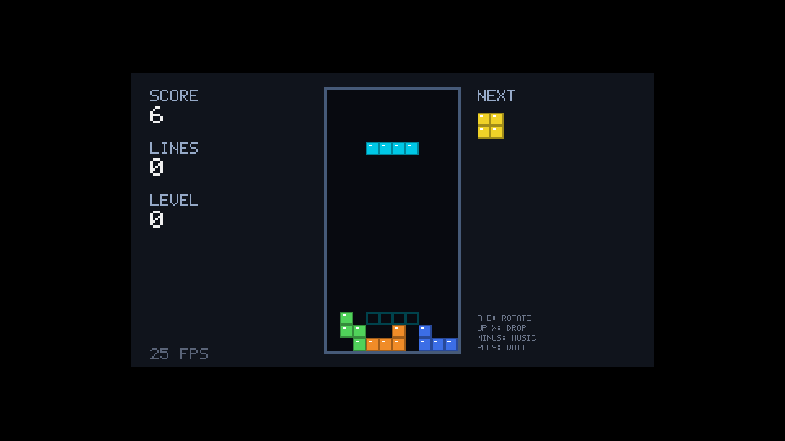
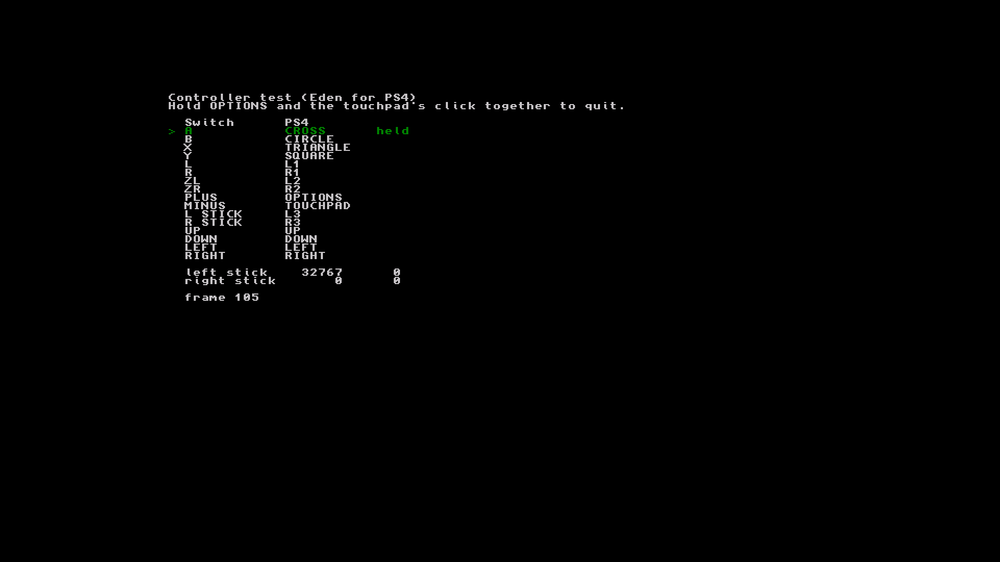
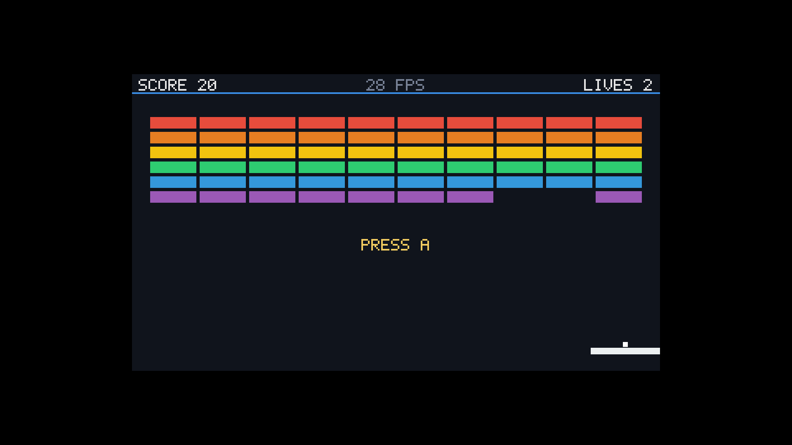
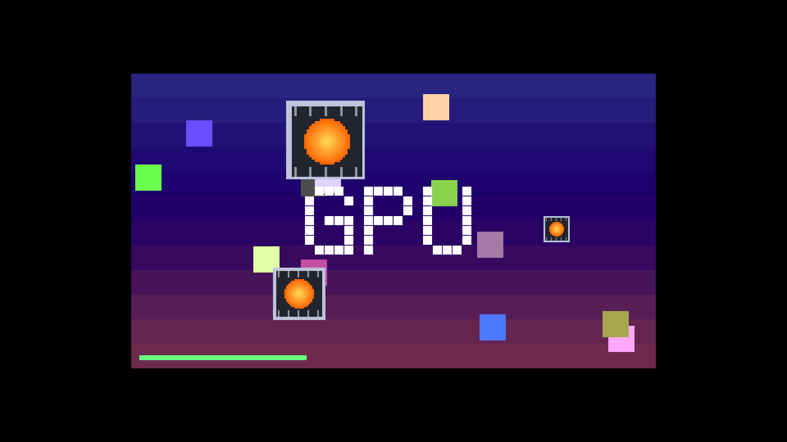
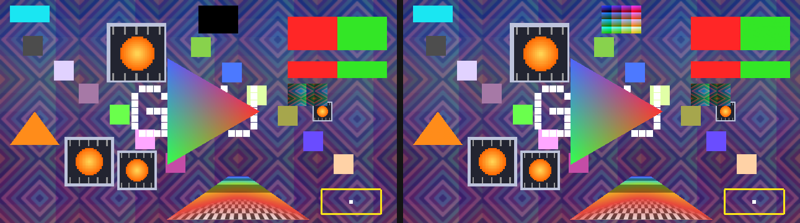
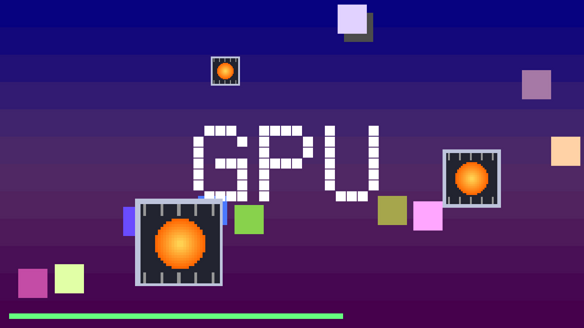

# Eden for PS4: stage 3, Switch games playable; stage 4 begun, the GPU

Stage 1 ([switch-bench](../switch-bench/README.md), results in
[RESULTS.md](../switch-bench/RESULTS.md)) measured Eden's recompiler and the memory a PS4 can give
it. Stage 2 ran Eden's actual Switch core on the PS4: the kernel, the scheduler and the four
emulated CPU cores, the HLE services, the loader, with a Switch program that writes text. Stage 3
plays a game: a Switch homebrew game's picture on the screen, the PS4 controller as the Switch's,
and its sound.

## Stage 3: games

`game/breakout.c` is a small Switch game, written for this: Breakout at 640x360, drawn by the CPU
into a libnx framebuffer (no GPU commands), with the controller read through HID and beeps played
through `audout`. It's built with libnx, the Switch homebrew library, compiled with clang (below).
In the package as `breakout.nro`, first on the start page's list.

`game/blocks.c` is a second game: falling blocks with a ghost piece, a next-piece preview, levels,
and a tune (Korobeiniki, a 19th-century Russian folk song) under the beeps. Its best score is kept
on the emulated SD card (`/data/eden-ps4/user/sdmc/blocks-best.txt` on the PS4), through Eden's
file system services. The two games share `game/nxgame.h` (drawing, the font, sound).

`game/padtest.c` is a controller test: every Switch button with the PS4 button it's mapped to, lit
while held, and the sticks' positions, as text through libnx's console (also drawn by the CPU).






What runs it:

- **Picture.** A Switch program shows a frame by queueing a buffer to the display service (VI),
  whose compositor (nvnflinger) hands its layers to the renderer. Eden's null renderer threw them
  away; patch 0008 has it compose them on the CPU instead, for a frontend that asks for frames
  (`EmuWindow::WantsSoftwareFrames`): each layer's buffer read from emulated memory, unswizzled from
  the GPU's block-linear layout, converted to RGBA (RGBA8, RGBX8, BGRA8 and RGB565), cropped,
  flipped and blended as the compositor asks. A frame of one layer, the usual case, goes to the
  launcher at its own size (Breakout's: 640x360), more layers scaled to 1280x720 and blended. The
  launcher scales it to 1920x1080 into the video-out buffers, a row at a time from a row buffer:
  those buffers are write-combined memory, which the CPU reads uncached (shadPS4 backs them with
  ordinary memory, so it wouldn't show the cost of reading them). A game that draws with the GPU
  (NVN, Vulkan, OpenGL) shows nothing: its buffers hold whatever the GPU would have drawn, and
  there's no GPU emulation.
- **Controller.** The PS4 pad, read every 4 ms, is player 1's Pro Controller, through Eden's virtual
  gamepad input engine (`Launcher::SetPad`). By the PS4's conventions: Cross is A, Circle B, Square
  Y, Triangle X; L1/R1 L/R, L2/R2 ZL/ZR, OPTIONS +, the touchpad's click -, and both sticks.
- **Sound.** Patch 0009 adds a frontend sink to Eden's audio (`AudioEngine::Frontend`): each audio
  stream a program opens (`audout`, `audren`) plays through an output the frontend gives it, from a
  thread of its own, in 512-frame buffers. On the PS4 that's an AudioOut port (the system user's
  main port, 48 kHz stereo, as Crema's audio), on a thread raised above the emulation's priority.
  On the desktop, `EDEN_PS4_AUDIO=<file.wav>` records it. If an output can't open, its stream plays
  silently at an output's pace, so the program doesn't wait on it. Both of libnx's ways to play
  sound work: `audout` (Breakout) and the audio renderer `audren` (switchbrew's audren-simple
  example, recorded on the desktop).

In shadPS4, Breakout runs at 26 to 30 frames per second (61 on the desktop build): the start page,
X, the game; the pad's X launches the ball, the stick moves the paddle, OPTIONS quits back to the
start page. That rate is shadPS4's display here, which draws with a software Vulkan device: each
frame waits 28 to 30 ms for a buffer to come off the screen, and scaling it onto the screen takes
2.2 to 2.4 ms (the boot trace's numbers). A console flips in hardware. It hasn't run on one yet.

Most homebrew programs built with libnx ask for all the memory there is as their heap at start,
about 3.2 GiB, which Eden's kernel clears. On the desktop that took about 30 s, every page of the
emulated DRAM faulting in to be written; patch 0011 drops the pages instead, and they read as zeros
(Linux only). On the PS4 the emulated DRAM is direct memory, committed from the start, so clearing
it is a plain write of 3.2 GiB, a second or so; the package's games and controller test ask for
64 MiB anyway.

## Stage 2: the test program

Stage 2's program, still in the package, is `hello/`: a small Switch homebrew program built by
hand (no libnx). It checks what a game needs first and prints the results through the Switch
kernel's debug output call (`svcOutputDebugString`):

```
hello: a Switch program is running, on emulated core 0
hello: memory available to it: 3283 MiB
hello: heap: 32 MiB at 0x2100c00000, written and read back
hello: computed 0xaf5bb1d62401f407 in 14 ms
hello: slept 250 ms, the clock says 250 ms
hello: a thread on core 1 computed the same
hello: all checks passed, exiting
```

That is the output on a desktop (`build.sh host`), where it passed 30 runs in a row, each exiting
cleanly. The PS4 build prints the same in shadPS4 (below); it hasn't run on a console yet. The
checks:

- the kernel's memory info (`svcGetInfo`)
- a 32 MiB heap (`svcSetHeapSize`), every word written and read back through the recompiler's page
  table
- a loop recompiled from AArch64 and timed by the emulated system tick
- `svcSleepThread`, measured against that tick (the scheduler and the emulated clock)
- a second thread on emulated core 1 (`svcCreateThread`, `svcStartThread`,
  `svcWaitSynchronization`) that must compute the same result
- `svcExitProcess`

Around those lines the launcher shows Eden's own warnings and errors. A bare NRO always brings a
few: no RomFS, no program ID or title (it has no NACP), and controller mappings for the Joy-Con
driver, which this build leaves out with SDL. The launcher sets no Cemuhook (UDP) controller
servers, so that client opens no socket.

## Stage 4, begun: the GPU

`game/gputest.c` draws with the Switch's GPU instead of the CPU. It talks to the GPU through
libnx's nvidia services (no deko3d, no shaders): a GPU channel bound to the Maxwell 3D engine, the
window's framebuffers mapped into the GPU's address space as its render target, every rectangle a
clear limited to a scissor rectangle, and a fence that the command stream signals (a syncpoint
increment) before the frame is queued. It draws a backdrop, bouncing squares and the word GPU,
about 80 clears a frame, and sprites with the 2D engine: a 32x32 image the CPU draws, copied once
by the DMA engine, then blitted onto the frame at 1x, 2x and 3x. And a triangle drawn with shaders:
a vertex program (two attribute loads and stores: position and colour) and a fragment program (the
colour interpolated, into the render target), with their shader program headers, in Maxwell machine
code written by hand, as there's no shader compiler in this build environment. And textured shapes,
drawn as games draw sprites and backgrounds: a turning square with the sprite on it (point
sampled), and a backdrop of tiles over the bands, scrolling, blended by its alpha. The tile is
drawn by the CPU and copied by the DMA engine into a block-linear image, the GPU's own layout, as
games upload their textures; it's filtered bilinearly and repeats. And a depth test: two bars
across each other in depth, a red one drawn first and a green one, each in front on its own half.
And a square coloured from a storage buffer: its fragment program loads 16 bytes from a GPU
address it finds in the constant buffer (where NVN keeps storage buffers' addresses), which Eden's
shader recompiler turns into a storage buffer read. And lines, 3 pixels wide, and a point.



Two ways it shows:

- **The null renderer, in software** (patch 0014; the PS4 build): colour clears are written to
  emulated memory (block linear or pitch, scissored, the common colour formats, channel masks for
  the 8-bit ones), a block of the surface at a time, and DMA copies and 2D engine blits go to their
  engines' software paths instead of being claimed as done. The sprites found a bug in Eden's
  software blitter (from yuzu): its nearest-neighbour scaling mixed the source row's fraction into
  the column, so a 2x blit came out as interleaved stripes (patch 0015 fixes it; the Vulkan
  renderer's blit was right, and the two now draw the same). So a program that draws with clears,
  copies and blits shows in the CPU-composed frames, on the PS4 now: the GPU test runs at 60 frames
  a second on the desktop and 34 in shadPS4 (its display's pace again).
- **Shader draws, in software** (patch 0016; the PS4 build): the null renderer's draws go to a
  software renderer. The vertex and fragment programs are translated by Eden's shader recompiler,
  and their IR flattened into operations on numbered cells (phis become moves on each edge of the
  structured control flow), which an interpreter runs: no JIT, so nothing needs executable memory.
  Vertices are fetched from the vertex streams (float, unorm, snorm, integer, scaled; indexed or
  not; instanced), shaded, clipped against w > 0, mapped to the window as the Vulkan renderer maps
  them, culled, and rasterized into render target 0 in emulated memory a block at a time, with the
  varyings interpolated as Vulkan interpolates them (perspective, linear, flat) and blended. The
  GPU test's first frame comes out the same as through the Vulkan renderer (below), and it draws at
  60 frames a second on the desktop. Not done yet: stencil, more than one render target, storage
  images, geometry and tessellation shaders; a draw that needs them is skipped (or drawn without
  them), and logged once.
- **Textures, in software** (patch 0017): a texture is decoded from emulated memory the first
  time it's sampled, with Eden's own code for the GPU's layouts and compressed formats (its
  unswizzle, its BC1-7 and ASTC decoders), into 8-bit RGBA for the formats that fit and floats for
  the rest, every mip level and layer, and kept. It's checked again (its bytes hashed) after
  anything that might have written to it (a draw or clear into it, a DMA copy, a 2D blit, an
  inline upload) and once a frame, for the CPU's writes. Sampling follows the texture header and
  the sampler: nearest or bilinear filtering, mipmaps (explicit levels; an implicit one is the base
  level, as there are no derivatives here), every wrap mode and border colours, swizzles, sRGB,
  depth compares, gathers, texel fetches, size queries; 1D, 2D, 3D, cube maps and arrays. Linear
  inline uploads, which the null renderer dropped, are written to memory now.
- **Faster, on several threads** (patch 0018): each draw's triangles are set up first (24.8 fixed
  point edge functions, so the edge two triangles share is drawn once, by the top-left rule;
  clipped to a guard band), then rasterized 8 rows at a time (a row of the render target's GOBs,
  reached directly) by a few threads: `EDEN_SW_THREADS`, by default half the processors, up to 4.
  The fragment shader runs on 16 pixels at a time (a program that branches, a pixel at a time),
  with fast paths for the commonest work: 2D 8-bit textures filtered with 8-bit weights, blending
  by source alpha into RGBA8, and 2D triangles (no perspective correction). A pixel of the GPU
  test's blended, filtered backdrop costs about 70 ns on one desktop thread, against 200 before:
  the test draws at 40-48 frames a second on one thread, 60 on four. `EDEN_SW_STATS` (always on
  in the PS4 build) logs what the draws cost every 2 seconds.
- **Depth** (patch 0019): the depth test against the depth buffer (every depth format, as the
  buffer keeps it, so the test is exact), before the fragment shader runs, so pixels behind skip
  it; depth writes; and depth and stencil clears.
- **Storage buffers and global memory** (patch 0020): shaders' storage buffer reads and writes
  (their addresses and sizes read from the constant buffers, as Eden's buffer cache reads them),
  and global memory accesses the recompiler couldn't tie to a buffer, go to emulated memory. The
  subgroup operations (votes, ballots, shuffles, the quad swizzle) work as for subgroups of one.
- **Points and lines** (patch 0021): points as squares of the point size (fixed or the vertex
  program's), lines widened along their minor axis to the line width, as aliased lines are drawn;
  line strips and loops, quad strips and polygons too. The GPU test's lines and point come out the
  same as through the Vulkan renderer, pixel for pixel. A line loop showed that Eden's Vulkan
  renderer draws line loops as triangles (its topology table maps them to a triangle list), so
  the test draws a strip back to its start instead.


- **Eden's Vulkan renderer, headless** (patch 0013; the desktop, `EDEN_PS4_RENDERER=vulkan`): the
  renderer makes a surface that shows nothing (`VK_EXT_headless_surface`) and reads each frame back
  for the launcher instead of presenting it. With lavapipe, Mesa's Vulkan driver that runs on the
  CPU, the GPU test draws at 58 frames a second, through Eden's whole GPU path: the Maxwell engine,
  its texture cache, its Vulkan renderer and presenter. That is the CPU-Vulkan route below, shown
  working; what's left for the PS4 is a CPU Vulkan built for it.



## What's next: the GPU

What draws with the CPU runs now; what draws with the GPU (every commercial game, and homebrew
built on deko3d, OpenGL or SDL's renderer) needs the Switch's GPU emulated. Eden turns the
Maxwell GPU's commands and shaders into Vulkan or OpenGL, and a PS4 app has neither: its GPU
speaks GNM, through Sony's libraries. The ways there, roughly by size:

- **A CPU Vulkan.** SwiftShader (or Mesa's lavapipe) is a Vulkan driver that runs on the CPU, with
  its shaders compiled by a JIT. Eden's side is done (patch 0013, tested with lavapipe above);
  SwiftShader with its Subzero JIT (no LLVM) is the one to port, as it's built to be portable. It's
  cloned in this build environment, but building it wasn't allowed here (newly downloaded code).
  Built for the PS4 (its JIT needs the system pool's executable memory, as dynarmic does), it would
  run Eden's Vulkan renderer unchanged; its frames would reach the screen as the null renderer's do
  now. Slow, but enough for 2D homebrew at 720p or below, and the shortest way to a first GPU-drawn
  picture.
- **A GNM backend for Eden's renderer.** Eden's Vulkan renderer rewritten against the PS4's GPU
  library, and its shader recompiler (SPIR-V now) taught to emit PS4 shaders. Fast, and a much
  larger project: the PS4's shader format isn't documented.
- Either needs the console's keys and firmware for commercial games, which Eden takes from the
  user's own Switch.

## The PS4 app

`out/EdenPS4.pkg` (title ID EDNP00001, version in `VERSION`). It opens on a start page with a list
of programs: the D-pad chooses, X boots.

- **Breakout** (`breakout.nro`, in the package). Left stick or D-pad to move, X to launch the ball,
  OPTIONS to quit.
- **Blocks** (`blocks.nro`, in the package). D-pad or stick to move and to drop faster, Cross and
  Circle to rotate, up or Triangle to drop, the touchpad's click for the music, OPTIONS to quit.
- **GPU test** (`gputest.nro`, in the package): drawn with the Switch's GPU (stage 4, above).
  OPTIONS quits.
- **Controller test** (`padtest.nro`, in the package). OPTIONS and the touchpad's click together
  quit.
- **The test program** (`hello.nro`, in the package): stage 2's checks, text only.
- **Every `.nro` in `/data/eden-ps4`.** A homebrew program that draws with the CPU (libnx's
  framebuffer or console, as the games and the controller test) can work; one that draws with the
  GPU (deko3d, OpenGL, SDL's renderer) shows nothing.

When the program ends, the start page comes back. Both sticks pressed in (L3 + R3) for a second stop
a program, for one without a way to quit or one that hangs; where its threads were goes to
`log.txt`. Without a controller, the test program boots after a countdown; pressing up or down stops
it. If the last run didn't finish, the page first shows what that run left behind: the end of its
output (`log.txt`), its crash report (`crash.log`) and the last steps of its boot trace. With a
controller connected, it then waits for a button, so a photo of it can come first. Stack addresses
are ELF addresses: symbolize them with `llvm-symbolizer --obj=<that build's ELF> 0x...`.
`build.sh ps4` keeps every build's ELF in `~/eden-ps4-elves`.

Until the program draws, its output and Eden's warnings and errors are on screen; they always go to
`/data/eden-ps4/log.txt`. Eden's data folders (NAND, SD card, keys) are in `/data/eden-ps4/user`.
Nothing is written outside `/data/eden-ps4`.

## Testing on a console

Nothing in stage 2 or 3 has run on a console yet. What to try, and what tells the most:

1. Install `out/EdenPS4.pkg` and start it. The start page should list five programs. If the app
   closes or freezes before that, `/data/eden-ps4/boot-trace.log` has its last steps and
   `crash.log` its crash report (next start, the start page shows both: a photo is enough).
2. **The test program** (stage 2's checks): every line should end with "passed" or a result, and
   the start page come back.
3. **Breakout** and **Blocks**: the picture, the controls, the beeps (and Blocks' tune). Both
   show their frame rate. `boot-trace.log` gets a line every 10 s with the frames a second, how
   long each waited for a buffer off the screen (the display's pace) and how long scaling it took
   (the launcher's cost).
4. **Controller test**: each PS4 button should light its Switch button.
5. **GPU test**: the bands, the squares and GPU (clears), three circling sprites (2D blits of a
   DMA copy), a turning RGB triangle (shaders), a turning square with the sprite on it and a
   scrolling backdrop of diamond tiles over the bands (textures), a red and a green bar at the top
   right, each in front on its half (depth), all drawn by the GPU emulation in software, and its frame rate as a green bar (6 pixels a frame a second). Its `log.txt` gets a
   line every 2 seconds, "Software draw: a second: ... ms rasterizing (on up to N threads)": what
   the console's cores make of the software GPU.
6. Any CPU-drawn homebrew `.nro` copied to `/data/eden-ps4` (FTP) appears in the list. L3 + R3
   held for a second stops it.

After a run, `/data/eden-ps4/log.txt` has the program's output and Eden's warnings and errors, and
`boot-trace.log` the launcher's steps (the audio port it opened, the first frame, the frame rate).
Stack addresses in a crash report are symbolized with that build's ELF (kept next to the package in
`out/` when it's sent, and in `~/eden-ps4-elves`).

## Testing in shadPS4

With 02.00: the start page lists the package's programs and an `.nro` put in `/data/eden-ps4`.
Breakout: X (shadPS4's keyboard: N), the game's first frame 1.6 s later, an AudioOut port opened for
its sound; X launched the ball, the paddle followed the stick (D), OPTIONS (Enter) quit to the start
page. The controller test showed Cross (N) as A and the stick (D) at full right, and quit with
OPTIONS and the touchpad (Enter and Space). Blocks played (the arrows, N, Up), and its best score
was written to the SD card by one run and read by the next. L3 + R3 (X and M) held stopped a game
and brought the list back, three times in a row in one session. A keyboard tap of a few milliseconds
can fall between two of a game's reads of the controller; a held key always counts. shadPS4 has no
sound here (no audio device), so the sound is tested on the desktop: there the WAV file has
Breakout's beeps, each at its pitch and length (the ball's launch 660 Hz for 60 ms, a brick about
1 kHz, a wall 330 Hz, a lost ball 160 Hz for 250 ms), in real time.

`shadps4-play.sh` runs the package's staging folder in shadPS4, headless, and plays a script of
key presses, waits on the boot trace and screenshots, read from stdin (its header lists them);
those runs above are such scripts. As for stage 1 (see
[its README](../switch-bench/README.md#testing-in-shadps4) for building shadPS4 and running it
headless): the PKG's staging folder `~/eden-ps4-build/stage` without
`sce_module/`, run from a folder with a `user/` subfolder, so the app's `/data` is `user/data`.
shadPS4 can't show what the console does with memory pools or executable memory, but the boot
trace shows which pools the runtime and Eden got their memory from.

With 01.00 (4 runs, all the same): the start page counts down, `hello.nro` boots, every check
passes and the program exits. The boot trace shows the app heap taking 384 MiB of system flexible
memory and the four 32 MiB code caches coming from the same pool, which runs code there; the 4
GiB of emulated DRAM mapped from direct memory. At the end Eden reports that it couldn't write
to its network interrupt pipe (`network.cpp:201`, logged, not fatal), which may be shadPS4's
`pipe`. After a run that crashed, the start page showed its log, its compacted crash report and
its last steps, and waited for a button.

## What the PS4 port changes in Eden

The patches are in `patches/`, made with `git format-patch` against Eden commit `eb88a40`:

| patch | what |
|---|---|
| dynarmic: PS4 code memory, A64 page table sign extension | stage 1's fixes ([switch-bench README](../switch-bench/README.md)) |
| build: SDL3 optional | `ENABLE_SDL3=OFF` builds without it (no SDL on the PS4) |
| frontend hooks | a log callback, `EDEN_EXTRA_FRONTEND_DIR` to build an out-of-tree frontend, and `SetAppDirectory` (Eden's data folder) on every POSIX platform, not just Android |
| core_timing: stop the timer thread before waking it | an upstream shutdown hang, found here |
| page table sign bit 55 | stage 1's finding: Eden's 57 is cleared by its own mask |
| PS4 memory | below |
| PS4 build | compile fixes: the PS4's compiler defines `__FreeBSD__`, but it lacks some FreeBSD headers and calls |
| null renderer: frames for frontends without a GPU renderer | stage 3's picture, above |
| audio: a frontend sink | stage 3's sound, above |
| null renderer: one layer at its own size | a frame with one layer (the usual case) isn't scaled to 1280x720 on its way to the frontend, which scales it anyway |
| host memory: clear large regions on Linux by dropping their pages | a homebrew program's 3.2 GiB heap, cleared in no time on the desktop (above) |
| audio: frontend sink streams play silently when the output can't open | a stream without an output still consumes its buffers at an output's pace, so a program waiting for them doesn't stall |
| vulkan: headless rendering for frontends that take frames | stage 4's Vulkan renderer without a window, above |
| null renderer: colour clears, DMA copies and 2D blits in software | stage 4's GPU test on the PS4, above |
| sw_blitter: nearest-neighbour scaling reads the right source pixel | an upstream bug the GPU test's sprites found, above |
| null renderer: shader draws in software | stage 4's software renderer, above |
| null renderer: textures in software draws | above |
| null renderer: faster software draws, on several threads | above |
| null renderer: depth testing, depth and stencil clears | above |
| null renderer: storage buffers, global memory and subgroup ops in software shaders | above |
| null renderer: points, lines, quad strips and polygons in software draws | above |

The PS4 memory changes, from what stage 1 measured:

- **The Switch's DRAM** (4 GiB) comes from direct memory, the GPU's 4.5 GiB pool, in pieces mapped
  back to back into one reserved range (`common/orbis_memory.cpp`, used by
  `common/host_memory.cpp`). Flexible memory, behind `mmap`, has well under 1 GiB.
- **The page table** (1 GiB for a 39-bit address space) only reserves its address range. Its 16
  KiB pages get memory as Eden fills them in (`common/sparse_large_vector.*`), as Eden already does
  on Windows. A recompiled read of an empty part faults, and a signal handler gives it a page of
  zeros. A game maps a few GiB, so its page table uses a few MiB. The GPU's and the device memory
  manager's tables are sparse vectors too, and work the same way.
- **Code caches** are 32 MiB per emulated core instead of 512 MiB: the PS4 runs code only from its
  system memory pool. The app heap (Crema's runtime) is capped at 384 MiB of that pool so that the
  caches fit (`PS4_SYSTEM_HEAP_MAX_MB` in `port/ps4_runtime.cpp`; Crema keeps 512 MiB).
- **No fastmem**: the PS4 can't map the same memory twice for an app.
- Fiber stacks were already 512 KiB on the PS4 upstream (2 MiB elsewhere). Eden makes about 75
  fibers (one per emulated thread, most of them for HLE services).

Other PS4 choices, in the launcher and `ps4-eden.cmake`: Boost.Asio is built without kqueue (the
PS4 has no `sys/event.h`), thread names and priorities aren't set (not calls Crema makes on these
consoles), and FFmpeg is built without its Linux-only calls (below).

## Testing on the desktop

`test.sh` runs each program in the desktop build with scripted controller input and checks what it
printed, drew and played: the test program's checks, Breakout's frames and beeps, Blocks' frames,
tune and best score (saved by one run, read by the next), the controller test, stopping a program,
the GPU test (its fences, its frames having the picture, its shader triangle), and that a program
with libnx's full-memory heap starts at once. 21 checks, about 30 s.

## Building

Needs:

- Eden at commit `eb88a40` with `patches/` applied (`git am patches/*.patch`)
- CMake 3.31 or newer (`CMAKE=/path/to/cmake` if it isn't the one on `PATH`)
- Crema's PS4 toolchain and sysroot (`docs/BUILDING.md`; `toolchain/build-sdk.sh` builds its
  section 2) for the PS4 build
- clang 21 and lld for the test program and the game, and for the game libnx built with clang
  (`nx/build.sh`)

```
eden-ps4/fetch-deps.sh                # Eden's dependencies, as git clones, into ~/eden-deps
eden-ps4/build-ffmpeg.sh              # FFmpeg for the PS4 (the PS4 build only)
EDEN_DIR=~/eden eden-ps4/build.sh host    # desktop: ~/eden-host/bin/eden-ps4 <program.nro>
EDEN_DIR=~/eden eden-ps4/build.sh ps4     # out/EdenPS4.pkg
eden-ps4/hello/build.sh               # hello.nro on its own
eden-ps4/nx/build.sh                  # libnx and its toolchain, with clang, into ~/nx/devkitpro
eden-ps4/game/build.sh                # the games and the controller test (build.sh ps4 does too)
```

`nx/build.sh` builds what devkitPro's packages would give (their servers are blocked in some build
environments; GitHub's git isn't): devkitPro's newlib, libnx, compiler-rt's builtins (libgcc's
part), and elf2nro and nacptool, at pinned commits. clang stands in for devkitA64's gcc, under its
names. libnx needs a few changes for clang (`nx/libnx-clang.patch`): the thread pointer is
`tpidr_el0` written directly (clang has no `-mtp=soft`), the C11 atomics on plain variables go
through `__atomic` builtins (`clang_atomics.h`, force-included), three structures that end in
variable-length arrays (a GCC extension) are a fixed array or left out (the GPU channel submits,
which a CPU-drawn program doesn't use), and a weak symbol isn't also made global. lld needs the
linker script to give TLS a program header (`switch_clang.ld`). Its steps are the ones that built
this machine's toolchain, by hand; the script as a whole hasn't been run from scratch.

`fetch-deps.sh` clones what Eden's CPM would download as GitHub archives (blocked in some build
environments), at the versions Eden pins, and applies Eden's patches for them. Boost and the time
zone database are release downloads, which CPM fetches itself.

`build-ffmpeg.sh` builds Eden's pinned FFmpeg with the parts Eden uses (the H.264, VP8 and VP9
decoders, two filters, swscale), through Crema's PS4 compiler wrapper. It turns off what the PS4's
C library links but can't do: `sched_getaffinity`, `prctl` and musl's `pthread_setname_np` are
Linux system calls, which the PS4's FreeBSD kernel doesn't have.

`build.sh ps4` checks the system functions the app imports against Crema's when `CREMA_ELF` points
at a Crema build's ELF: the consoles run Crema's, so every import must be one of them (as stage 1
checks; see its README).

On the desktop, `EDEN_PS4_DATA` sets the data folder (default: a new temporary folder) and
`EDEN_PS4_TIMEOUT` how long a program may run (default 60 s). For a program that draws, plays sound
and reads the controller, without a screen, speakers or a controller:

- `EDEN_PS4_FRAMES=<dir>` saves its frames as PPM images: the first, one a second, and the last
- `EDEN_PS4_AUDIO=<file.wav>` records its sound
- `EDEN_PS4_INPUT="<seconds>:<buttons>,..."` presses player 1's buttons, e.g.
  `"3:A,3.2:,5:Right,6:"` (`Stop` for the buttons stops the program, as L3 + R3 on the PS4)
- `EDEN_PS4_LOG=<filter>` sets Eden's log filter, e.g. `"*:Info Service.VI:Debug"`
