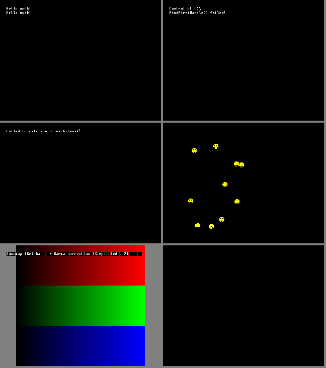

# xbox-core: original Xbox programs on the host's own CPU

The emulator core that [xbox-bench](../xbox-bench/README.md) showed is possible on the PS4. Xbox
programs (XBEs) run **natively in 32-bit compatibility mode**: no recompiler, no BIOS, no Xbox
kernel. A high-level kernel answers the program's calls to `xboxkrnl.exe` on the host.
It runs on the desktop (Linux x86-64) and builds for the PS4.

**Where it stands:** nxdk's samples run: the C runtime, C++, the Windows API layer, SDL2, the
NV2A's 3D drawing (vertex programs, textures, register combiners) in a multi-threaded software
renderer, sound through the AC'97 and the APU's voice processor (DirectSound's hardware), and the Xbox
controller over USB. Games load from a folder or
straight from a disc image (`.iso`). 280 of the kernel's 337 functions are implemented (most of the rest are the driver model's IRPs and device queues), each new
one checked by `tests/kernel-test`. No commercial game has been tried yet.



*Top: `hello++` (C++), `winapi_filefind`. Middle: `winapi_drivelist`, `sdl` (SDL2 sprites).
Bottom: `gamma`, `triangle` (black: it draws with the NV2A).*

## How it works

| part | file | what |
|---|---|---|
| CPU | `switch.S`, `cpu.cpp` | far return into the system's 32-bit code segment; back through a far return to 64-bit code. `fs` is the guest's KPCR while Xbox code runs (`wrfsbase` on Linux, `amd64_set_fsbase` on the PS4), the emulator's own otherwise |
| kernel calls | `switch.S`, `kernel.cpp` | every import of the XBE's kernel thunk table points at a stub (`mov eax, ordinal; jmp gate`); the gate switches to 64-bit code and calls the handler with the guest's arguments, then returns with the export's stdcall/fastcall stack cleanup (`exports.inc`, from nxdk's `xboxkrnl.exe.def`) |
| threads | `cpu.cpp`, `kernel.cpp` | one host thread per guest thread; KPCR, ETHREAD and stack in guest memory, TLS laid out as the Xbox kernel does (`[StackBase + _tls_index*4]`) |
| objects | `kernel.cpp` | events, semaphores, mutants, timers, threads, critical sections, read/write locks in the Xbox's own layouts in guest memory; waits on a host condition variable; APCs run in alertable waits; timers fire from their own thread (DPCs, APCs, periods) |
| library | `kernel_rtl.cpp` | the Rtl string, memory, integer and printf functions, the pool, interlocked lists, HMAC-SHA1 and RC4 |
| library | `kernel_crypto.cpp` | DES and triple DES (ECB, CBC), RSA over the console's key blobs, PKCS #1 signature checks |
| memory | `memory.cpp` | RAM at `0x10000`, contiguous memory at `0x80000000` (separate: the PS4 can't alias), kernel area at `0x8c000000`, stacks at `0xd0000000`, devices from `0xfd000000` unmapped |
| devices | `devices.cpp`, `cpu.cpp` | an access to device memory faults; the fault handler decodes the instruction (`mov`, `movzx`, ALU ops, `test`) and does it on the device's registers. vblank interrupt with its DPCs at 60 Hz |
| GPU | `nv2a.cpp`, `render.cpp`, `draw.cpp`, `pixel.cpp` | the NV2A's FIFO (DMA pusher, RAMHT, objects, interrupts, flips) and its 3D engine in software: vertex programs interpreted, triangles rasterized by a pool of threads (bands of rows, in order), textures (swizzled, linear, DXT, palettes), the register combiners, alpha test and blending |
| sound | `audio.cpp`, `apu.cpp` | the AC'97's bus masters played at 48 kHz (PS4: AudioOut; desktop: `--wav`); the MCPX APU that DirectSound drives: its front end (voice methods, lists, SSL streams, SGE pages, notifiers) and voice processor (envelopes, PCM and IMA ADPCM, pitch, 32 mix bins); its DSPs aren't run, the voices' own mix is heard |
| input | `usb.cpp` | the OHCI host controller and an Xbox controller on the port games see as player 1 (PS4: the DualShock 4; desktop: `--pad`) |
| files | `files.cpp`, `xiso.cpp` | `D:` and `\Device\CdRom0` are the XBE's folder or its disc image (XDVDFS, also inside full dumps); the hard disk's partitions are folders under `xbox-data/`; names match regardless of case |

Privileged instructions that Xbox code may run are skipped or answered: `cli`/`sti`, `wbinvd`, port
I/O, `rdmsr`. `rdmsr 0x2a` reports a 5.5 × 133 MHz Pentium III, which nxdk's runtime reads.
A program's `hlt` ends that thread with a report of its caller's arguments: an assertion's text,
for example.

## Running it

```
cmake -S xbox-core -B ~/xc-host -G Ninja && ninja -C ~/xc-host
~/xc-host/xbox-core path/to/default.xbe --seconds 5 --png screen.png [-v 2]
~/xc-host/xbox-core game.iso --wav sound.wav --pad a,start,lx=-20000
```

`-v 1` reports drawing time, `-v 2` logs every kernel call. `--pad` holds controller input from the
first second on. Linux with FSGSBASE (kernel 5.9 or newer) is needed.

Tests:
- nxdk's samples: `NXDK_DIR=~/emu/nxdk tests/run-nxdk-samples.sh hello sdl gamma mesh ...` builds
  and runs them, with a PNG and a log for each in `tests/out/`.
- `tests/kernel-test`: kernel exports against known results (`make`, then run `bin/default.xbe`;
  each check is a `PASS`/`FAIL` line in the log).
- `tests/disc-test`: file access on D:, from a folder and from a disc image (`make`, then
  `./make-image.sh`; run `bin/default.xbe` and `disc-test.iso`).

## On the PS4

`build.sh ps4` makes `out/xbox-core.pkg` (title ID XBCR00001) with nxdk's samples and the two
tests inside.

- The app opens on a menu: the samples, and your own games as
  `/data/xbox-core/games/<name>/default.xbe` (that folder is D:) or `/data/xbox-core/games/<name>.iso`.
  UP/DOWN choose, X runs.
- `/data/xbox-core/autostart.txt` holding an XBE's or image's path skips the menu.
- The program's screen is scaled up on the TV, with the log over it for the first 15 seconds
  (L3 and R3 together toggle it).
- The DualShock 4 is the Xbox controller: Cross/Circle/Square/Triangle are A/B/X/Y, L1/R1
  white/black, L2/R2 the triggers, OPTIONS start, the touch pad's click back. Rumble reaches it.
- The log is also in `/data/xbox-core/log.txt`, and crash reports in `/data/xbox-core/crash.log`.
- To run another program, close the app and open it again.

Its first log lines check the hardware path:
- `cpu self-test: 32-bit code runs, its fs is its KPCR (...)` means the switch into 32-bit code,
  the guest's `fs` (through `amd64_set_fsbase`) and the way back all work;
- `memory: 0x400000-... in the RAM is the system's; left out` is the app's own executable, which the
  RAM is mapped around. Programs whose image reaches past `0x400000` won't load until the
  executable moves (xbox-bench 01.04).

**Not run on a PS4 yet.** In shadPS4 the app itself works (menu, autostart, screen, log), but the
core stops at its first mapping: shadPS4's address space starts at `0x400000`, so it can't give the
Xbox's addresses below it. The real console could (xbox-bench).

## Next

1. **A console run**: the self-test line, then `sample: test-kernel`, `sample: test-disc (disc
   image)`, `sample: mesh`.
2. **The app's executable out of the Xbox's addresses**, for games whose image is bigger than the
   ~4 MiB below `0x400000`. xbox-bench 01.04's variants show which way the system allows.
3. **Commercial games**: the XDK's own drivers bring the APU (DirectSound), more of the NV2A
   (points, lines, cube maps, bump mapping, fog), structured exception handling, and the rest of the
   kernel's I/O calls.
4. **Drawing on the PS4's GPU** instead of the CPU, once games show what they need.

## The PS4 library

The app opens on a library of what it can run: the samples it carries and your games in
`/data/xbox-core/games` (a folder with `default.xbe` and its files, or a disc image `<name>.iso`).
Each shows its own title, title ID and region (read from its XBE), its size, and when it last ran
and how that ended. Cover art is yours to add: `cover.jpg`/`cover.png` in a game's folder,
`<name>.jpg` beside an image, or `/data/xbox-core/covers/<title ID>.jpg`; without one a cover is
drawn from the title. L1/R1 switch to Settings (the log while a game starts, the picture's scaling,
the library's order) and About. Triangle on a game can make it start with the app; hold L1 while the
app opens to get back to the library. The screen is drawn in software (`frontend/`, fonts: Inter,
SIL OFL); `ui-preview` (desktop build) renders it to PNG files.
